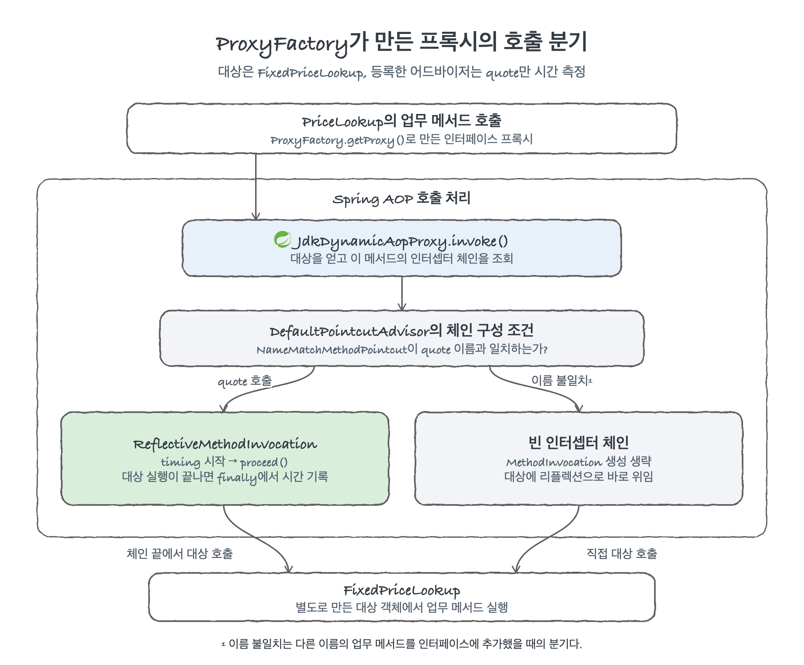

# Spring ProxyFactory and Advisors

`ProxyFactory`는 JDK 프록시와 CGLIB 프록시를 같은 API에서 구성할 수 있게 한다. 호출을 가로채는 코드는 `MethodInterceptor`로 작성하며, 대상의 어느 호출에 적용할지는 포인트컷이 결정한다. [Spring Framework 6.2 · ProxyFactory](https://docs.spring.io/spring-framework/reference/6.2/core/aop-api/prog.html)

## 1. 포인트컷, 어드바이스와 어드바이저

| 구성 | 맡은 역할 |
| --- | --- |
| 포인트컷 | 대상 클래스와 메서드가 조건에 맞는지 판별한다. 동적 매칭을 사용하는 경우 호출 인자도 확인한다. |
| 어드바이스 | 호출 전후에 수행할 로직을 정의한다. |
| 어드바이저 | 한 어드바이스와 적용 조건을 함께 등록한다. |

## 2. quote 메서드만 가로채는 프록시

```java
NameMatchMethodPointcut pointcut = new NameMatchMethodPointcut();
pointcut.setMappedName("quote");

MethodInterceptor timing = invocation -> {
    long started = System.nanoTime();
    try {
        return invocation.proceed();
    } finally {
        System.getLogger("pricing").log(System.Logger.Level.DEBUG,
            "elapsed: {0} ns", System.nanoTime() - started);
    }
};

ProxyFactory factory = new ProxyFactory(new FixedPriceLookup());
factory.addAdvisor(new DefaultPointcutAdvisor(pointcut, timing));
PriceLookup lookup = (PriceLookup) factory.getProxy();
```

이 예제의 `MethodInterceptor`는 `org.aopalliance.intercept` 타입이다. `proceed()`는 체인의 다음 인터셉터를 호출하고, 체인의 끝에서는 실제 대상 메서드를 호출한다. 프로그램으로 구성한 위 프록시는 이름이 `quote`인 호출에만 시간 측정을 적용한다. [Spring Framework 6.2 · 포인트컷 API](https://docs.spring.io/spring-framework/reference/6.2/core/aop-api/pointcuts.html) · [Spring Framework 6.2 · 인터셉터 어드바이스](https://docs.spring.io/spring-framework/reference/6.2/core/aop-api/advice.html)



그림의 구현 근거 · [JdkDynamicAopProxy 호출 분기](https://github.com/spring-projects/spring-framework/blob/v6.2.19/spring-aop/src/main/java/org/springframework/aop/framework/JdkDynamicAopProxy.java#L187-L209) · [DefaultAdvisorChainFactory 포인트컷 매칭](https://github.com/spring-projects/spring-framework/blob/v6.2.19/spring-aop/src/main/java/org/springframework/aop/framework/DefaultAdvisorChainFactory.java#L53-L88) · [ReflectiveMethodInvocation의 proceed](https://github.com/spring-projects/spring-framework/blob/v6.2.19/spring-aop/src/main/java/org/springframework/aop/framework/ReflectiveMethodInvocation.java#L149-L174)

## 3. 프록시 타입과 여러 어드바이저

`new ProxyFactory(target)`는 대상이 구현한 인터페이스를 감지한다. 이 예에서 `setProxyTargetClass(true)`를 프록시 생성 전에 호출하면 클래스 기반 프록시를 선택하도록 지정할 수 있다. 일반적인 인터페이스 프록시에서는 인터페이스 타입으로 참조를 받는다. [Spring Framework 6.2 · 프록시 생성 방식](https://docs.spring.io/spring-framework/reference/6.2/core/aop/proxying.html)

한 프록시에 여러 어드바이저를 추가할 수 있다. 호출에 두 어드바이저가 적용되면 앞쪽 어드바이스가 다음 호출을 감싼다. 예를 들어 시간 측정이 재시도보다 바깥에 있으면 모든 시도에 걸린 시간이 합쳐진다. [Spring Framework 6.2 · 어드바이저 API](https://docs.spring.io/spring-framework/reference/6.2/core/aop-api/advisor.html)
