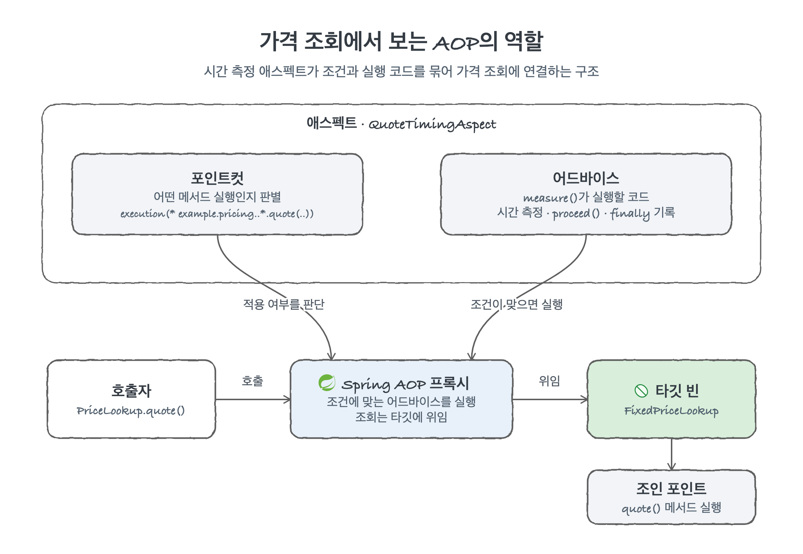

# Spring AOP Fundamentals

가격 계산은 애플리케이션의 업무 기능이다. 시간 측정, 요청 추적, 트랜잭션처럼 여러 업무 기능에 공통으로 적용되는 동작은 횡단 관심사로 다룰 수 있다. AOP는 이러한 동작과 적용 위치를 함께 선언할 수 있게 한다. [Spring Framework 6.2 · AOP 개요](https://docs.spring.io/spring-framework/reference/6.2/core/aop.html)

## 1. 호출 경로를 이해하기 위한 용어

| 용어 | 가격 조회 예에서의 의미 |
| --- | --- |
| 애스펙트 | 시간 측정 관심사처럼 여러 적용 지점을 가진 기능 |
| 조인 포인트 | 동작을 적용할 수 있는 지점. Spring AOP에서는 메서드 실행이다. |
| 포인트컷 | 어떤 메서드 실행이 적용 대상일지 판별하는 조건 |
| 어드바이스 | 메서드 전후의 시간 측정 등 실제로 실행할 코드 |
| 타깃 | 호출을 위임받는 실제 가격 조회 객체 |
| AOP 프록시 | 타깃 앞에서 조건에 맞는 어드바이스를 실행하는 객체 |
| 위빙 | 애스펙트를 대상과 연결하는 과정 |

## 2. 프록시 기반 AOP와 AspectJ 위빙

| 적용 방식 | 적용 지점 |
| --- | --- |
| Spring AOP | 실행 중 스프링 빈의 프록시를 통해 들어오는 메서드 실행 |
| AspectJ 컴파일 시 위빙 | 컴파일 단계에서 대상 클래스에 애스펙트를 연결 |
| AspectJ 로드 시 위빙 | 클래스가 JVM에 로드될 때 바이트코드에 애스펙트를 연결 |

Spring에서 AspectJ 형식의 `@Aspect`나 포인트컷 표현식을 사용하더라도 일반적인 Spring AOP 호출은 프록시를 경유한다. 생성자나 필드 접근 등 메서드 실행 이외의 조인 포인트가 필요한 경우에는 별도의 AspectJ 위빙을 검토한다. [Spring Framework 6.2 · Spring AOP와 AspectJ 선택](https://docs.spring.io/spring-framework/reference/6.2/core/aop/choosing.html) · [Spring Framework 6.2 · @AspectJ 지원](https://docs.spring.io/spring-framework/reference/6.2/core/aop/ataspectj.html)

어드바이스가 적용되지 않을 때는 객체가 컨테이너에서 관리되는지, 호출이 프록시를 통과하는지, 포인트컷이 호출에 맞는지를 확인한다. [Spring Framework 6.2 · 프록시의 동작](https://docs.spring.io/spring-framework/reference/6.2/core/aop/proxying.html)

그림의 구현 근거 · [Spring Framework 6.2 · AOP 용어](https://docs.spring.io/spring-framework/reference/6.2/core/aop/introduction-defn.html)
