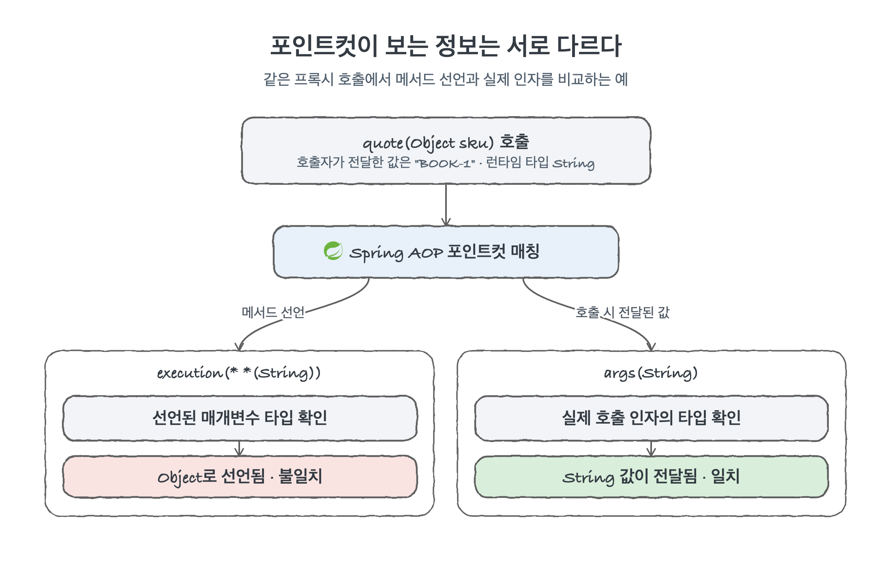

# Spring AOP Pointcut Expressions

포인트컷 지시자는 메서드 선언, 호출 인자, 대상 타입, 애노테이션, 빈 이름 등을 조건으로 사용한다. Spring AOP의 조인 포인트는 지원되는 프록시 메서드 실행이다. [Spring Framework 6.2 · 포인트컷 선언](https://docs.spring.io/spring-framework/reference/6.2/core/aop/ataspectj/pointcuts.html)

## 1. 자주 사용하는 지시자

| 지시자 | 판단하는 정보 |
| --- | --- |
| `execution` | 반환 타입, 선언 타입, 메서드 이름, 매개변수 선언 등 메서드 시그니처 |
| `within` | 메서드가 선언된 타입의 범위 |
| `args` | 실제로 전달된 인자의 런타임 타입 또는 바인딩할 값 |
| `this`, `target` | 각각 Spring 프록시 객체와 실제 대상 객체의 타입 |
| `@annotation` | 실행되는 메서드의 애노테이션 |
| `@within`, `@target` | 각각 메서드가 속한 선언 타입과 실행 대상 타입의 애노테이션 |
| `@args` | 실제 인자의 런타임 타입에 붙은 애노테이션 |
| `bean` | Spring 빈의 이름. Spring AOP에서 제공하는 지시자 |

`execution(* example.pricing..*.quote(..))`는 반환 타입과 인자 개수에 제한을 두지 않고, `example.pricing` 및 하위 패키지에서 이름이 `quote`인 메서드 실행을 고른다. `execution(* *(String))`처럼 선언된 인자 타입을 검사하는 조건과 `args(String)`처럼 실제 인자를 검사하는 조건은 적용 결과가 다를 수 있다. `&&`, `||`, `!`로 조건을 조합할 수 있다. [Spring Framework 6.2 · 지원 지시자와 예제](https://docs.spring.io/spring-framework/reference/6.2/core/aop/ataspectj/pointcuts.html)



## 2. 인자를 어드바이스에서 받기

```java
@Around(value = "execution(* example.pricing..*.quote(..)) && args(sku)", argNames = "sku")
public Object inspect(ProceedingJoinPoint joinPoint, String sku) throws Throwable {
    System.getLogger("pricing").log(System.Logger.Level.DEBUG,
        "quote argument supplied: {0}", sku != null);
    return joinPoint.proceed();
}
```

`args(sku)`가 호출 인자를 `sku`에 바인딩한다. 첫 매개변수인 `ProceedingJoinPoint`는 Spring이 제공하므로 이 예제의 `argNames`에 이름을 추가할 필요가 없다. 애노테이션 인스턴스도 `@annotation(marker)` 등으로 바인딩할 수 있다. [Spring Framework 6.2 · 어드바이스 매개변수 바인딩](https://docs.spring.io/spring-framework/reference/6.2/core/aop/ataspectj/advice.html)

## 3. 프록시 타입과 조건 검증

JDK 프록시는 대상의 인터페이스 타입을 구현하므로 `this(인터페이스)` 조건에 맞을 수 있다. 같은 프록시에서 `this(구현클래스)`는 일치하지 않아도 `target(구현클래스)`는 실제 대상 타입으로 판별할 수 있다. 클래스 프록시를 사용하는 구성에서는 `this` 결과가 달라질 수 있다.

Spring AOP 포인트컷은 `call`, `get`, `set`처럼 AspectJ의 다른 조인 포인트를 가리키는 지시자를 지원하지 않는다. 포인트컷을 변경할 때는 일치해야 하는 빈과 일치 범위 밖의 빈을 모두 테스트한다. [Spring Framework 6.2 · 지시자 지원 범위](https://docs.spring.io/spring-framework/reference/6.2/core/aop/ataspectj/pointcuts.html) · [Spring Framework 6.2 · 프록시 타입](https://docs.spring.io/spring-framework/reference/6.2/core/aop/proxying.html)
