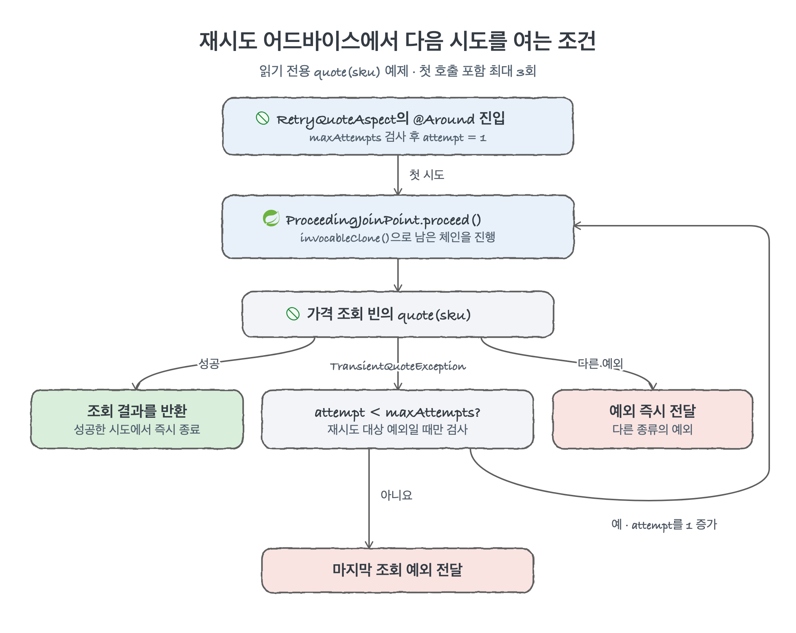

# Spring AOP Tracing and Retries

로깅과 재시도는 호출 대상과 분리해 적용할 수 있다. 로깅은 어떤 메서드가 실행됐는지 기록하고, 재시도는 정해 둔 일시적 실패에 한해 같은 호출을 다시 실행한다. 이 예제는 읽기 전용 가격 조회를 대상으로 한다. [Spring Framework 6.2 · 어드바이스 적용](https://docs.spring.io/spring-framework/reference/6.2/core/aop/ataspectj/advice.html)

## 1. 조회 지점 표시와 추적 정보

```java
@Retention(RetentionPolicy.RUNTIME)
@Target(ElementType.METHOD)
public @interface TracedQuote {}
```

```java
@Aspect
public class TraceAspect {
    @Before("@annotation(example.pricing.TracedQuote)")
    public void trace(JoinPoint joinPoint) {
        System.getLogger("pricing").log(System.Logger.Level.DEBUG,
            "trace {0}: {1}", TraceContext.currentId(),
            joinPoint.getSignature().toShortString());
    }
}
```

조회 구현 메서드에 `@TracedQuote`를 붙이고 애스펙트를 빈으로 등록한다. [01번의 TraceContext](01_threadlocal_and_request_context.md)를 요청 범위에서 사용하면 같은 ID로 여러 호출을 연결할 수 있다. 로그에는 운영 환경에서 사용할 식별자와 메타데이터만 선별해 남긴다. [Spring Framework 6.2 · 애노테이션 포인트컷](https://docs.spring.io/spring-framework/reference/6.2/core/aop/ataspectj/pointcuts.html)

## 2. 실패 유형과 시도 횟수를 제한한 재시도

```java
@Retention(RetentionPolicy.RUNTIME)
@Target(ElementType.METHOD)
public @interface RetryQuote {
    int maxAttempts() default 3;
}
```

```java
@Aspect
@Order(20)
public class RetryQuoteAspect {
    @Around(value = "@annotation(retry)", argNames = "retry")
    public Object retry(ProceedingJoinPoint joinPoint, RetryQuote retry) throws Throwable {
        int maxAttempts = retry.maxAttempts();
        if (maxAttempts < 1) {
            throw new IllegalArgumentException("maxAttempts must be positive");
        }
        for (int attempt = 1; ; attempt++) {
            try {
                return joinPoint.proceed();
            } catch (TransientQuoteException failure) {
                if (attempt >= maxAttempts) {
                    throw failure;
                }
            }
        }
    }
}
```

예제에서 `TransientQuoteException`은 재시도 가능한 조회 실패를 나타내는 `RuntimeException` 하위 타입으로 둔다. `maxAttempts`에는 첫 호출이 포함된다. 이 타입의 실패가 계속되면 마지막 예외가 호출자에게 전달되고, 다른 예외는 즉시 전달된다. [Spring Framework 6.2 · proceed 호출 제어](https://docs.spring.io/spring-framework/reference/6.2/core/aop/ataspectj/advice.html)



그림의 구현 근거 · [MethodInvocationProceedingJoinPoint.proceed](https://github.com/spring-projects/spring-framework/blob/v6.2.19/spring-aop/src/main/java/org/springframework/aop/aspectj/MethodInvocationProceedingJoinPoint.java#L79-L83) · [ReflectiveMethodInvocation의 체인과 호출 복제](https://github.com/spring-projects/spring-framework/blob/v6.2.19/spring-aop/src/main/java/org/springframework/aop/framework/ReflectiveMethodInvocation.java#L148-L225)

## 3. 운영 경계

결제나 주문 생성처럼 다시 실행하면 결과가 중복될 수 있는 작업은 멱등성 보장 방법부터 확인한다. 외부 호출을 재시도할 때는 전체 시간 제한, 대기 간격, 최대 시도 수를 함께 정한다.

시도마다 별도 트랜잭션이 필요하다면 트랜잭션 경계를 재시도 어드바이스의 안쪽에 두고, 실제 전파 설정과 기존 트랜잭션 참여 여부를 확인한다. 검증은 성공 전에 두 번 실패하는 경우, 시도를 모두 소진하는 경우, 재시도 대상이 아닌 실패를 포함한다. [Spring Framework 6.2 · 어드바이스 순서](https://docs.spring.io/spring-framework/reference/6.2/core/aop/ataspectj/advice.html#aop-ataspectj-advice-ordering) · [Spring Framework 6.2 · 트랜잭션 전파](https://docs.spring.io/spring-framework/reference/6.2/data-access/transaction/declarative/tx-propagation.html)
