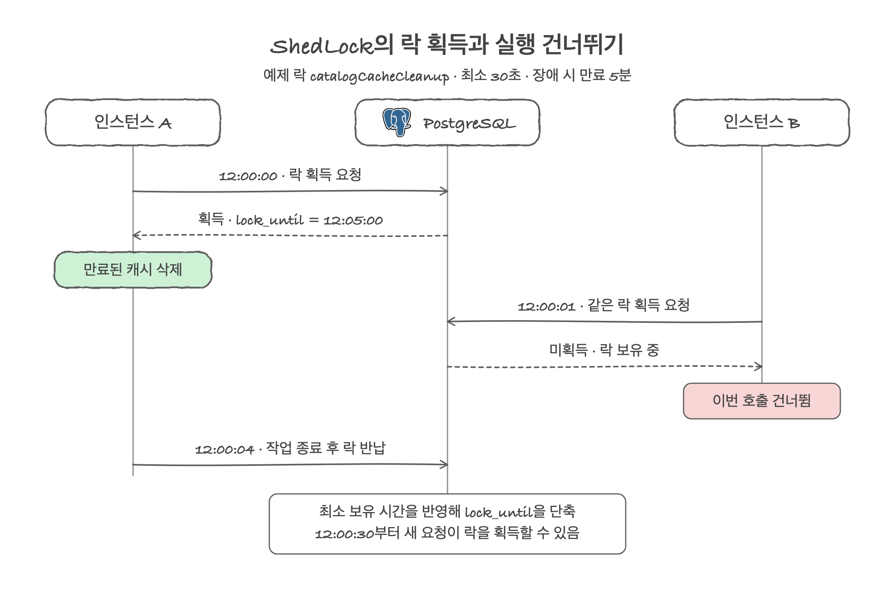

# ShedLock으로 여러 인스턴스의 스케줄 실행 조율하기

ShedLock 7.12.0을 기준으로, 여러 Spring 인스턴스에서 같은 `@Scheduled` 작업이 동시에 시작될 때 실행을 조율하는 방법을 정리한다. 예제는 `JdbcTemplateLockProvider`와 공유 PostgreSQL을 사용한다. [Maven Central 배포 정보](https://repo.maven.apache.org/maven2/net/javacrumbs/shedlock/shedlock-spring/maven-metadata.xml) · [ShedLock 7.12.0 공식 문서](https://github.com/lukas-krecan/ShedLock/blob/shedlock-parent-7.12.0/README.md)

## 1. 같은 락 이름으로 실행을 조율하기

각 인스턴스의 Spring 스케줄러가 작업 시각에 메서드를 호출한다. ShedLock은 `@SchedulerLock`이 붙은 메서드를 실행하기 전에 `LockProvider`에 락을 요청한다. 같은 저장소에서 같은 이름으로 요청한 인스턴스 중 락을 얻은 인스턴스가 메서드 본문을 실행하고, 락이 이미 잡혀 있어 얻지 못한 인스턴스는 이번 호출을 건너뛴다. 건너뛴 호출은 대기열에 쌓이거나 락 해제 시 자동으로 재실행되지 않는다. [ShedLock 동작 규칙](https://github.com/lukas-krecan/ShedLock/blob/shedlock-parent-7.12.0/README.md#behavior) · [락 실행기 소스](https://github.com/lukas-krecan/ShedLock/blob/shedlock-parent-7.12.0/shedlock-core/src/main/java/net/javacrumbs/shedlock/core/DefaultLockingTaskExecutor.java)



그림의 근거 · [ShedLock 동작 규칙](https://github.com/lukas-krecan/ShedLock/blob/shedlock-parent-7.12.0/README.md#behavior) · [PostgreSQL DB 시각 기반 SQL](https://github.com/lukas-krecan/ShedLock/blob/shedlock-parent-7.12.0/providers/sql/shedlock-sql-support/src/main/java/net/javacrumbs/shedlock/provider/sql/PostgresSqlServerTimeStatementsSource.java)

ShedLock은 만료 시각이 있는 락으로 동시 실행을 줄인다. 예약 회차마다 반드시 한 번 실행돼야 하는 작업은 실행 이력과 누락분 처리 정책이 필요하다. 같은 업무가 재시도되거나 만료 경계를 넘어 겹쳐 실행될 수 있으므로, 쓰기나 외부 호출은 업무 키로 중복 처리를 제어한다. [ShedLock 적용 범위와 제약](https://github.com/lukas-krecan/ShedLock/blob/shedlock-parent-7.12.0/README.md#shedlock-is-not-a-distributed-scheduler) · [ShedLock 만료 시 동작](https://github.com/lukas-krecan/ShedLock/blob/shedlock-parent-7.12.0/README.md#caveats)

## 2. Spring에서 PostgreSQL 락 연결하기

`LockProvider`가 락을 보관할 공유 저장소를 정한다. ShedLock은 JDBC 외에도 Redis, MongoDB 등의 구현을 제공한다. [ShedLock 구성 요소와 저장소](https://github.com/lukas-krecan/ShedLock/blob/shedlock-parent-7.12.0/README.md#components)

Spring Boot 3.5가 관리하는 `DataSource`를 사용하는 예제다. `shedlock-spring`과 `shedlock-provider-jdbc-template`을 같은 버전으로 두고, 모든 인스턴스의 `spring.datasource.*` 설정이 같은 PostgreSQL 데이터베이스와 `shedlock` 테이블을 사용하도록 맞춘다. ShedLock 7.x의 최소 JVM 버전은 17이다. [Spring Boot DataSource 설정](https://docs.spring.io/spring-boot/3.5/reference/data/sql.html#data.sql.datasource) · [ShedLock Spring 설정](https://github.com/lukas-krecan/ShedLock/blob/shedlock-parent-7.12.0/README.md#enable-and-configure-scheduled-locking-spring) · [JDBC 설정](https://github.com/lukas-krecan/ShedLock/blob/shedlock-parent-7.12.0/README.md#jdbctemplate) · [호환성 표](https://github.com/lukas-krecan/ShedLock/blob/shedlock-parent-7.12.0/README.md#compatibility-matrix)

```kotlin
dependencies {
    implementation("org.springframework.boot:spring-boot-starter-jdbc")
    implementation("net.javacrumbs.shedlock:shedlock-spring:7.12.0")
    implementation("net.javacrumbs.shedlock:shedlock-provider-jdbc-template:7.12.0")
    runtimeOnly("org.postgresql:postgresql")
}
```

서비스 시작 전에 DB 마이그레이션으로 락 테이블을 만든다. `name`은 기본 키다. `catalog_cache`는 예제 작업이 사용하는 별도 테이블이다. [ShedLock의 PostgreSQL 테이블 정의](https://github.com/lukas-krecan/ShedLock/blob/shedlock-parent-7.12.0/README.md#jdbctemplate)

```sql
CREATE TABLE shedlock (
    name varchar(64) PRIMARY KEY,
    lock_until timestamp NOT NULL,
    locked_at timestamp NOT NULL,
    locked_by varchar(255) NOT NULL
);

CREATE TABLE catalog_cache (
    cache_key text PRIMARY KEY,
    expires_at timestamptz NOT NULL
);
```

`@EnableScheduling`으로 스케줄링을 켜고 `@EnableSchedulerLock`으로 ShedLock을 연결한다. Spring은 UTC 기준 매분 0초에 실행을 시도한다. 락을 얻은 호출이 만료된 캐시 행을 삭제한다. `usingDbTime()`은 락의 획득과 만료를 계산할 때 PostgreSQL 서버의 UTC 시각을 사용한다. [Spring 스케줄링](https://docs.spring.io/spring-framework/reference/6.2/integration/scheduling.html) · [ShedLock Spring 활성화](https://github.com/lukas-krecan/ShedLock/blob/shedlock-parent-7.12.0/README.md#enable-and-configure-scheduled-locking-spring) · [JDBC 설정과 DB 시각](https://github.com/lukas-krecan/ShedLock/blob/shedlock-parent-7.12.0/README.md#jdbctemplate)

```java
import javax.sql.DataSource;

import net.javacrumbs.shedlock.core.LockAssert;
import net.javacrumbs.shedlock.core.LockProvider;
import net.javacrumbs.shedlock.provider.jdbctemplate.JdbcTemplateLockProvider;
import net.javacrumbs.shedlock.spring.annotation.EnableSchedulerLock;
import net.javacrumbs.shedlock.spring.annotation.SchedulerLock;
import org.springframework.context.annotation.Bean;
import org.springframework.context.annotation.Configuration;
import org.springframework.jdbc.core.JdbcTemplate;
import org.springframework.scheduling.annotation.EnableScheduling;
import org.springframework.scheduling.annotation.Scheduled;

@Configuration(proxyBeanMethods = false)
@EnableScheduling
@EnableSchedulerLock(defaultLockAtMostFor = "5m")
public class CatalogSchedulingConfiguration {
    @Bean
    LockProvider lockProvider(DataSource dataSource) {
        return new JdbcTemplateLockProvider(JdbcTemplateLockProvider.Configuration.builder()
                .withJdbcTemplate(new JdbcTemplate(dataSource))
                .usingDbTime()
                .build());
    }

    @Bean
    CatalogCacheCleanup catalogCacheCleanup(DataSource dataSource) {
        return new CatalogCacheCleanup(new JdbcTemplate(dataSource));
    }

    public static class CatalogCacheCleanup {
        private final JdbcTemplate jdbcTemplate;

        public CatalogCacheCleanup(JdbcTemplate jdbcTemplate) {
            this.jdbcTemplate = jdbcTemplate;
        }

        @Scheduled(cron = "${catalog.cache.cleanup-cron:0 * * * * *}", zone = "UTC")
        @SchedulerLock(name = "catalogCacheCleanup", lockAtLeastFor = "30s")
        public void removeExpiredEntries() {
            LockAssert.assertLocked();
            jdbcTemplate.update("DELETE FROM catalog_cache WHERE expires_at <= CURRENT_TIMESTAMP");
        }
    }
}
```

기본 `PROXY_METHOD` 모드는 Spring AOP로 `@SchedulerLock` 메서드를 가로챈다. 예제처럼 메서드를 `public`으로 선언하고 `final`을 붙이지 않는다. 같은 빈의 `this`로 호출하면 프록시를 거치지 않는다. `LockAssert.assertLocked()`를 작업 시작에 두면 락 없이 본문에 들어가는 설정 오류를 발견할 수 있다. [ShedLock 프록시 모드](https://github.com/lukas-krecan/ShedLock/blob/shedlock-parent-7.12.0/README.md#modes-of-spring-integration) · [LockAssert](https://github.com/lukas-krecan/ShedLock/blob/shedlock-parent-7.12.0/README.md#lock-assert) · [Spring AOP 공식 문서](https://docs.spring.io/spring-framework/reference/6.2/core/aop/proxying.html) · [위키의 자기 호출 예제](12_spring_aop_proxy_limitations_and_self_invocation.md)

## 3. 최소 보유 시간과 만료 시간 고르기

- `lockAtLeastFor`는 락을 획득한 뒤 유지하는 최소 시간이다. 예제에서는 A가 `12:00:00`에 락을 얻고 `12:00:04`에 메서드를 마치면 `12:00:30`부터 다른 인스턴스가 같은 락을 얻을 수 있다. 이를 이용해 매우 짧은 작업이 인스턴스별 실행 시각 차이로 연달아 수행되는 일을 줄인다. [ShedLock 동작 규칙](https://github.com/lukas-krecan/ShedLock/blob/shedlock-parent-7.12.0/README.md#behavior) · [PostgreSQL 락 해제 SQL](https://github.com/lukas-krecan/ShedLock/blob/shedlock-parent-7.12.0/providers/sql/shedlock-sql-support/src/main/java/net/javacrumbs/shedlock/provider/sql/PostgresSqlServerTimeStatementsSource.java)
- `lockAtMostFor`는 획득한 노드가 종료 처리를 하지 못했을 때 다음 시도가 락을 다시 얻을 수 있게 하는 만료 시간이다. 연장하지 않는 예제에서는 `12:00:00`에 락을 얻은 A가 종료 처리 없이 죽으면 `12:05:00`부터 다음 요청이 획득할 수 있다. A가 그 시각 이후에도 실행 중이면 다른 노드의 작업과 겹칠 수 있다. 만료 시간이 작업을 중단시키지는 않으므로 최대 예상 실행 시간을 충분히 넘겨 설정한다. [ShedLock 동작 규칙과 예시](https://github.com/lukas-krecan/ShedLock/blob/shedlock-parent-7.12.0/README.md#behavior)

메서드의 `@SchedulerLock`에 `lockAtMostFor`를 생략하면 `@EnableSchedulerLock`의 `defaultLockAtMostFor`를 사용한다. `lockAtLeastFor`는 적용되는 `lockAtMostFor`를 넘을 수 없다. [ShedLock 기본 만료 시간](https://github.com/lukas-krecan/ShedLock/blob/shedlock-parent-7.12.0/README.md#behavior) · [LockConfiguration 검증](https://github.com/lukas-krecan/ShedLock/blob/shedlock-parent-7.12.0/shedlock-core/src/main/java/net/javacrumbs/shedlock/core/LockConfiguration.java)

## 4. PostgreSQL에서 락 상태 확인하기

`usingDbTime()`을 쓰면 PostgreSQL의 락 SQL은 같은 `name`의 행이 없을 때 삽입하고, 행이 있으면 `lock_until`이 DB의 UTC 시각 이하인 경우에만 갱신한다. 획득이 성공하면 `locked_at`과 `locked_by`가 바뀌고, 종료 시에는 `lock_until`이 종료 시각과 최소 유지 시각 중 늦은 값으로 갱신된다. `locked_by`는 마지막 획득 시 기록된 값이므로 현재 작업 실행 여부는 애플리케이션 로그나 메트릭과 대조한다. [PostgreSQL DB 시각 기반 SQL](https://github.com/lukas-krecan/ShedLock/blob/shedlock-parent-7.12.0/providers/sql/shedlock-sql-support/src/main/java/net/javacrumbs/shedlock/provider/sql/PostgresSqlServerTimeStatementsSource.java)

```sql
SELECT name, locked_at, locked_by, lock_until,
       lock_until > timezone('utc', CURRENT_TIMESTAMP) AS lock_active
FROM shedlock
WHERE name = 'catalogCacheCleanup';
```

JDBC 락 행은 직접 삭제하지 않는다. Provider가 이미 존재하는 행의 이름을 메모리에 기억하므로 실행 중에 행을 삭제하면 재시작 없이 다시 삽입되지 않을 수 있다. 작업이 실행되지 않으면 `net.javacrumbs.shedlock`의 DEBUG 로그와 락 테이블을 확인한다. [ShedLock JDBC의 행 삭제 주의](https://github.com/lukas-krecan/ShedLock/blob/shedlock-parent-7.12.0/README.md#warning) · [문제 진단](https://github.com/lukas-krecan/ShedLock/blob/shedlock-parent-7.12.0/README.md#troubleshooting)

`shedlock-micrometer`를 추가하고 `MicrometerLockingTaskExecutorListener` 빈을 등록하면 `lock.name` 태그로 획득 시도·성공·미획득과 실행 시간을 볼 수 있다. `shedlock.lock.not.acquired`로 건너뛴 시도를, `shedlock.execution.duration`으로 실행 시간이 만료 설정에 가까워지는지 관찰한다. [ShedLock Micrometer 연동](https://github.com/lukas-krecan/ShedLock/blob/shedlock-parent-7.12.0/README.md#micrometer-integration-spring)
