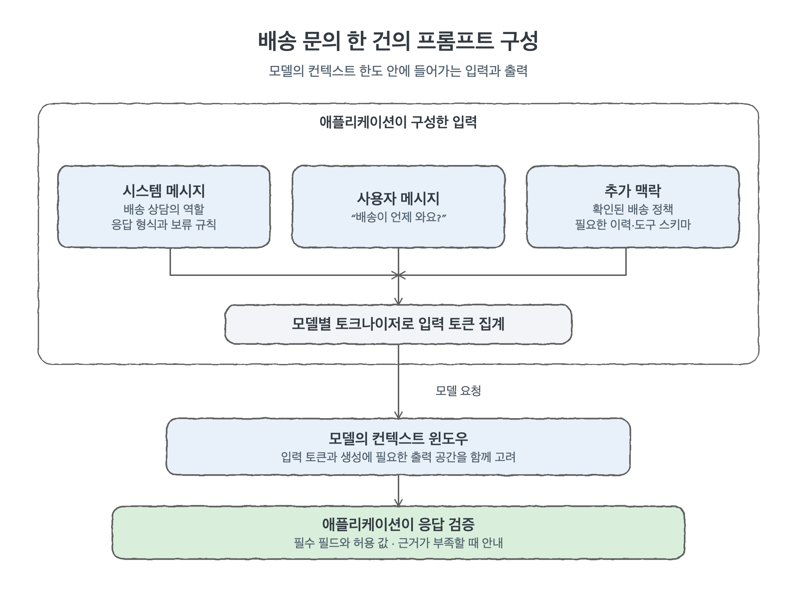

# LLM Fundamentals for Backend Developers

백엔드에서 LLM을 호출할 때는 모델에 보낼 정보, 응답 형식, 호출 비용, 결과 검증을 함께 설계한다. 상품 배송 문의를 처리하는 서비스를 예로 들어 각 요소의 역할을 살펴본다.

## 1. 프롬프트와 메시지 역할

프롬프트는 모델이 답을 생성할 때 참고하는 입력이다. 애플리케이션의 역할·응답 규칙은 시스템 메시지에 두고, 고객 문의는 사용자 메시지에 둔다. 조회 결과나 예시를 추가할 수 있으며, 자료의 출처와 어느 상황에서 답을 보류할지도 구체적으로 정한다. 응답을 다음 코드가 소비한다면 필요한 필드와 허용 값을 함께 정의한다. [OpenAI · Prompt engineering](https://developers.openai.com/api/docs/guides/prompt-engineering)

그림의 근거 · [OpenAI 프롬프트 설계](https://developers.openai.com/api/docs/guides/prompt-engineering) · [OpenAI 토큰](https://help.openai.com/en/articles/4936856-what-are-tokens-and-how-to-count-them)

## 2. 토큰과 컨텍스트 윈도우

토큰은 모델의 토크나이저가 텍스트를 나눈 단위다. 같은 글자 수라도 언어와 토크나이저에 따라 토큰 수가 달라진다. 컨텍스트 윈도우는 모델이 한 번의 요청에서 처리할 수 있는 토큰의 범위다. 대화 이력, 시스템 메시지, 검색 자료, 도구 스키마 등도 입력 예산을 사용하며 출력에도 공간이 필요하다. 모델별 입력·출력 한도와 사용량은 공급자의 모델 문서와 실제 응답 메타데이터에서 확인한다. [OpenAI · 토큰 설명](https://help.openai.com/en/articles/4936856-what-are-tokens-and-how-to-count-them) · [OpenAI · 모델 사양](https://developers.openai.com/api/docs/models)

## 3. 임베딩과 의미 공간

임베딩 모델은 텍스트를 숫자 벡터로 변환한다. 「배송이 언제 와요?」와 「예상 도착일」처럼 단어가 달라도 유사한 의미의 문장은 학습된 벡터 공간에서 가까울 수 있다. 검색할 문서와 질의는 같은 임베딩 모델로 변환하고, 벡터 간 거리나 유사도를 기준으로 후보를 찾는다. 고객 ID, 상품 상태, 적용 기간처럼 정확히 일치해야 하는 속성은 메타데이터나 정형 조건으로 처리한다. [OpenAI · Embeddings](https://developers.openai.com/api/docs/guides/embeddings)

## 4. 파인튜닝과 RAG

파인튜닝은 예제 데이터로 모델의 동작을 조정한다. 문의 분류 규칙이나 답변 형식을 일관되게 적용해야 할 때 먼저 프롬프트와 평가 세트를 만들고, 반복되는 오류가 남으면 파인튜닝의 효과를 평가한다. [OpenAI · Supervised fine-tuning](https://developers.openai.com/api/docs/guides/supervised-fine-tuning)

RAG는 요청 시점에 관련 정보를 검색해 모델의 컨텍스트에 넣는 방식이다. 자주 바뀌는 반품 정책과 배송 안내는 문서를 갱신하고 검색할 수 있게 만든다. 모델 호출 뒤에는 답이 검색 근거에 맞는지 확인한다. [Spring AI · RAG](https://docs.spring.io/spring-ai/reference/2.0/api/retrieval-augmented-generation.html)

## 5. 모델과 모델 공급자

| 구분 | 설계에서 확인할 내용 |
| --- | --- |
| 모델 | 채팅 생성이나 임베딩처럼 어떤 작업을 수행하는지, 스트리밍·구조화 출력·도구 호출을 지원하는지 확인한다. |
| 공급자 또는 런타임 | 모델에 접근하는 API, 인증, 오류와 제한, 실행 환경을 제공한다. OpenAI는 호스팅 API 예시이고 Ollama는 로컬 모델 실행 예시다. |
| 애플리케이션 계약 | 입력 제한, 시간 초과, 재시도, 응답 검증을 정의한다. 모델을 바꿀 때는 같은 평가 요청으로 품질과 동작을 확인한다. |

[Spring AI · 모델 API](https://docs.spring.io/spring-ai/reference/2.0/api/index.html) · [Ollama · API 소개](https://docs.ollama.com/api/introduction)
