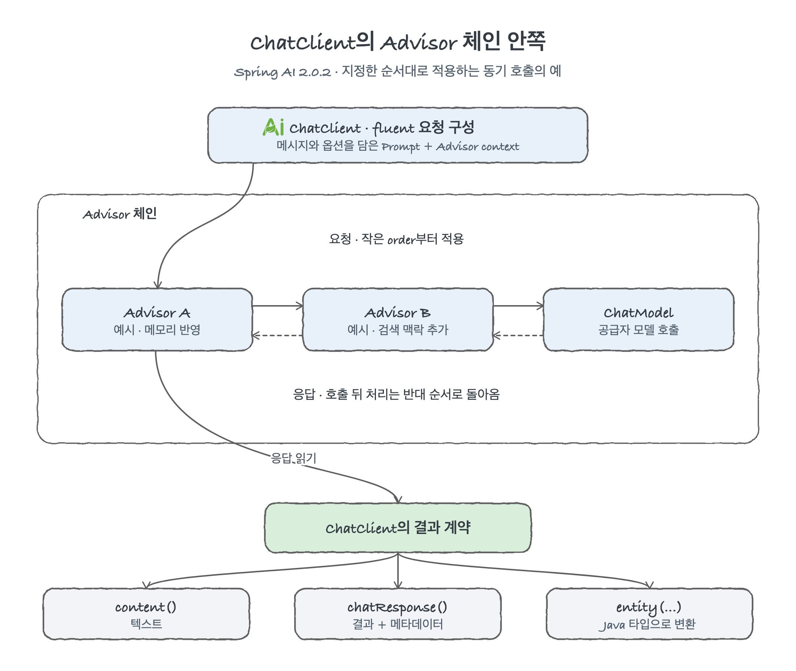

# Spring AI Core Components

Spring AI 요청은 `ChatClient`에서 메시지와 옵션을 구성하고, 어드바이저를 거쳐 `ChatModel`에 전달한다. 결과는 텍스트로 읽거나, 후속 로직이 처리할 Java 타입으로 변환할 수 있다. [Spring AI · Chat Client](https://docs.spring.io/spring-ai/reference/2.0/api/chatclient.html)



그림의 근거 · [Spring AI Advisors](https://docs.spring.io/spring-ai/reference/2.0/api/advisors.html) · [Spring AI ChatClient](https://docs.spring.io/spring-ai/reference/2.0/api/chatclient.html) · [Spring AI Structured Output](https://docs.spring.io/spring-ai/reference/2.0/api/structured-output/converters.html)

## 1. 구성 요소별 역할

| 구성 요소 | 역할 |
| --- | --- |
| `ChatClient` | 시스템·사용자 메시지, 옵션, 어드바이저를 연결하는 fluent API다. `call()`이나 `stream()` 뒤에 결과를 읽을 메서드를 호출한다. |
| Advisors | 모델 호출 전후에 요청이나 응답을 처리한다. 대화 메모리와 검색 맥락 추가에 사용하며, 실행 순서에 따라 모델에 전달되는 정보가 달라질 수 있다. |
| Prompts | `Prompt`는 메시지와 모델 옵션을 담는다. 템플릿은 반복 요청의 문구를 재사용하고, 실제 값은 호출할 때 전달한다. |
| Models | `ChatModel`은 메시지 생성, `EmbeddingModel`은 벡터 변환을 담당한다. 모델 작업마다 입출력 계약이 다르다. |
| Structured Output | 모델의 출력을 Java 타입으로 변환한다. 형식 변환 후에도 필수 필드와 업무 규칙을 확인한다. |

[Spring AI · Advisors](https://docs.spring.io/spring-ai/reference/2.0/api/advisors.html) · [Spring AI · Prompts](https://docs.spring.io/spring-ai/reference/2.0/api/prompt.html) · [Spring AI · 구조화 출력 변환기](https://docs.spring.io/spring-ai/reference/2.0/api/structured-output/converters.html)

## 2. ChatClient로 결과 읽기

`content()`는 응답 텍스트를 읽고, `chatResponse()`는 생성 결과와 모델이 제공한 메타데이터를 확인할 때 쓴다. `stream().content()`의 `Flux<String>`은 응답을 조각 단위로 전달하므로 완성된 전체 응답을 처리할 때의 코드와 호출부 계약이 다르다. [Spring AI · ChatClient 결과와 스트리밍](https://docs.spring.io/spring-ai/reference/2.0/api/chatclient.html)

다음 예제에서 시스템 메시지는 출력 규칙을, 사용자 메시지는 원문을 전달한다. `entity(Summary.class)`로 변환한 뒤 생성한 요약이 비어 있는지 확인한다.

```java
import org.springframework.ai.chat.client.ChatClient;

class TicketSummary {
    record Summary(String text) {}

    static Summary summarize(ChatClient client, String ticket) {
        Summary summary = client.prompt()
                .system("문의의 사실만 한국어 한 문장으로 요약하세요.")
                .user(ticket)
                .call()
                .entity(Summary.class);

        if (summary == null || summary.text() == null || summary.text().isBlank()) {
            throw new IllegalStateException("Empty ticket summary");
        }
        return summary;
    }
}
```

구조화 출력을 제공하는 모델은 JSON 스키마를 적용하는 등 공급자 기능을 사용할 수 있다. 모델과 모드에 따라 변환 실패나 빈 응답을 처리할 경로를 둔다. 애플리케이션의 업무 규칙은 변환 성공 후 별도로 검사한다. [Spring AI · 구조화 출력](https://docs.spring.io/spring-ai/reference/2.0/api/structured-output/converters.html)
