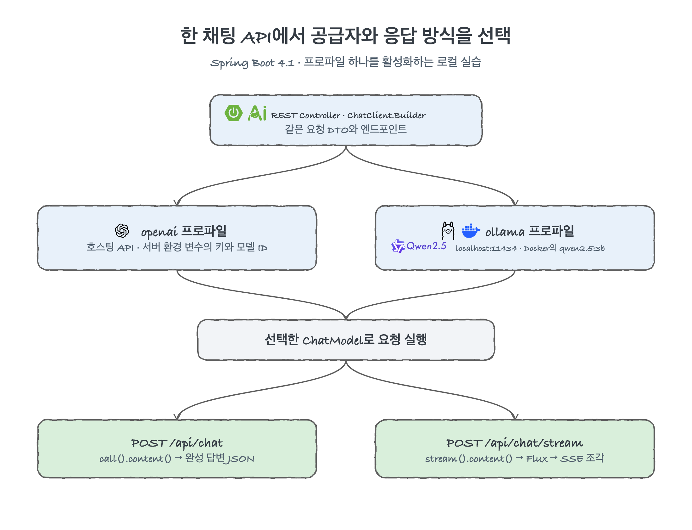

# Building Spring AI Chat APIs with OpenAI and Ollama

같은 REST 계약으로 OpenAI와 Ollama에 연결한다. 실습 기준은 Java 17, Spring Boot 4.1.0, Spring AI 2.0.2다. 애플리케이션은 호스트에서 실행하고 로컬 Ollama는 Docker로 실행한다. [Spring AI · 시작하기](https://docs.spring.io/spring-ai/reference/2.0/getting-started.html) · [springdoc · Spring Boot 호환 범위](https://springdoc.org/)

## 1. Gradle 프로젝트 구성

`build.gradle`에 Boot BOM과 Spring AI BOM을 적용한다. `src/main/java/demo/ai`의 진입점에는 `@SpringBootApplication`을 선언한다. Gradle CLI에서 직접 입력받는 예제는 `bootRun`에 아래처럼 표준 입력을 연결한다.

```groovy
plugins {
    id 'java'
    id 'org.springframework.boot' version '4.1.0'
}

repositories { mavenCentral() }

java {
    toolchain { languageVersion = JavaLanguageVersion.of(17) }
}

dependencies {
    implementation platform('org.springframework.boot:spring-boot-dependencies:4.1.0')
    implementation platform('org.springframework.ai:spring-ai-bom:2.0.2')
    implementation 'org.springframework.boot:spring-boot-starter-webmvc'
    implementation 'org.springframework.ai:spring-ai-starter-model-openai'
    implementation 'org.springframework.ai:spring-ai-starter-model-ollama'
    implementation 'org.springdoc:springdoc-openapi-starter-webmvc-ui:3.0.2'
}

tasks.named('bootRun') {
    standardInput = System.in
}
```

```java
package demo.ai;

import org.springframework.boot.SpringApplication;
import org.springframework.boot.autoconfigure.SpringBootApplication;

@SpringBootApplication
public class AiApplication {
    public static void main(String[] args) {
        SpringApplication.run(AiApplication.class, args);
    }
}
```

## 2. OpenAI와 Ollama 프로파일

두 모델 스타터를 함께 쓰는 실습에서는 채팅에 사용하지 않는 OpenAI 자동 설정을 끈다. `src/main/resources/application.properties`에 공통 설정을 둔다.

```properties
spring.ai.model.image=none
spring.ai.model.audio.speech=none
spring.ai.model.audio.transcription=none
spring.ai.model.moderation=none
```

OpenAI API 프로젝트의 설정에서 API 키를 발급하고, IDE 실행 설정이나 셸의 환경 변수 `OPENAI_API_KEY`로 서버에 전달한다. 사용할 수 있는 채팅 모델 ID는 `OPENAI_CHAT_MODEL`에 지정한다. 키는 서버에서만 읽게 하고, 소스나 Swagger 요청 본문에 적지 않는다. [OpenAI · API 빠른 시작](https://developers.openai.com/api/docs/quickstart) · [OpenAI · API 키 보관](https://help.openai.com/en/articles/5112595-best-practices-for-api-key-safety)

`application-openai.properties`를 `src/main/resources`에 둔다.

```properties
spring.ai.model.chat=openai
spring.ai.model.embedding=none
spring.ai.openai.api-key=${OPENAI_API_KEY}
spring.ai.openai.chat.model=${OPENAI_CHAT_MODEL}
```

Ollama는 모델 파일과 런타임을 로컬에서 관리한다. Hugging Face는 모델을 배포하는 곳이고, GGUF는 모델 가중치를 저장할 수 있는 파일 형식이다. 호환 GGUF를 직접 쓸 때는 Ollama `Modelfile`의 `FROM`으로 가져올 수 있다. 이 실습은 Ollama 라이브러리의 모델을 내려받는다. [Ollama · Docker](https://docs.ollama.com/docker) · [Ollama · GGUF 가져오기](https://docs.ollama.com/import) · [Ollama · Qwen 2.5](https://ollama.com/library/qwen2.5:3b)

```bash
docker run -d --name spring-ai-ollama \
  -p 127.0.0.1:11434:11434 -v spring-ai-ollama:/root/.ollama ollama/ollama
docker exec spring-ai-ollama ollama pull qwen2.5:3b
```

`application-ollama.properties`를 같은 디렉터리에 둔다.

```properties
spring.ai.model.chat=ollama
spring.ai.model.embedding=none
spring.ai.ollama.base-url=http://localhost:11434
spring.ai.ollama.chat.model=qwen2.5:3b
```

Spring AI 2.0의 채팅 모델 속성은 `spring.ai.openai.chat.model`, `spring.ai.ollama.chat.model`이다. 두 프로파일 중 하나를 활성화하면 그 공급자의 모델이 선택된다. [Spring AI · OpenAI Chat](https://docs.spring.io/spring-ai/reference/2.0/api/chat/openai-chat.html) · [Spring AI · Ollama Chat](https://docs.spring.io/spring-ai/reference/2.0/api/chat/ollama-chat.html)



그림의 근거 · [Spring AI ChatClient](https://docs.spring.io/spring-ai/reference/2.0/api/chatclient.html) · [Spring AI OpenAI Chat](https://docs.spring.io/spring-ai/reference/2.0/api/chat/openai-chat.html) · [Spring AI Ollama Chat](https://docs.spring.io/spring-ai/reference/2.0/api/chat/ollama-chat.html)

## 3. 동기 응답과 SSE 스트리밍

아래 클래스는 `ChatClient.Builder` 자동 설정을 사용한다. 일반 호출에는 전체 답변을 담은 JSON을 보내고, 스트리밍 호출에는 조각을 SSE로 내보낸다.

```java
package demo.ai;

import java.util.Objects;
import org.springframework.ai.chat.client.ChatClient;
import org.springframework.http.MediaType;
import org.springframework.web.bind.annotation.PostMapping;
import org.springframework.web.bind.annotation.RequestBody;
import org.springframework.web.bind.annotation.RequestMapping;
import org.springframework.web.bind.annotation.RestController;
import reactor.core.publisher.Flux;

@RestController
@RequestMapping("/api/chat")
class ChatController {
    record ChatRequest(String message) {}
    record ChatReply(String answer) {}

    private final ChatClient client;

    ChatController(ChatClient.Builder builder) {
        this.client = builder.build();
    }

    @PostMapping
    ChatReply chat(@RequestBody ChatRequest request) {
        return new ChatReply(Objects.requireNonNull(
                client.prompt().user(request.message()).call().content()));
    }

    @PostMapping(path = "/stream", produces = MediaType.TEXT_EVENT_STREAM_VALUE)
    Flux<String> stream(@RequestBody ChatRequest request) {
        return client.prompt().user(request.message()).stream().content();
    }
}
```

각 프로파일로 앱을 하나씩 실행한다. Swagger UI는 `http://localhost:8080/swagger-ui/index.html`에서 두 공급자의 일반 호출을 확인할 때 쓴다. SSE 조각이 도착하는 과정은 버퍼링을 끈 `curl -N`으로 확인한다. 사용 토큰과 모델 응답 메타데이터가 필요하면 `call().chatResponse()`를 선택한다. [Spring AI · ChatClient 응답 형태](https://docs.spring.io/spring-ai/reference/2.0/api/chatclient.html)

```bash
./gradlew bootRun --args='--spring.profiles.active=ollama'
# OpenAI 키와 모델 ID를 환경 변수에 설정한 터미널에서는 다음 명령을 사용한다.
# ./gradlew bootRun --args='--spring.profiles.active=openai'

curl -sS http://localhost:8080/api/chat -H 'Content-Type: application/json' \
  --data '{"message":"배송 문의에 대한 인사말을 한 문장으로 써 주세요."}'
curl -N http://localhost:8080/api/chat/stream -H 'Content-Type: application/json' \
  --data '{"message":"배송 안내 항목을 세 줄로 알려 주세요."}'
```
