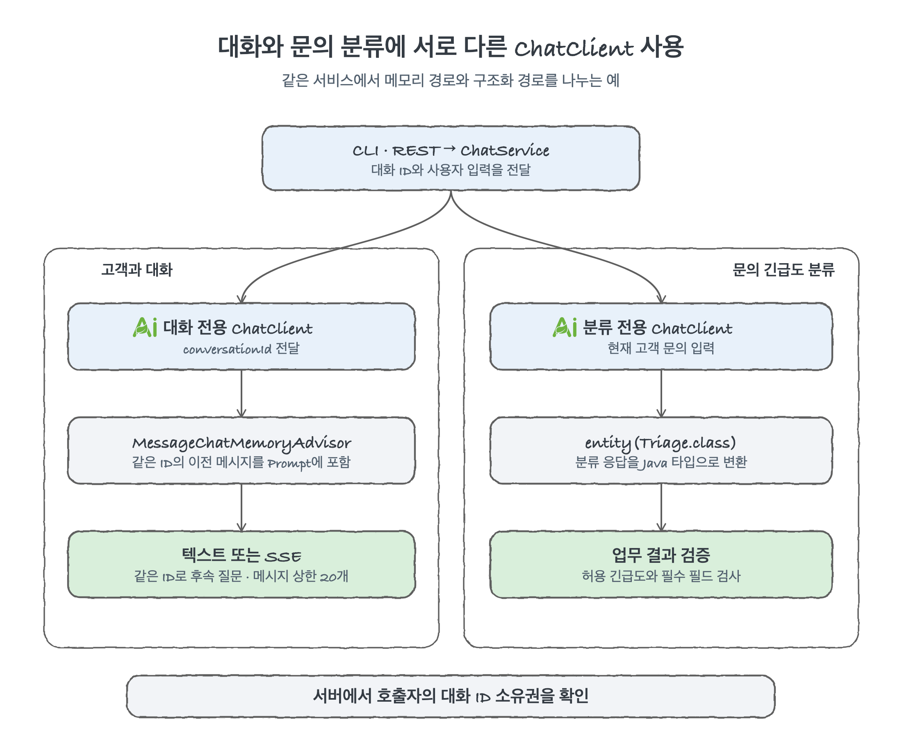

# Building Spring AI Chatbots with Memory and Structured Output

[04번 채팅 앱](04_building_chat_apis_with_openai_and_ollama.md)에 대화 메모리, CLI, 동기·스트리밍 REST 호출, 고객 문의 긴급도 분류를 추가한다. 대화 흐름과 분류는 서로 다른 `ChatClient`를 쓴다.

## 1. Chat Options와 프롬프트 패턴

`ChatOptions`는 모델 ID, 생성 옵션 등을 담는다. 실행 환경에서는 프로파일에 기본값을 두고, 요청별 설정이 필요한 경우 `prompt().options(...)`로 지정한다. 예를 들어 해당 모델이 온도를 지원하면 `ChatOptions.builder().temperature(0.2).build()`를 넘길 수 있다. 공급자와 모델마다 지원 옵션을 확인한다. [Spring AI · Chat Model과 옵션](https://docs.spring.io/spring-ai/reference/2.0/api/chatmodel.html)

| 패턴 | 적용 예 |
| --- | --- |
| 역할 정의 | 배송 정책 안내를 맡긴다. |
| 목표 명시 | 문의 하나에 대한 다음 행동을 제시하게 한다. |
| 맥락 제공 | 주문 상태와 확인한 정책을 자료로 전달한다. |
| 입력 구분 | 고객 원문과 애플리케이션의 지시를 메시지에서 분리한다. |
| 예시 제공 | 일반·높음·긴급 문의를 각각 예시로 보여 준다. |
| 응답 제약 | 응답 언어와 최대 길이를 지정한다. |
| 출력 계약 | 필수 필드와 허용 값이 있는 구조를 지정한다. |
| 근거 제한 | 전달한 정책으로 답하고 정보가 부족하면 확인 요청을 한다. |
| 작업 분리 | 분류를 먼저 하고 선택된 업무 흐름이 응답을 만든다. |

각 패턴의 효과는 같은 평가 문의 집합으로 비교한다. [OpenAI · 프롬프트 설계](https://developers.openai.com/api/docs/guides/prompt-engineering)

## 2. 대화별 메모리를 적용한 서비스

CLI와 REST는 같은 서비스를 부른다. `ChatMemory.CONVERSATION_ID`는 호출마다 전달하며, 같은 ID를 쓰는 요청만 이전 메시지를 공유한다. 아래에서는 메모리에 최근 메시지 20개를 두고, 분류에는 메모리가 붙지 않은 클라이언트를 쓴다. 사용자가 대화 ID를 제공하는 서비스에서는 인증된 소유자와 ID의 관계를 확인한다. [Spring AI · Chat Memory](https://docs.spring.io/spring-ai/reference/2.0/api/chat-memory.html)



그림의 근거 · [Spring AI Chat Memory](https://docs.spring.io/spring-ai/reference/2.0/api/chat-memory.html) · [Spring AI Structured Output](https://docs.spring.io/spring-ai/reference/2.0/api/structured-output/converters.html)

```java
package demo.ai;

import java.util.Objects;
import org.springframework.ai.chat.client.ChatClient;
import org.springframework.ai.chat.client.advisor.MessageChatMemoryAdvisor;
import org.springframework.ai.chat.memory.ChatMemory;
import org.springframework.ai.chat.memory.MessageWindowChatMemory;
import org.springframework.ai.chat.model.ChatModel;
import org.springframework.stereotype.Service;
import reactor.core.publisher.Flux;

@Service
class SupportChat {
    enum Urgency { NORMAL, HIGH, URGENT }
    record Triage(Urgency urgency, String reason) {}

    private final ChatClient conversation;
    private final ChatClient classifier;

    SupportChat(ChatModel model) {
        ChatMemory memory = MessageWindowChatMemory.builder().maxMessages(20).build();
        this.conversation = ChatClient.builder(model)
                .defaultAdvisors(MessageChatMemoryAdvisor.builder(memory).build())
                .build();
        this.classifier = ChatClient.builder(model).build();
    }

    private ChatClient.ChatClientRequestSpec message(String id, String question) {
        return conversation.prompt().user(question)
                .advisors(a -> a.param(ChatMemory.CONVERSATION_ID, id));
    }

    String reply(String id, String question) {
        return Objects.requireNonNull(message(id, question).call().content());
    }

    Flux<String> stream(String id, String question) {
        return message(id, question).stream().content();
    }

    Triage classify(String ticket) {
        Triage result = classifier.prompt()
                .system("""
                        쇼핑몰 문의의 긴급도를 분류하세요.
                        정상 상태 문의는 NORMAL, 처리 지연은 HIGH,
                        결제 피해나 계정 탈취 신고는 URGENT로 분류하세요.
                        reason에는 고객이 제공한 사실만 적으세요.
                        """)
                .user(ticket)
                .call().entity(Triage.class);
        if (result == null || result.urgency() == null
                || result.reason() == null || result.reason().isBlank()) {
            throw new IllegalStateException("Invalid triage result");
        }
        return result;
    }
}
```

`entity(Triage.class)`는 응답을 Java 타입으로 변환한다. 모델이 분류 예시를 잘 따르는지는 긴급도별 테스트 문의로 평가한다. 실패한 변환과 응답 검증 오류는 호출부의 오류 계약으로 처리한다. [Spring AI · 구조화 출력 변환기](https://docs.spring.io/spring-ai/reference/2.0/api/structured-output/converters.html)

## 3. CLI와 REST에서 같은 서비스 호출

```java
package demo.ai;

import java.util.Scanner;
import java.util.UUID;
import org.springframework.boot.ApplicationRunner;
import org.springframework.context.annotation.Bean;
import org.springframework.context.annotation.Configuration;
import org.springframework.context.annotation.Profile;
import org.springframework.http.MediaType;
import org.springframework.web.bind.annotation.*;
import reactor.core.publisher.Flux;

@RestController
@RequestMapping("/api/support")
class SupportController {
    record Message(String conversationId, String text) {}
    record Ticket(String text) {}

    private final SupportChat chat;

    SupportController(SupportChat chat) {
        this.chat = chat;
    }

    @PostMapping("/chat")
    ChatController.ChatReply chat(@RequestBody Message message) {
        return new ChatController.ChatReply(chat.reply(message.conversationId(), message.text()));
    }

    @PostMapping(path = "/chat/stream", produces = MediaType.TEXT_EVENT_STREAM_VALUE)
    Flux<String> stream(@RequestBody Message message) {
        return chat.stream(message.conversationId(), message.text());
    }

    @PostMapping("/triage")
    SupportChat.Triage triage(@RequestBody Ticket ticket) {
        return chat.classify(ticket.text());
    }
}

@Configuration(proxyBeanMethods = false)
@Profile("cli")
class SupportCli {
    @Bean
    ApplicationRunner supportRunner(SupportChat chat) {
        return args -> {
            String id = UUID.randomUUID().toString();
            Scanner input = new Scanner(System.in);
            while (input.hasNextLine()) {
                String line = input.nextLine();
                if (line.equals("/exit")) return;
                if (!line.isBlank()) System.out.println(chat.reply(id, line));
            }
        };
    }
}
```

CLI는 `./gradlew bootRun --args='--spring.profiles.active=ollama,cli --spring.main.web-application-type=none'`으로 실행한다. REST 앱에서는 `ollama`나 `openai`만 활성화한다. 동일한 `conversationId`로 「내 주문 번호는 A42야」와 「내 주문 번호를 알려 줘」를 보내고, 다른 ID로 같은 질문을 보내 대화가 분리되는지 확인한다.
