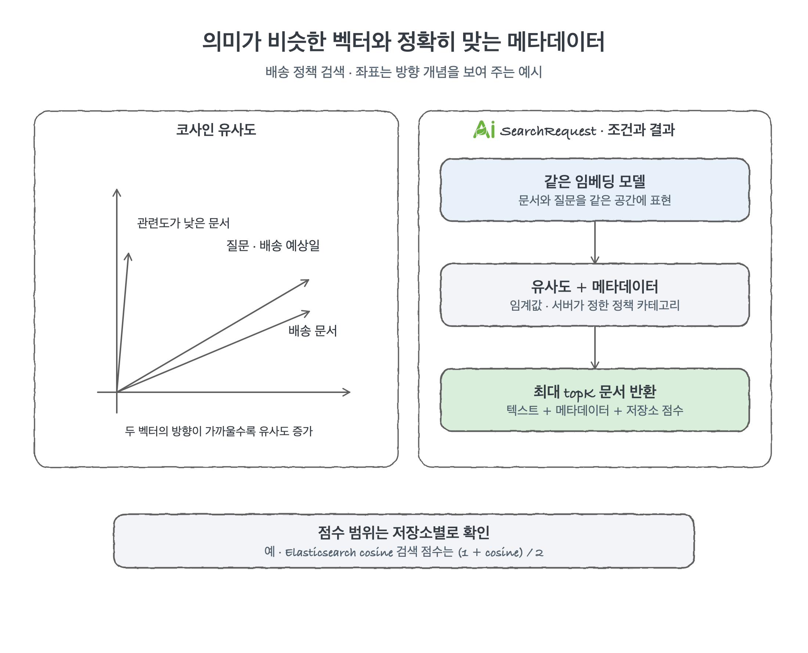

# Vector Databases and Similarity Search for RAG

벡터 검색은 질문과 가까운 문서를 찾고, 메타데이터 조건은 결과의 범위를 제한한다. RAG에서는 이 두 기준을 조합해 모델에 전달할 근거를 고른다. [Spring AI · Vector Store](https://docs.spring.io/spring-ai/reference/2.0/api/vectordbs.html)

## 1. 벡터 데이터베이스와 코사인 유사도

벡터 저장소의 문서는 보통 ID, 텍스트, 임베딩, 메타데이터를 포함한다. 코사인 유사도는 두 벡터의 내적을 각 벡터 길이의 곱으로 나눈 값이다. 같은 방향이면 1이고, 직교하면 0이며, 반대 방향이면 -1이다. 벡터가 0이면 코사인 유사도를 계산할 수 없다. [Elasticsearch · kNN 및 유사도](https://www.elastic.co/docs/solutions/search/vector/knn)

검색 결과 점수는 저장소 API에서 정규화할 수 있다. 예를 들어 Elasticsearch kNN의 cosine 설정은 `(1 + cosine) / 2` 형태의 검색 점수로 바꾼다. Spring AI의 `Document.getScore()`를 사용할 때는 대상 구현이 어떤 점수를 노출하는지 확인하고, 저장소가 바뀌면 같은 평가 질문으로 임계값을 다시 고른다. [Elasticsearch · dense_vector 유사도와 점수](https://www.elastic.co/docs/reference/elasticsearch/mapping-reference/dense-vector) · [Spring AI · Elasticsearch Vector Store](https://docs.spring.io/spring-ai/reference/2.0/api/vectordbs/elasticsearch.html)



그림의 근거 · [Spring AI Vector Store](https://docs.spring.io/spring-ai/reference/2.0/api/vectordbs.html) · [Elasticsearch dense_vector](https://www.elastic.co/docs/reference/elasticsearch/mapping-reference/dense-vector)

## 2. VectorStore와 SearchRequest

`VectorStore.add(...)`로 문서를 넣으면 구현이 임베딩을 만들고 저장한다. `SearchRequest`에는 질문, 후보 수, 점수 임계값, 메타데이터 조건을 넣을 수 있다. 아래의 정책 분류 값은 서버가 정한 필터다. 테넌트별 검색을 구현할 때는 인증된 테넌트 정보를 기준으로 조건을 만든다. [Spring AI · Vector Store API](https://docs.spring.io/spring-ai/reference/2.0/api/vectordbs.html)

```java
package demo.ai;

import java.util.List;
import org.springframework.ai.document.Document;
import org.springframework.ai.vectorstore.SearchRequest;
import org.springframework.ai.vectorstore.VectorStore;

class PolicySearch {
    static List<Document> shipping(VectorStore store, String question) {
        return store.similaritySearch(SearchRequest.builder()
                .query(question)
                .topK(4)
                .similarityThreshold(0.7)
                .filterExpression("category == 'shipping' && locale == 'ko'")
                .build());
    }
}
```

`0.7`은 함수 사용법을 보여 주기 위한 값이다. 기준을 높이면 검색 결과가 줄어들 수 있다. 배송 질문, 다른 카테고리의 질문, 알려진 근거가 없는 질문을 함께 평가해 검색 조건과 결과 수를 정한다.
