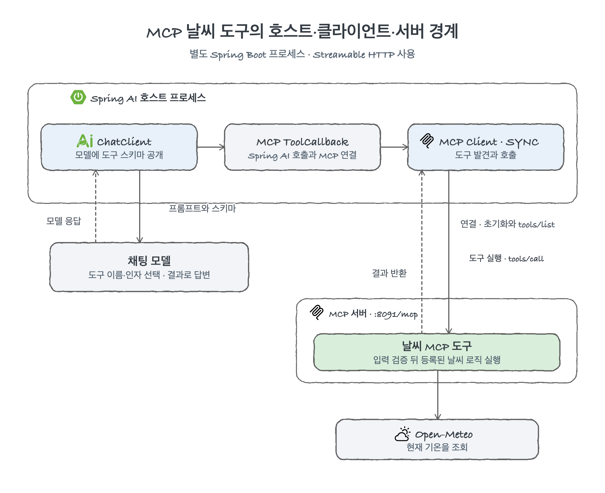

# Building Spring AI MCP Clients and Servers

Model Context Protocol(MCP)은 애플리케이션이 다른 프로세스의 도구, 리소스, 프롬프트를 발견하고 사용하는 프로토콜이다. 이 예제의 Spring AI 호스트는 도구가 필요한 모델 응답을 받은 뒤 MCP 클라이언트로 날씨 서버를 호출한다.

## 1. 모델과 도구 서버의 경계

| 경계 | 역할 |
| --- | --- |
| 모델과 Spring AI 호스트 | 호스트가 도구 스키마를 모델에 전달한다. 모델은 도구 이름과 인자를 골라 호출을 요청한다. |
| 호스트와 MCP 서버 | 호스트 안의 MCP 클라이언트가 연결을 초기화하고 `tools/list`와 `tools/call`을 사용한다. |
| MCP 서버와 날씨 API | 서버가 요청을 검증하고 날씨 API에 접근한 뒤 결과를 반환한다. |

[Java 메서드로 만든 날씨 도구](08_calling_external_apis_with_spring_ai_tools.md)와 모델이 상호작용하는 방식은 동일하다. MCP를 추가하면 도구 발견과 실행이 별도 서버와의 프로토콜 호출을 거친다. 실습에서는 별도 프로세스를 HTTP로 연결하는 Streamable HTTP 전송을 사용한다. [MCP Architecture](https://modelcontextprotocol.io/docs/learn/architecture)



그림의 근거 · [Spring AI MCP Client](https://docs.spring.io/spring-ai/reference/2.0/api/mcp/mcp-client-boot-starter-docs.html) · [MCP 도구](https://modelcontextprotocol.io/specification/2025-11-25/server/tools) · [MCP Streamable HTTP](https://modelcontextprotocol.io/specification/2025-11-25/basic/transports)

## 2. MCP 서버

별도 Gradle 프로젝트에 [채팅 API 예제](04_building_chat_apis_with_openai_and_ollama.md)의 Boot 설정과 BOM을 적용하고, 다음 의존성으로 구성한다. 앞 문서의 `WeatherTools.java`를 같은 경로인 `src/main/java/demo/ai/WeatherTools.java`에 복사한다. 나머지 서버 코드는 `src/main/java/demo/mcp/`에 둔다.

```groovy
dependencies {
    implementation platform('org.springframework.boot:spring-boot-dependencies:4.1.0')
    implementation platform('org.springframework.ai:spring-ai-bom:2.0.2')
    implementation 'org.springframework.boot:spring-boot-starter-webmvc'
    implementation 'org.springframework.ai:spring-ai-starter-mcp-server-webmvc'
}

tasks.withType(JavaCompile).configureEach {
    options.compilerArgs += ['-parameters']
}
```

```properties
server.address=127.0.0.1
server.port=8091
spring.ai.mcp.server.name=weather-mcp
spring.ai.mcp.server.protocol=STREAMABLE
spring.ai.mcp.server.type=SYNC
spring.ai.mcp.server.streamable-http.mcp-endpoint=/mcp
```

```java
package demo.mcp;

import demo.ai.WeatherTools;
import org.springframework.boot.SpringApplication;
import org.springframework.boot.autoconfigure.SpringBootApplication;
import org.springframework.context.annotation.Bean;

@SpringBootApplication
public class WeatherMcpApplication {

    public static void main(String[] args) {
        SpringApplication.run(WeatherMcpApplication.class, args);
    }

    @Bean
    McpWeatherTools mcpWeatherTools() {
        return new McpWeatherTools(WeatherTools.openMeteo());
    }
}
```

```java
package demo.mcp;

import demo.ai.WeatherTools;
import org.springframework.ai.mcp.annotation.McpTool;
import org.springframework.ai.mcp.annotation.McpToolParam;

public class McpWeatherTools {

    private final WeatherTools weather;

    public McpWeatherTools(WeatherTools weather) {
        this.weather = weather;
    }

    @McpTool(name = "currentWeather", description = "Get the current temperature for Seoul or Busan")
    public WeatherTools.Weather currentWeather(
            @McpToolParam(description = "City name: seoul or busan", required = true) String city) {
        return weather.currentWeather(city);
    }
}
```

서버는 모델에 연결하지 않으므로 OpenAI API 키가 필요하지 않다. 서버 디렉터리에서 `./gradlew bootRun`을 실행한다. [Spring AI MCP Server Boot Starters](https://docs.spring.io/spring-ai/reference/2.0/api/mcp/mcp-server-boot-starter-docs.html), [MCP Server Annotations](https://docs.spring.io/spring-ai/reference/2.0/api/mcp/mcp-annotations-server.html)

## 3. MCP 클라이언트와 ChatClient

기존 채팅 프로젝트에 클라이언트 스타터를 추가한다. 접속이 필요한 프로파일에서만 클라이언트를 초기화하도록 공통 `application.properties`에 `spring.ai.mcp.client.enabled=false`를 추가한다. `src/main/resources/application-mcp-client.properties`에 다음 접속 설정을 두고 서버를 먼저 실행한다.

```groovy
implementation 'org.springframework.ai:spring-ai-starter-mcp-client'
```

```properties
spring.ai.mcp.client.enabled=true
spring.ai.mcp.client.type=SYNC
spring.ai.mcp.client.request-timeout=10s
spring.ai.mcp.client.streamable-http.connections.weather.url=http://127.0.0.1:8091
spring.ai.mcp.client.streamable-http.connections.weather.endpoint=/mcp
```

스타터가 등록한 `SyncMcpToolCallbackProvider`를 `ChatClient`에 연결한다. 외부 서버를 연결할 때는 그 서버의 전송 방식과 정확한 엔드포인트, 인증 조건을 확인한다. 모델에 공개할 도구에는 필요한 권한만 부여한다. [Spring AI MCP Client Boot Starters](https://docs.spring.io/spring-ai/reference/2.0/api/mcp/mcp-client-boot-starter-docs.html)

```java
package demo.ai;

import org.springframework.ai.chat.client.ChatClient;
import org.springframework.ai.chat.model.ChatModel;
import org.springframework.ai.mcp.SyncMcpToolCallbackProvider;
import org.springframework.boot.ApplicationRunner;
import org.springframework.context.annotation.Bean;
import org.springframework.context.annotation.Configuration;
import org.springframework.context.annotation.Profile;
import org.springframework.stereotype.Service;
import org.springframework.web.bind.annotation.GetMapping;
import org.springframework.web.bind.annotation.RequestParam;
import org.springframework.web.bind.annotation.RestController;

@Service
@Profile("mcp-client")
class McpWeatherChat {

    private final ChatClient client;

    McpWeatherChat(ChatModel model, SyncMcpToolCallbackProvider tools) {
        client = ChatClient.builder(model)
                .defaultSystem("For current weather, use the MCP weather tool. Report tool failures clearly.")
                .defaultTools(tools)
                .build();
    }

    String answer(String question) {
        return client.prompt().user(question).call().content();
    }
}

@RestController
@Profile("mcp-client")
class McpWeatherController {

    private final McpWeatherChat chat;

    McpWeatherController(McpWeatherChat chat) {
        this.chat = chat;
    }

    @GetMapping("/api/mcp/weather")
    Answer answer(@RequestParam("question") String question) {
        return new Answer(chat.answer(question));
    }

    record Answer(String answer) {}
}

@Configuration
@Profile("mcp-client & mcp-cli")
class McpWeatherCliConfiguration {

    @Bean
    ApplicationRunner askMcpWeather(McpWeatherChat chat) {
        return args -> {
            var questions = args.getOptionValues("weather.question");
            if (questions == null || questions.size() != 1) {
                throw new IllegalArgumentException("Use --weather.question=<question>");
            }
            System.out.println(chat.answer(questions.get(0)));
        };
    }
}
```

## 4. CLI와 REST로 확인

```bash
# 채팅 프로젝트에서 실행한다. 모델 환경 변수는 04번 문서의 설정을 따른다.
./gradlew bootRun --args='--spring.profiles.active=openai,mcp-client,mcp-cli --spring.main.web-application-type=none --weather.question="서울의 현재 기온은?"'

./gradlew bootRun --args='--spring.profiles.active=openai,mcp-client'
curl -G http://localhost:8080/api/mcp/weather \
  --data-urlencode 'question=서울의 현재 기온은?'
```

연동이 실패하면 서버 연결, 도구 목록, 도구 호출, 모델 답변 순서로 확인한다. 같은 질문을 CLI와 REST로 보내고 둘 다 MCP 도구를 통해 기온과 단위를 응답하는지 확인한다.
