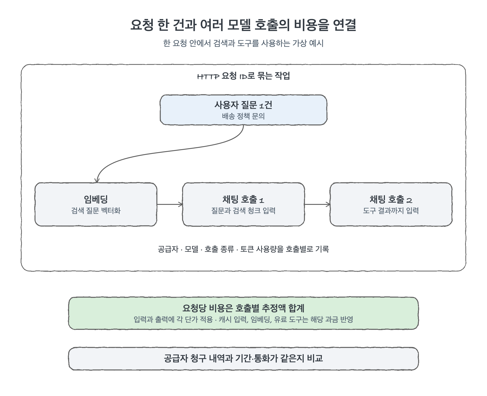

# Getting Started with LLM Cost Monitoring in Spring AI

LLM 서비스 비용은 요청 횟수뿐 아니라 모델이 읽고 생성한 토큰 수에 따라 달라진다. 같은 질문도 시스템 프롬프트, 대화 이력, RAG 검색 결과, 도구 호출이 추가되면 모델이 처리하는 양이 달라진다.

## 1. 요청과 모델 호출을 구분하기

사용자 질문 한 건을 처리하는 동안 검색용 임베딩을 만들고, 채팅 모델을 여러 번 호출할 수 있다. 요청당 비용을 계산하려면 그 요청에서 실행한 작업을 함께 집계한다. 모델별 토큰 사용량은 사용량 증가의 원인을 좁히는 데 사용한다.

그림의 근거 · [Spring AI Observability](https://docs.spring.io/spring-ai/reference/2.0/observability/index.html) · [OpenAI API 가격](https://developers.openai.com/api/docs/pricing)

| 관측 단위 | 확인할 항목 |
| --- | --- |
| HTTP 요청 | 완료 시간, 응답 상태, 요청 건수 |
| 모델 호출 | 공급자, 모델, 호출 종류, 입력·출력 토큰 |
| 검색 | 후보 수, 실제 첨부한 청크 수, 검색 시간 |
| 공급자 청구 | 모델별 가격, 캐시 적용, 청구 기간과 통화 |

텍스트 채팅의 비용을 추정할 때는 일반 입력과 출력 토큰에 각자의 단가를 적용한다. 공급자가 캐시 입력을 별도로 청구하면 해당 토큰을 일반 입력에서 분리한다. 임베딩이나 유료 도구를 사용한 경우 해당 과금도 포함하고, 집계 기간이 끝나면 공급자의 비용 내역과 비교한다. [OpenAI API 가격표](https://developers.openai.com/api/docs/pricing) · [OpenAI Prompt Caching](https://developers.openai.com/api/docs/guides/prompt-caching)

## 2. 실습용 모델 연결

[OpenAI와 Ollama 채팅 API](04_building_chat_apis_with_openai_and_ollama.md)의 프로젝트를 사용한다. OpenAI를 선택할 경우 실습 프로젝트에서 API 키를 발급하고 프로세스 환경 변수 `OPENAI_API_KEY`와 `OPENAI_CHAT_MODEL`을 설정한다. 키는 채팅 클라이언트에만 전달한다. 모니터링 조회 권한에는 키가 필요 없다. [OpenAI API Quickstart](https://developers.openai.com/api/docs/quickstart) · [OpenAI API Key Safety](https://help.openai.com/en/articles/5112595-best-practices-for-api-key-safety)

로컬에서는 Ollama 프로파일로 요청을 보내 토큰과 지연 차이를 확인할 수 있다. 이때 토큰을 OpenAI 단가로 환산한 값은 비교용이며, 로컬 추론 비용을 계산하려면 장비와 운영 비용을 별도로 반영한다.
