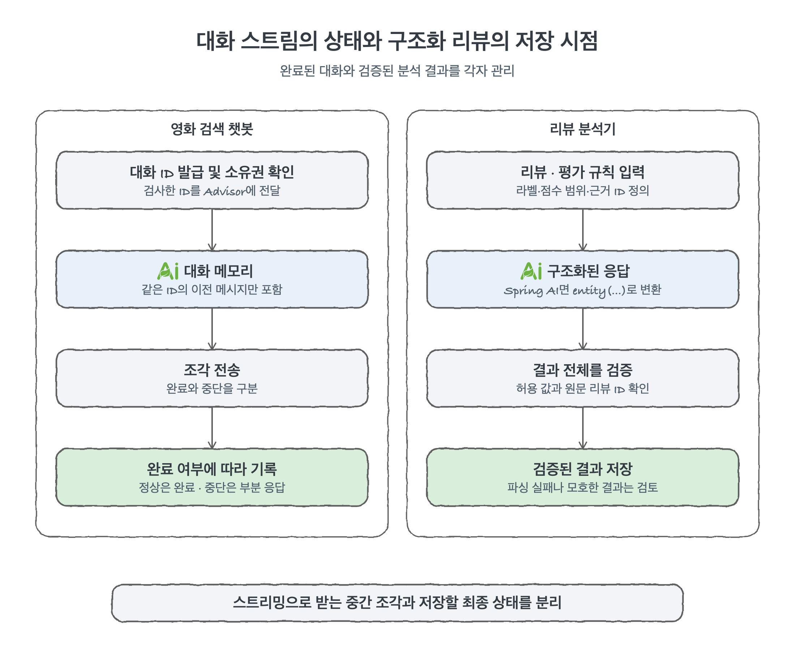

# Stateful Streaming Chat and Structured Review Analysis

영화 검색 챗봇은 이전 조건을 참고할 수 있어야 하고, 리뷰 분석기는 결과를 코드로 검증할 수 있어야 한다. 대화 상태와 리뷰 분류 결과에 서로 다른 저장·검증 정책을 둔다.

## 1. 대화 단위로 메모리 유지하기

첫 요청에서 서버가 난수 기반 대화 ID를 발급하고 호출자와의 소유 관계를 저장한다. 후속 요청에서는 소유권을 확인한 ID만 `ChatMemory.CONVERSATION_ID` 어드바이저 파라미터로 전달한다. `MessageChatMemoryAdvisor`가 메모리의 이전 메시지를 요청에 포함할 수 있다. 전체 대화 이력이 필요한 경우에는 저장 목적과 보존 기간을 정하고, 모델에 보낼 최근 대화 범위도 따로 정한다. [Spring AI · Chat Memory](https://docs.spring.io/spring-ai/reference/2.0/api/chat-memory.html)

영화를 검색하는 경우, “그중 2010년 이후 작품”처럼 이전 조건을 참조하는 요청을 같은 대화로 보내 결과가 조건을 이어받는지 확인한다. 동시에 들어온 요청의 순서가 중요하면 같은 대화 ID의 메시지 처리 순서를 제어한다. 스트림 중단 시 보낸 조각은 부분 응답으로 기록하고 다음 요청에서 완료된 답변처럼 재사용하지 않는다.

그림의 근거 · [Spring AI Chat Memory](https://docs.spring.io/spring-ai/reference/2.0/api/chat-memory.html) · [Spring AI Structured Output](https://docs.spring.io/spring-ai/reference/2.0/api/structured-output/converters.html)

## 2. 리뷰를 구조화된 결정으로 바꾸기

| 작업 | 리뷰 분석 예시 |
| --- | --- |
| 분류 | 허용 값 `POSITIVE`, `MIXED`, `NEGATIVE` 중 선택한다. |
| 점수 | 재현성 같은 항목을 사전에 작성한 루브릭의 등급으로 매긴다. |
| 참 여부 | 리뷰에 상영 자막 문제가 명시됐는지 확인한다. |

TypeSafe Jev는 이런 작업을 각각 `choice`, `score`, `noul` 타입으로 표현한다. Jev에 연결한다면 공급자 응답을 애플리케이션의 결과 타입으로 매핑한다. Spring AI 채팅 모델을 쓰는 경우 `entity(...)`로 결과를 읽을 수 있으며, 허용 라벨과 점수 범위, 인용한 리뷰 ID는 애플리케이션에서 확인한다. [TypeSafe · Jev Introduction](https://docs.typesafe.ai/introduction) · [Spring AI · Structured Output](https://docs.spring.io/spring-ai/reference/2.0/api/structured-output/converters.html)

분류를 스트리밍하는 경우 완성된 구조와 검증 결과를 얻고 나서 업무 상태를 저장한다. 테스트에는 빈 리뷰, 상충하는 리뷰, 허용 범위를 벗어난 점수, 존재하지 않는 근거 ID를 포함한다.

관련 문서 [Building Chatbots with Memory and Structured Output](05_building_chatbots_with_memory_and_structured_output.md)
