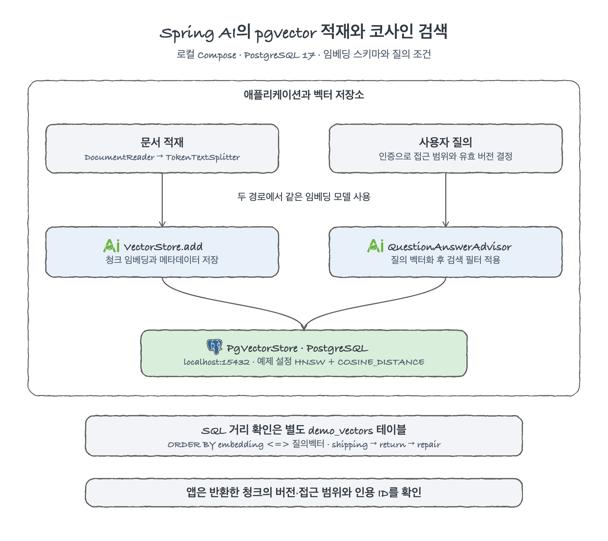

# Building Spring AI RAG with pgvector

적재는 문서의 버전이 바뀔 때 실행하고, 질의는 사용자가 질문할 때 실행한다. 두 흐름은 같은 임베딩 모델과 벡터 저장소를 사용한다. [Spring AI · ETL Pipeline](https://docs.spring.io/spring-ai/reference/2.0/api/etl-pipeline.html) · [Spring AI · PgVectorStore](https://docs.spring.io/spring-ai/reference/2.0/api/vectordbs/pgvector.html)



그림의 근거 · [Spring AI PgVectorStore](https://docs.spring.io/spring-ai/reference/2.0/api/vectordbs/pgvector.html) · [pgvector 거리 연산](https://github.com/pgvector/pgvector) · [Spring AI RAG](https://docs.spring.io/spring-ai/reference/2.0/api/retrieval-augmented-generation.html)

## 1. Docker Compose로 pgvector 실행

다음 `compose.yaml`은 로컬 실습 계정과 루프백 포트를 사용한다.

```yaml
services:
  pgvector:
    image: pgvector/pgvector:0.8.7-pg17-trixie
    environment:
      POSTGRES_DB: rag
      POSTGRES_USER: rag
      POSTGRES_PASSWORD: local-rag-demo
    ports:
      - "127.0.0.1:15432:5432"
    healthcheck:
      test: ["CMD-SHELL", "pg_isready -U rag -d rag"]
      interval: 2s
      timeout: 3s
      retries: 15
```

```bash
docker compose up -d --wait
docker compose exec -T pgvector psql -U rag -d rag -v ON_ERROR_STOP=1
```

다음 SQL은 3차원 합성 벡터로 코사인 거리 연산을 확인한다. `<=>`는 거리를 반환하므로 가까운 벡터를 먼저 얻으려면 오름차순으로 정렬한다. 예상 순서는 `shipping`, `return`, `repair`다. 이 테이블은 뒤에서 Spring AI가 관리하는 벡터 테이블과 별개다. [pgvector · Distance Operators and Docker Images](https://github.com/pgvector/pgvector)

```sql
CREATE EXTENSION IF NOT EXISTS vector;
CREATE TABLE IF NOT EXISTS demo_vectors (
    chunk_id text PRIMARY KEY,
    embedding vector(3) NOT NULL
);

INSERT INTO demo_vectors (chunk_id, embedding) VALUES
    ('shipping', '[1,0,0]'),
    ('return', '[0.8,0.2,0]'),
    ('repair', '[0,1,0]')
ON CONFLICT (chunk_id) DO UPDATE SET embedding = EXCLUDED.embedding;

SELECT chunk_id, embedding <=> '[1,0,0]'::vector AS distance
FROM demo_vectors
ORDER BY distance;
```

## 2. Spring AI 벡터 저장소 연결

Spring AI BOM을 적용한 프로젝트에 `spring-ai-starter-vector-store-pgvector`와 임베딩 모델용 스타터를 추가한다. `QuestionAnswerAdvisor`에는 `spring-ai-vector-store-advisor`를 사용한다. 다음 설정은 호스트에서 실행하는 앱 기준이다. 앱도 Compose에 띄우면 주소를 `pgvector:5432`로 바꾼다. `initialize-schema`는 로컬 개발에 사용하고, 배포 환경의 스키마·인덱스 변경은 DB 마이그레이션으로 관리한다. 임베딩의 차원이 바뀌면 새 벡터 테이블에 재색인한다. [Spring AI · PgVectorStore v2.0.2](https://github.com/spring-projects/spring-ai/blob/v2.0.2/spring-ai-docs/src/main/antora/modules/ROOT/pages/api/vectordbs/pgvector.adoc) · [Spring AI · QuestionAnswerAdvisor](https://docs.spring.io/spring-ai/reference/2.0/api/retrieval-augmented-generation.html)

```yaml
spring:
  datasource:
    url: jdbc:postgresql://localhost:15432/rag
    username: rag
    password: local-rag-demo
  ai:
    vectorstore:
      pgvector:
        initialize-schema: true
        index-type: HNSW
        distance-type: COSINE_DISTANCE
```

## 3. 적재와 질의 검증

1. `DocumentReader`에서 `Document`를 읽고 `TokenTextSplitter`로 분할한다. 문서 ID, 유효 버전, 접근 범위, 청크 ID를 메타데이터에 저장한다.
2. `VectorStore.add(...)`로 적재한다. 재적재 전에 청크 ID를 결정적으로 부여하고, 이전 버전이 계속 검색되지 않도록 조회 조건과 정리 작업을 설계한다.
3. 인증된 호출자의 접근 범위로 검색 필터를 적용한다. 질문에 대한 검색 결과를 먼저 검증하고, `QuestionAnswerAdvisor`로 검색 맥락을 모델 요청에 포함한다.
4. 검색 결과가 비거나 응답이 검색 범위 밖의 출처를 인용하면 답변을 보류한다. 문서 교체 뒤에는 새 버전만 조회되는지도 확인한다.

관련 문서 [RAG Fundamentals and Vector Store Retrieval](19_rag_fundamentals_and_vector_store_retrieval.md) · [Building RAG Chatbots with Elasticsearch](07_building_rag_chatbots_with_elasticsearch.md)
