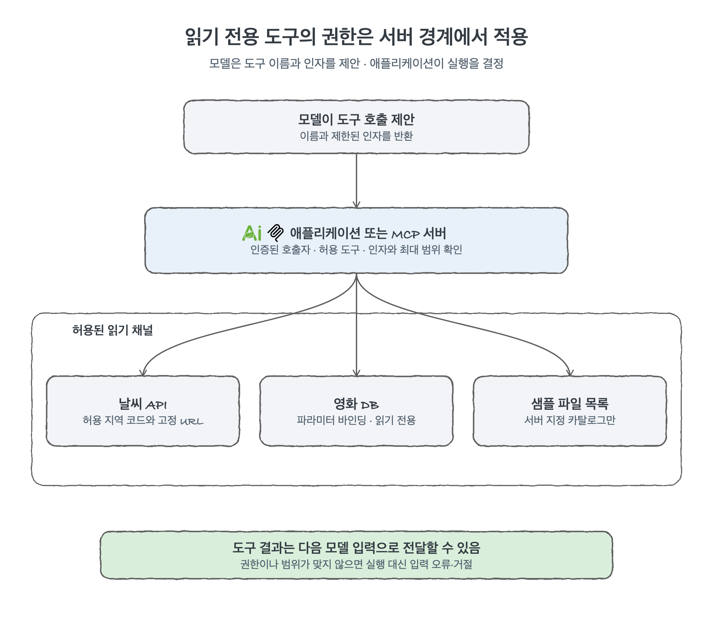

# Tool Calling and Read-Only MCP Integrations

모델이 도구의 이름과 인자를 제안하면 애플리케이션이 이를 검증하고 실행한다. 호출 결과는 모델에 다시 전달할 수 있다. Spring AI의 애플리케이션 도구나 MCP 서버 도구에 같은 입력 검증과 접근 정책을 적용한다. [Spring AI · Tool Calling](https://docs.spring.io/spring-ai/reference/2.0/api/tools.html) · [MCP · Tools](https://modelcontextprotocol.io/specification/2025-11-25/server/tools)

## 1. 읽기 전용 도구의 계약

| 도구 | 모델이 제출하는 값 | 실행 코드의 역할 |
| --- | --- | --- |
| 날씨 조회 | 지원 지역의 코드 | 미리 등록한 날씨 API로만 보내고 응답 크기와 타임아웃을 제한한다. |
| 영화 DB 조회 | 제목 검색어, 결과 개수 | 서버가 고정한 파라미터 바인딩 쿼리를 읽기 전용 계정으로 실행하고, 권한과 최대 건수를 적용한다. |
| 실습 파일 목록 | 서버가 정한 카탈로그 이름 | 미리 매핑한 샘플 디렉터리의 파일명만 반환하고 경로 입력과 심볼릭 링크는 받지 않는다. |

명령을 실행하기 전에 허용된 도구인지 확인하고, 호출자 ID와 조회 권한은 인증된 서비스에서 부여한다. 모델의 도구 인자나 반환 데이터에는 임의 URL, SQL, 호스트 파일 경로가 필요한 계약을 두지 않는다.

그림의 근거 · [MCP 도구](https://modelcontextprotocol.io/specification/2025-11-25/server/tools) · [Spring AI Tool Calling](https://docs.spring.io/spring-ai/reference/2.0/api/tools.html)

## 2. 로컬 MCP 실습 범위

파일 목록 샘플에는 공개된 가상 문서만 넣는다. 서버를 컨테이너로 실행한다면 그 디렉터리만 읽기 전용으로 마운트한다. 클라이언트가 접근할 도구를 허용 목록으로 제한하고, 애플리케이션의 결과에는 파일명과 최대 반환 개수를 포함한다. 목록이 비어 있거나 등록되지 않은 카탈로그를 받으면 각각 빈 목록이나 입력 오류를 반환한다.

도구를 한 애플리케이션에서만 쓰는 경우 서비스 코드에서 계약을 관리할 수 있다. 여러 클라이언트가 같은 계약을 쓴다면 MCP로 배포하고, 연결 설정과 도구 변경·권한 정책을 서버 경계에서 관리한다. [Model Context Protocol · Architecture](https://modelcontextprotocol.io/docs/learn/architecture)

관련 문서 [Calling External APIs with Spring AI Tools](08_calling_external_apis_with_spring_ai_tools.md) · [Building Spring AI MCP Clients and Servers](09_building_spring_ai_mcp_clients_and_servers.md)
