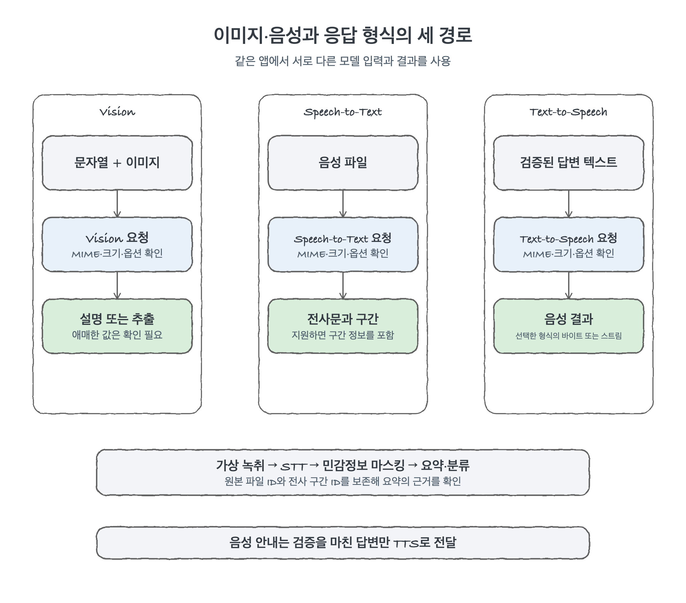

# Multimodal Image and Audio Workflows

이미지를 모델에 보여 설명을 얻는 작업, 음성을 문자로 바꾸는 STT, 텍스트를 음성으로 바꾸는 TTS는 각기 다른 응답 계약을 갖는다. 모델과 공급자를 고를 때 입력 형식, 최대 용량, 지원 언어와 출력 형식을 확인한다. [Spring AI · Multimodality](https://docs.spring.io/spring-ai/reference/2.0/api/multimodality.html)

## 1. 입력과 응답

| 기능 | 입력 | 기대 결과 |
| --- | --- | --- |
| Vision | 사용자 텍스트와 이미지 리소스 및 MIME 타입 | 이미지에 근거한 설명, 추출 결과, 판단 불가 상태 |
| Speech to Text | 음성 파일 | 전사문과 공급자 설정이 지원하는 구간 정보 |
| Text to Speech | 텍스트와 음성 옵션 | 선택한 오디오 형식의 바이트 또는 스트림 |

Vision 요청은 실제 이미지와 요청의 목적을 같은 사용자 메시지에 담는다. 이미지의 문자나 표가 흐리면 애매한 값을 추정해 확정하지 않도록 응답 계약을 둔다. 실행 전에는 파일의 실제 형식과 크기를 확인하고, 이미지·음성 처리 결과는 파일 원문과 구별해 저장한다. [Spring AI · Audio Transcriptions](https://docs.spring.io/spring-ai/reference/api/audio/transcriptions/openai-transcriptions.html) · [Spring AI · Text-to-Speech](https://docs.spring.io/spring-ai/reference/api/audio/speech/openai-speech.html)

## 2. 콜센터 녹취 분석

그림의 근거 · [Spring AI Multimodality](https://docs.spring.io/spring-ai/reference/2.0/api/multimodality.html) · [Spring AI Audio Transcriptions](https://docs.spring.io/spring-ai/reference/2.0/api/audio/transcriptions/openai-transcriptions.html) · [Spring AI Text-to-Speech](https://docs.spring.io/spring-ai/reference/2.0/api/audio/speech/openai-speech.html)

음성 파일 ID, 전사 구간 ID, 구조화 결과를 연결한다. “사용자가 배송 지연을 언급했는가”를 답할 때는 인용을 전사 구간과 대조하고, 잡음이나 화자 혼선으로 정확히 확인하기 어려우면 검토 상태를 반환한다. 음성 안내가 필요한 경우 검증된 답변만 TTS에 전달한다.

실습은 합성 음성·이미지로 검증한다. 전사와 요약의 오류를 따로 기록하고, 실제 녹취를 처리할 환경에서는 원본과 전사문 각각의 접근 권한과 보존 기간을 정한다.

관련 문서 [Stateful Streaming Chat and Structured Review Analysis](17_stateful_streaming_chat_and_structured_review_analysis.md) · [Operating AI Services with Observability and Guardrails](26_operating_ai_services_with_observability_and_guardrails.md)
