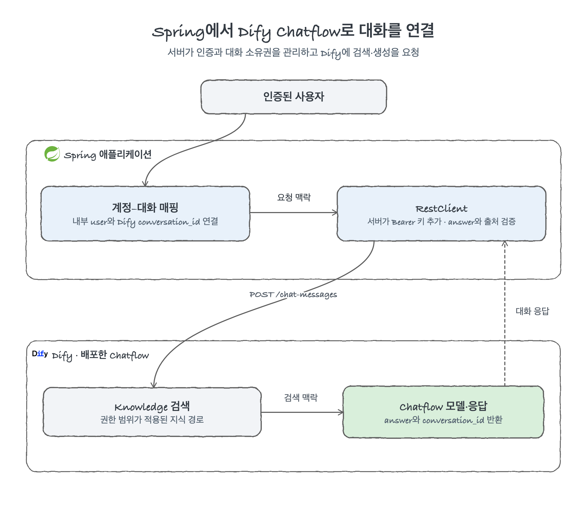

# Integrating Spring AI with Dify

Spring AI 애플리케이션에서 인증과 업무 정책을 관리하고, Dify Chatflow에는 검색·프롬프트·응답 생성의 일부를 위임할 수 있다. 대화가 필요한 앱은 Chatflow를, 정해진 입력을 받아 작업 결과를 반환하는 경우에는 Workflow를 검토한다. Dify Knowledge에 넣은 문서는 쿼리에서 사용하는 지식 검색 노드로 연결한다. [Dify · Knowledge Retrieval](https://docs.dify.ai/en/cloud/use-dify/nodes/knowledge-retrieval)

## 1. 대화 API 계약

Spring 애플리케이션의 `RestClient`가 Dify를 호출한다. 키는 서버에서 보관하고 `Authorization: Bearer` 헤더로 주입한다. 앱 설정에 필요한 `inputs`를 채운 뒤 Dify의 서비스 API 기본 URL에 `/chat-messages`를 붙여 POST한다. [Dify · Send Chat Message](https://docs.dify.ai/en/api-reference/chat-messages/send-chat-message)

```json
{
  "inputs": {},
  "query": "테스트 문서의 주문 취소 조건은 무엇인가요?",
  "response_mode": "blocking",
  "user": "demo-user-001"
}
```

Dify의 `user`에는 애플리케이션이 발급한 안정적인 식별자를 전달한다. 새 대화 응답으로 받은 `conversation_id`는 애플리케이션 계정과 매핑하고 후속 호출에 추가한다. 응답의 `answer`와 필요한 출처만 서비스 계약으로 변환한다. 스트리밍을 선택할 때는 중간 이벤트와 완료 이벤트부터 애플리케이션 상태에 매핑한다. [Dify · End-User Identity](https://docs.dify.ai/en/api-reference/guides/end-user-identity) · [Dify · Service API Specification](https://github.com/langgenius/dify-docs/blob/main/en/api-reference/openapi_service.json)



그림의 근거 · [Dify Send Chat Message](https://docs.dify.ai/en/api-reference/chat-messages/send-chat-message) · [Dify Knowledge Retrieval](https://docs.dify.ai/en/cloud/use-dify/nodes/knowledge-retrieval)

## 2. 플랫폼과 코드의 역할

| Spring 애플리케이션 | Dify |
| --- | --- |
| 요청 인증, 테넌트와 대화 소유권, 감사 기록 | 시각적으로 관리하는 대화·검색 흐름과 프롬프트 |
| 호출 한도, 장애 응답, 출력과 출처 검증 | 배포한 Chatflow와 연결한 Knowledge |

Dify의 대화 식별자와 내부 문서 접근 조건은 별개로 관리한다. 권한이 다른 데이터는 분리된 지식 집합에 저장하거나 신뢰할 수 있는 권한 인식 검색 경로를 호출한다. 로컬 검증을 위해 Dify를 Docker Compose로 실행하는 경우 합성 지식 데이터로 정상 응답, 권한 없는 질문, 대화 재개, 타임아웃을 확인한다. [Dify · Docker Compose](https://docs.dify.ai/en/self-host/deploy/quick-start/docker-compose)

관련 문서 [Designing Internal Document Assistants](27_designing_internal_document_assistants.md)
