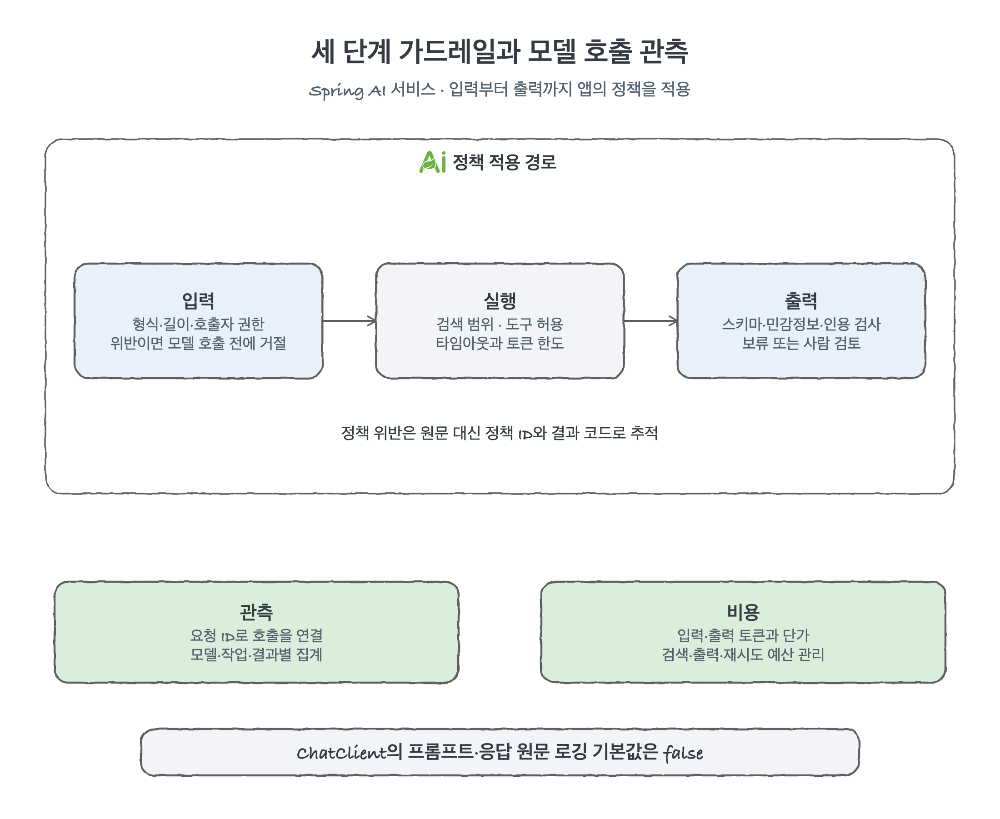

# Operating AI Services with Observability and Guardrails

운영에서는 분석할 지표, 제한할 비용, 거절하거나 보류할 요청을 각각 정한다. 요청 ID로 서비스와 공급자 호출을 연결하고, 로그에는 모델 ID, 프롬프트 버전, 토큰 수, 지연, 오류 종류를 우선 남긴다. [Spring AI · Observability](https://docs.spring.io/spring-ai/reference/2.0/observability/index.html)

## 1. 원문 로깅과 토큰 비용

Spring AI에서 `spring.ai.chat.client.observations.log-prompt`와 `spring.ai.chat.client.observations.log-completion`의 기본값은 모두 `false`다. 프롬프트·응답 원문은 필요성이 확인된 환경에서만 마스킹과 접근 제한을 적용해 수집한다. 질문이나 사용자 ID를 메트릭 태그에 붙이면 시계열 수가 급증할 수 있으므로, 지표는 모델·작업·결과 분류 같은 제한된 차원으로 집계한다. [Spring AI · Chat Client Observations](https://docs.spring.io/spring-ai/reference/2.0/observability/index.html)

입력과 출력 토큰을 구분하고, 공급자·모델·가격표 기준 시점에 따라 추정 비용을 계산한다. 캐시·도구·재시도나 제공자의 과금 단위가 다르면 실제 청구와 차이가 날 수 있다. 입력 한도, 검색 `topK`, 최대 출력, 재시도 횟수를 요청당 비용 예산과 함께 검토한다.

## 2. 가드레일을 세 단계에 배치하기

| 단계 | 확인할 내용 | 검증 방법 |
| --- | --- | --- |
| 입력 | 길이, 첨부 형식, 개인정보, 호출자 권한 | 제한 초과 및 미인증 요청이 호출 전에 거절되는지 확인한다. |
| 실행 | 검색 필터, 허용 도구 및 인자, 타임아웃·토큰 한도 | 해당 호출자가 허용된 문서와 도구에만 접근하는지 확인한다. |
| 출력 | 응답 스키마, 응답의 민감정보, 인용 근거 | 조건을 충족하지 않으면 응답을 보류하거나 검토로 전환하는지 확인한다. |

검색 문서와 도구 응답도 외부 입력으로 취급한다. 모델 출력은 앱의 권한 판정에 직접 사용하지 않고, 가드레일 실패는 정책 ID와 결과 코드로 추적한다. [OWASP · LLM Prompt Injection Prevention](https://cheatsheetseries.owasp.org/cheatsheets/LLM_Prompt_Injection_Prevention_Cheat_Sheet.html)

그림의 근거 · [Spring AI Observability](https://docs.spring.io/spring-ai/reference/2.0/observability/index.html) · [OWASP 프롬프트 인젝션 방어](https://cheatsheetseries.owasp.org/cheatsheets/LLM_Prompt_Injection_Prevention_Cheat_Sheet.html)

## 3. 배포 전 확인

처리 데이터, 공급자에게 전달하는 항목, 보존 기간과 삭제 경로를 정리한다. 운영 로그와 추적 데이터에 대한 권한, 응답 오류 대응 절차와 롤백 버전을 확인한다. 비용 급등, 공급자 오류, 근거 없는 출력이 각각 독립적으로 탐지되는지 검증한다.

관련 문서 [Measuring LLM Cost, Latency, Errors, and Quality](11_measuring_llm_cost_latency_errors_and_quality.md) · [Exposing Spring AI Metrics with Actuator](12_exposing_spring_ai_metrics_with_actuator.md)
