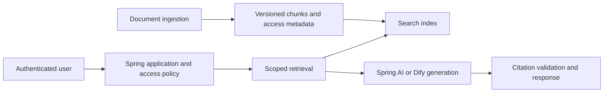

# Designing Internal Document Assistants

사내 문서 어시스턴트의 핵심 계약은 호출자가 접근할 수 있는 유효 문서에서 답을 찾아 출처를 제시하고, 충분한 근거가 없으면 답변을 보류하는 것이다. Spring AI와 Dify를 비교할 때 두 구현에 같은 문서, 권한 정책과 평가 질문을 사용한다.

## 1. 문서 적재와 질의 아키텍처

문서에는 소유 팀, 버전, 공개 범위와 청크 ID를 붙인다. 요청을 받은 Spring 애플리케이션이 인증 정보로 조회 범위를 결정한다. Dify를 응답 생성에 쓸 때도 동일한 조회 범위가 적용된 검색 결과만 전달한다. Dify가 직접 검색하는 경우 배포한 흐름의 지식 선택과 접근 범위가 동일한 조건을 충족하도록 검증한다. [Spring AI · RAG](https://docs.spring.io/spring-ai/reference/2.0/api/retrieval-augmented-generation.html) · [Dify · Knowledge Retrieval](https://docs.dify.ai/en/cloud/use-dify/nodes/knowledge-retrieval)

## 2. 구현 비교와 검증

| 설계 | 비교할 사항 |
| --- | --- |
| Spring AI | 코드로 관리하는 권한 필터, 적재 재처리, 처리 단계별 관측과 테스트 |
| Dify | 흐름 편집과 운영 인수인계, 지식 공개 범위와 API 계약 검증 |
| 함께 사용 | 애플리케이션과 플랫폼의 책임 경계, 장애·타임아웃 전파, 대화 ID 관리 |

재고 정책의 정상 질문, 답이 없는 질문, 다른 팀의 비공개 문서, 최신 버전과 폐기 버전이 섞인 질문을 검증한다. 기록에는 실제 검색·인용 ID, 보류 여부, 처리 지연, 입력 토큰을 남긴다. 설계 기록에는 접근 정책을 적용하는 위치, 문서 버전 전환 방법, 다음 실험에서 다시 볼 지표를 포함한다.

관련 문서 [Integrating Spring AI with Dify](25_integrating_spring_ai_with_dify.md) · [Tuning and Evaluating RAG Systems](21_tuning_and_evaluating_rag_systems.md)
