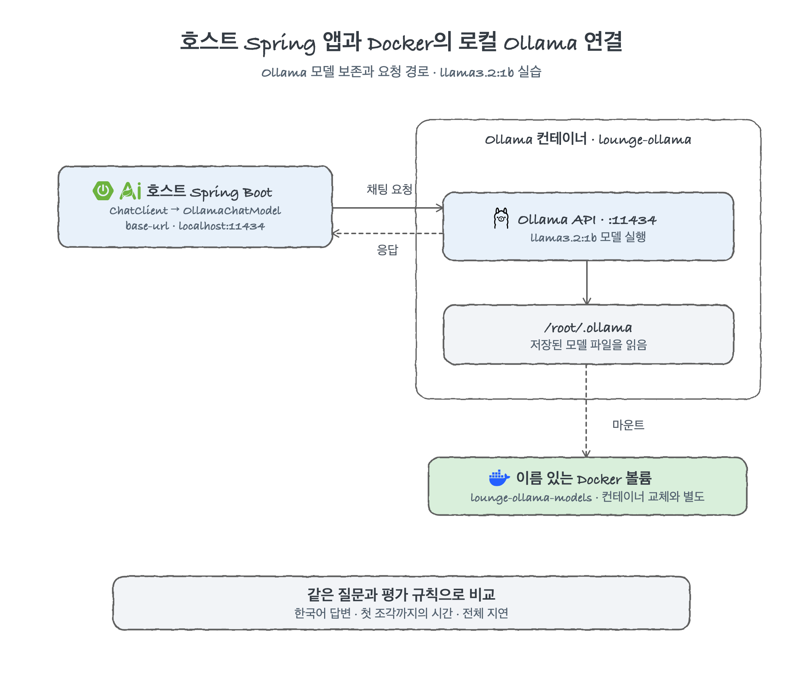

# Local LLM Workflows with Ollama and Spring AI

Ollama를 Docker에서 실행하면 외부 키 없이 로컬 채팅 모델을 연결해 프롬프트, 응답 포맷, 기본 요청 흐름을 비교할 수 있다. 모델 성능은 양자화, 컨텍스트 길이, CPU·GPU와 메모리 구성에 영향을 받으므로 같은 입력으로 벤치마크한다. [Ollama · Docker](https://docs.ollama.com/docker)

## 1. Docker에서 모델 실행하기

기존 Ollama 컨테이너가 있으면 해당 인스턴스를 사용한다. 아래 명령은 모델을 보존하는 볼륨과 호스트 루프백 포트를 사용한다. `ollama/ollama`의 기본 태그를 쓰는 개발 예제이므로, 재현용 실행 기록에는 이미지와 모델 버전을 남긴다.

```bash
docker run -d --name backend-engineering-handbook-ollama \
  -p 127.0.0.1:11434:11434 \
  -v backend-engineering-handbook-ollama-models:/root/.ollama \
  ollama/ollama
docker exec backend-engineering-handbook-ollama ollama pull llama3.2:1b
docker exec backend-engineering-handbook-ollama ollama list
```

호스트에서 실행하는 Spring 애플리케이션에 `spring-ai-starter-model-ollama`를 추가하고 다음과 같이 연결한다. 앱도 같은 Compose 네트워크에서 실행하면 `localhost` 대신 해당 서비스 이름을 지정한다. [Spring AI · Ollama Chat](https://docs.spring.io/spring-ai/reference/2.0/api/chat/ollama-chat.html)



그림의 근거 · [Ollama Docker](https://docs.ollama.com/docker) · [Spring AI Ollama Chat](https://docs.spring.io/spring-ai/reference/2.0/api/chat/ollama-chat.html)

```yaml
spring:
  ai:
    model:
      chat: ollama
    ollama:
      base-url: http://localhost:11434
      chat:
        model: "llama3.2:1b"
```

기존 `ChatClient` 기반 엔드포인트에 정상 질문과 근거가 없는 질문을 보내면서 한국어 응답, 첫 토큰까지의 시간, 전체 지연을 확인한다. 클라우드 모델과 비교할 때는 프롬프트와 입력 데이터, 답변 평가 규칙을 고정한다.

## 2. AI 도구로 개발할 때 검증 범위

코딩 도구에 변경 범위와 기존 테스트를 먼저 설명하고 작은 변경 단위로 제안을 받는다. 생성된 코드의 의존성, 외부 네트워크 호출, 환경 변수와 예외 처리를 리뷰하고, 테스트 결과가 실제 요구를 확인하는지 살핀다. 로컬 모델을 사용하는 앱과 별도 코딩 도구는 데이터 전송 설정이 다를 수 있으므로 각각 구성과 접근 범위를 확인한다.

관련 문서 [Building Chat APIs with OpenAI and Ollama](04_building_chat_apis_with_openai_and_ollama.md) · [Designing Spring AI ChatClient Services](16_designing_spring_ai_chatclient_services.md)
