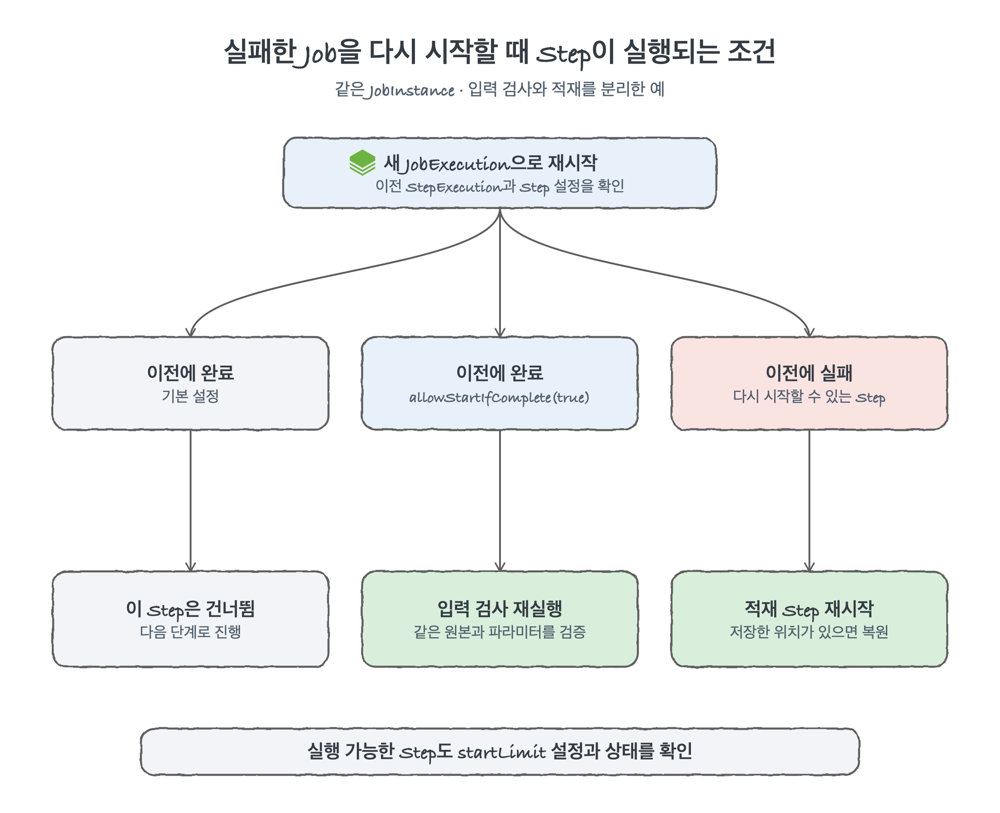

# Spring Batch Step Configuration and Restart

## 1. 단계에 맞는 실행 방식 고르기

| 방식 | 예 |
| --- | --- |
| Tasklet | 입력 검사, 임시 결과 정리처럼 단계를 한 번 또는 명시적으로 반복해 처리한다. |
| Chunk-oriented Step | 데이터를 읽고 변환한 뒤 일정 단위로 저장한다. |
| `JobStep` | 다른 Job을 독립된 Job 실행으로 호출한다. |
| `FlowStep` | 여러 단계로 구성된 Flow를 상위 Job의 한 Step으로 실행한다. |

`TaskletStep`은 `Tasklet.execute(...)`가 `RepeatStatus.FINISHED`를 반환할 때까지 호출을 반복할 수 있다. 각 호출은 단계에 구성한 트랜잭션으로 감싼다. 청크 처리도 프레임워크 내부에서 TaskletStep을 사용해 처리와 커밋의 경계를 관리한다. [Spring Batch 5.2 · TaskletStep](https://docs.spring.io/spring-batch/reference/5.2/step/tasklet.html) · [Spring Batch 5.2 · Step Flow](https://docs.spring.io/spring-batch/reference/5.2/step/controlling-flow.html)

## 2. 재시작 때 실행할 단계 지정하기

실패한 Job을 재시작하면 이전에 완료한 Step은 기본적으로 건너뛴다. 입력 검사처럼 재실행해야 하는 단계는 `allowStartIfComplete(true)`를 지정한다. `startLimit(n)`으로 같은 JobInstance에서 해당 Step을 시작할 수 있는 횟수를 제한할 수 있다. [Spring Batch 5.2 · Configuring a Step for Restart](https://docs.spring.io/spring-batch/reference/5.2/step/chunk-oriented-processing/restart.html)



그림의 근거 · [Step 재시작](https://docs.spring.io/spring-batch/reference/5.2/step/chunk-oriented-processing/restart.html) · [ItemStream](https://docs.spring.io/spring-batch/reference/5.2/readers-and-writers/item-stream.html)

```java
import org.springframework.batch.core.Step;
import org.springframework.batch.core.repository.JobRepository;
import org.springframework.batch.core.step.builder.StepBuilder;
import org.springframework.batch.core.step.tasklet.Tasklet;
import org.springframework.transaction.PlatformTransactionManager;

public class CatalogPreparation {

    public static Step step(JobRepository jobs, PlatformTransactionManager transactions, Tasklet inspect) {
        return new StepBuilder("validateCatalogInput", jobs)
                .tasklet(inspect, transactions)
                .allowStartIfComplete(true)
                .build();
    }
}
```

입력 검사 Tasklet은 다시 실행되더라도 같은 검증 결과를 낼 수 있게 구성한다. 복구에 필요한 상태는 [실행 컨텍스트](01_spring_batch_domain_model.md)에 저장하고, 파일이나 외부 시스템에 남는 결과는 반복 실행 시의 처리 규칙을 정한다.

## 3. 실행 파라미터를 늦게 바인딩하기

`@StepScope` 빈은 실행 중인 Step의 파라미터와 컨텍스트를 사용할 수 있다. 예를 들어 [CSV 리더](06_spring_batch_item_readers_and_checkpoints.md)는 `jobParameters['inputFile']`에서 파일 위치를 받는다. `@JobScope` 빈은 실행 중인 Job의 범위에 속한다. Spring Batch 5.2는 멀티스레드 또는 파티션 Step에서 Job 스코프 빈 사용을 권장하지 않는다. 파티션별 입력 값은 워커의 StepExecution 컨텍스트에 둘 수 있다. [Spring Batch 5.2 · Late Binding](https://docs.spring.io/spring-batch/reference/5.2/step/late-binding.html)
