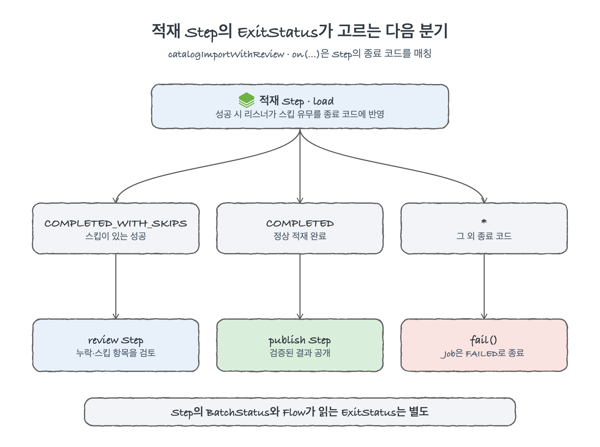

# Spring Batch Flow and Conditional Transitions

## 1. 상태 코드로 다음 단계 선택하기

| 상태 | 사용 위치 |
| --- | --- |
| `BatchStatus` | 실행 자체의 상태. 예를 들어 `STARTED`, `COMPLETED`, `FAILED`다. |
| `ExitStatus` | Step 또는 Job이 종료하면서 전달한 결과 코드. `on(...)`에서 Step의 종료 코드를 매치한다. |
| `FlowExecutionStatus` | Flow의 판단 지점에서 반환하는 상태. `JobExecutionDecider`에서 사용할 수 있다. |

`JobExecutionDecider`는 실행 정보나 컨텍스트를 읽어 `EMPTY` 같은 결과를 반환할 수 있다. 단순한 실행 결과 분기는 `ExitStatus`로 연결하고, 여러 값에 근거한 판단은 Decider로 분리할 수 있다. [Spring Batch 5.2 · Controlling Step Flow](https://docs.spring.io/spring-batch/reference/5.2/step/controlling-flow.html)

## 2. 스킵이 있으면 검토로 보내기

[Step 리스너](11_spring_batch_execution_listeners.md)에서 스킵이 있는 성공 결과를 `COMPLETED_WITH_SKIPS`로 지정한다. Flow는 이 코드를 검토 Step으로 연결한다. 와일드카드 분기는 명시한 성공 코드 이외의 결과를 실패로 처리한다.



그림의 근거 · [Step 흐름 제어](https://docs.spring.io/spring-batch/reference/5.2/step/controlling-flow.html) · [Step 리스너](https://docs.spring.io/spring-batch/reference/5.2/step/chunk-oriented-processing/intercepting-execution.html)

```java
import org.springframework.batch.core.Job;
import org.springframework.batch.core.Step;
import org.springframework.batch.core.job.builder.JobBuilder;
import org.springframework.batch.core.repository.JobRepository;

public class CatalogFlowPlan {

    public static Job create(JobRepository jobs, Step load, Step review, Step publish) {
        return new JobBuilder("catalogImportWithReview", jobs)
                .start(load).on("COMPLETED_WITH_SKIPS").to(review)
                .from(load).on("COMPLETED").to(publish)
                .from(load).on("*").fail()
                .end()
                .build();
    }
}
```

## 3. Job을 어떻게 끝낼지 정하기

| 흐름의 종료 동작 | Job에서의 의미 |
| --- | --- |
| `end()`를 종료 전이로 사용 | Job을 완료 처리한다. 실패 Step에서 이 전이를 사용해도 Job은 완료 상태가 된다. |
| `fail()` | Job을 실패로 표시한다. 구성에 따라 재시작할 수 있다. |
| `stopAndRestart(step)` | Job을 중지로 표시하고 이어서 실행할 위치를 지정한다. |

예제 맨 아래의 `.end()`는 Job Flow 빌더의 구성을 닫는다. 결과에 따라 완료 상태를 지정할 때는 해당 전이의 `.on(...).end()`를 사용한다. 재사용하는 단계 묶음은 `FlowBuilder`로 정의해 Job에 삽입하거나 `FlowStep`으로 감쌀 수 있다. [Spring Batch 5.2 · Ending a Flow and Externalizing Flow Definitions](https://docs.spring.io/spring-batch/reference/5.2/step/controlling-flow.html)
