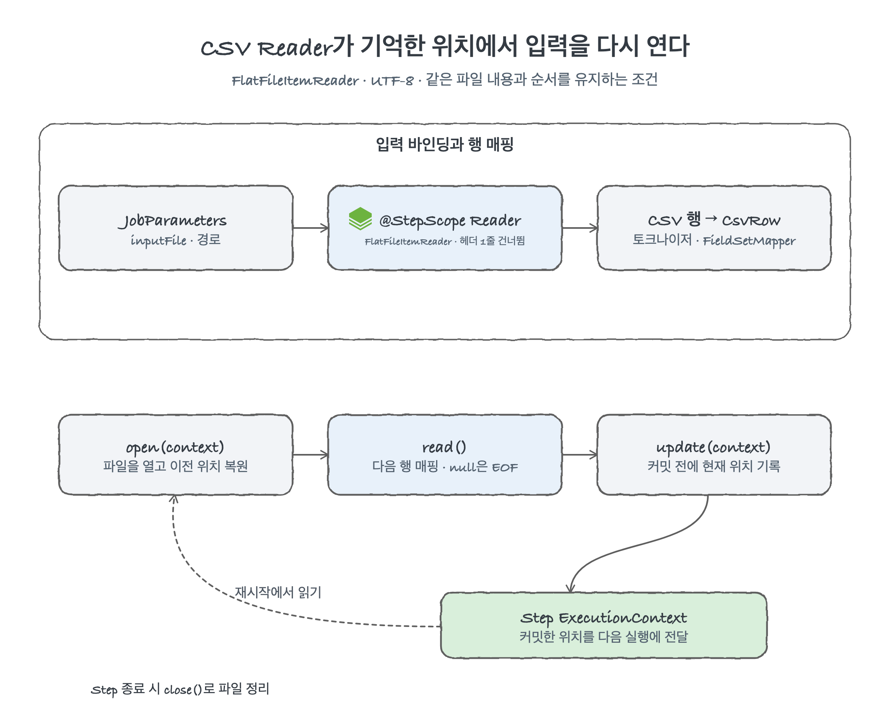

# Spring Batch Item Readers and Checkpoints

## 1. 입력 형식에 맞는 리더 고르기

`ItemReader.read()`는 다음 항목을 반환한다. `null`은 입력이 끝났다는 신호다. 특정 항목을 결과에서 제외하는 정책은 [프로세서](08_spring_batch_item_processing_and_filtering.md)에서 다룬다. [Spring Batch 5.2 · Item Reader and Writer Implementations](https://docs.spring.io/spring-batch/reference/5.2/readers-and-writers/item-reader-writer-implementations.html)

| 입력 | 리더와 고려 사항 |
| --- | --- |
| 구분자 또는 고정폭 파일 | `FlatFileItemReader`와 토크나이저를 선택하고, 인코딩과 헤더를 지정한다. |
| XML, JSON | `StaxEventItemReader` 또는 `JsonItemReader`에서 항목 단위를 지정한다. |
| DB 커서 | `JdbcCursorItemReader` 등으로 커서를 열고 순차 조회한다. 커서와 연결의 사용 시간을 고려한다. |
| DB 페이징 | `JdbcPagingItemReader` 또는 `JpaPagingItemReader`로 페이지를 읽는다. 유일하고 안정적인 정렬 키로 조회 순서를 고정한다. |
| 기존 서비스를 통한 조회 | `ItemReaderAdapter`로 기존 메서드를 연결할 수 있다. 메서드가 입력 종료를 알릴 수 있어야 한다. |

[Spring Batch 5.2 · FlatFileItemReader](https://docs.spring.io/spring-batch/reference/5.2/readers-and-writers/flat-files/file-item-reader.html) · [Spring Batch 5.2 · Database](https://docs.spring.io/spring-batch/reference/5.2/readers-and-writers/database.html) · [Spring Batch 5.2 · XML](https://docs.spring.io/spring-batch/reference/5.2/readers-and-writers/xml-reading-writing.html) · [Spring Batch 5.2 · JSON](https://docs.spring.io/spring-batch/reference/5.2/readers-and-writers/json-reading-writing.html)

## 2. 카탈로그 CSV 읽기

예제는 `sku,name,priceCents,active` 헤더가 있는 UTF-8 파일을 읽는다. Spring 빈으로 노출할 때 `@StepScope`와 `@Value("#{jobParameters['inputFile']}")`로 파일 위치를 받으면 실행마다 입력을 선택할 수 있다. 반환 타입을 `FlatFileItemReader` 같은 구체 타입으로 선언하면 스코프 프록시가 `ItemStream` 계약도 노출할 수 있다. [Spring Batch 5.2 · FlatFileItemReader](https://docs.spring.io/spring-batch/reference/5.2/readers-and-writers/flat-files/file-item-reader.html) · [Spring Batch 5.2 · Late Binding](https://docs.spring.io/spring-batch/reference/5.2/step/late-binding.html)

```java
import org.springframework.batch.item.file.FlatFileItemReader;
import org.springframework.batch.item.file.builder.FlatFileItemReaderBuilder;
import org.springframework.core.io.Resource;

public class CatalogCsvReaders {

    public static FlatFileItemReader<CatalogChunk.CsvRow> from(Resource csv) {
        return new FlatFileItemReaderBuilder<CatalogChunk.CsvRow>()
                .name("catalogCsvReader")
                .resource(csv)
                .linesToSkip(1)
                .encoding("UTF-8")
                .delimited()
                .names("sku", "name", "priceCents", "active")
                .fieldSetMapper(fields -> {
                    String active = fields.readString("active");
                    if (!"true".equalsIgnoreCase(active) && !"false".equalsIgnoreCase(active)) {
                        throw new IllegalArgumentException("active must be true or false");
                    }
                    return new CatalogChunk.CsvRow(fields.readString("sku"), fields.readString("name"),
                            fields.readLong("priceCents"), Boolean.parseBoolean(active));
                })
                .build();
    }
}
```

## 3. 입력 상태를 이어서 사용하기

파일 파싱 오류는 행 번호와 함께 `FlatFileParseException`으로 나타날 수 있다. [스킵 정책](09_spring_batch_repeat_retry_and_skip.md)에서 건별로 처리할 오류를 정한다. 재시작할 때는 같은 파일 내용과 순서를 유지한다. 여러 파일을 처리한다면 파일 집합과 정렬도 고정한다. 커스텀 래퍼가 내부 리더의 `ItemStream`을 노출하지 않으면 Step에 별도로 등록해 수명주기를 연결한다. [Spring Batch 5.2 · Flat File Exception Handling](https://docs.spring.io/spring-batch/reference/5.2/readers-and-writers/flat-files/file-item-reader.html) · [Spring Batch 5.2 · ItemStream](https://docs.spring.io/spring-batch/reference/5.2/readers-and-writers/item-stream.html)



그림의 근거 · [ItemStream](https://docs.spring.io/spring-batch/reference/5.2/readers-and-writers/item-stream.html) · [FlatFileItemReader](https://docs.spring.io/spring-batch/reference/5.2/readers-and-writers/flat-files/file-item-reader.html) · [Late Binding](https://docs.spring.io/spring-batch/reference/5.2/step/late-binding.html)
