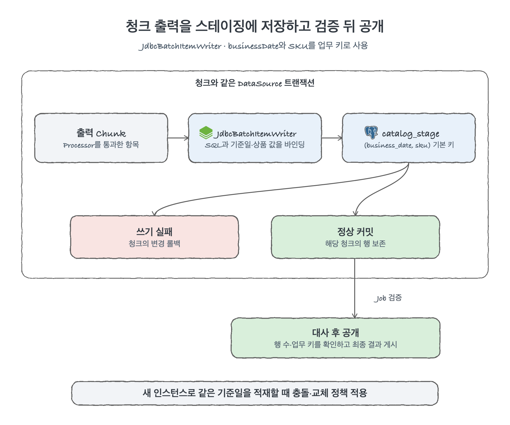

# Spring Batch Item Writers and Output

## 1. 청크에서 출력 항목 받기

Spring Batch 5.2에서 `ItemWriter.write(...)`는 `Chunk<? extends T>`를 받는다. 프로세서에서 모든 항목을 걸러낸 경우를 고려해 비어 있는 청크도 처리할 수 있어야 한다. Writer가 DB 트랜잭션에 참여하면 해당 청크의 쓰기 결과는 커밋이나 롤백에 맞춰 확정된다. [Spring Batch 5.2 · Item Processing and Writing](https://docs.spring.io/spring-batch/reference/5.2/processor.html) · [Spring Batch 5.2 · Chunk-oriented Processing](https://docs.spring.io/spring-batch/reference/5.2/step/chunk-oriented-processing.html)

| 출력 | Writer 예 |
| --- | --- |
| 구분자 또는 고정폭 파일 | `FlatFileItemWriter`와 `LineAggregator` |
| XML, JSON | `StaxEventItemWriter` 또는 `JsonFileItemWriter` |
| DB에 여러 행 기록 | `JdbcBatchItemWriter`로 SQL과 파라미터를 바인딩 |
| JPA 엔티티 저장 | `JpaItemWriter`로 엔티티를 반영하고 플러시 |
| 기존 서비스 또는 여러 목적지 | `ItemWriterAdapter`로 위임하거나 `CompositeItemWriter`로 여러 Writer에 전달 |

[Spring Batch 5.2 · FlatFileItemWriter](https://docs.spring.io/spring-batch/reference/5.2/readers-and-writers/flat-files/file-item-writer.html) · [Spring Batch 5.2 · Database Writers](https://docs.spring.io/spring-batch/reference/5.2/readers-and-writers/database.html) · [Spring Batch 5.2 · Reader and Writer Implementations](https://docs.spring.io/spring-batch/reference/5.2/readers-and-writers/item-reader-writer-implementations.html)

## 2. 기준일별 카탈로그를 스테이징에 쓰기

다음 예제는 단계와 같은 트랜잭션에 참여하는 `DataSource`를 사용한다. `businessDate`는 문서의 [Job 파라미터](02_spring_batch_job_configuration_and_execution.md)에서 전달한다.



그림의 근거 · [DB Reader와 Writer](https://docs.spring.io/spring-batch/reference/5.2/readers-and-writers/database.html) · [청크 처리](https://docs.spring.io/spring-batch/reference/5.2/step/chunk-oriented-processing.html) · [롤백 제어](https://docs.spring.io/spring-batch/reference/5.2/step/chunk-oriented-processing/controlling-rollback.html)

```sql
CREATE TABLE catalog_stage (
    business_date DATE NOT NULL,
    sku VARCHAR(64) NOT NULL,
    name VARCHAR(200) NOT NULL,
    price_cents BIGINT NOT NULL,
    PRIMARY KEY (business_date, sku)
);
```

```java
import java.time.LocalDate;
import javax.sql.DataSource;

import org.springframework.batch.item.database.JdbcBatchItemWriter;
import org.springframework.batch.item.database.builder.JdbcBatchItemWriterBuilder;

public class CatalogWriters {

    public static JdbcBatchItemWriter<CatalogChunk.Entry> staging(DataSource dataSource,
                                                                  LocalDate businessDate) {
        return new JdbcBatchItemWriterBuilder<CatalogChunk.Entry>()
                .dataSource(dataSource)
                .sql("INSERT INTO catalog_stage (business_date, sku, name, price_cents) VALUES (?, ?, ?, ?)")
                .itemPreparedStatementSetter((item, statement) -> {
                    statement.setObject(1, businessDate);
                    statement.setString(2, item.sku());
                    statement.setString(3, item.name());
                    statement.setLong(4, item.priceCents());
                })
                .build();
    }
}
```

## 3. 재실행과 출력 공개 규칙 정하기

같은 기준일을 새 인스턴스로 다시 적재하는 경우 기존 행과의 충돌을 어떻게 처리할지 정한다. 전체 교체라면 스테이징을 분리한 뒤 검증한 결과를 공개할 수 있다. 파일 출력에서는 재시작 시 이어 쓸 위치와 결과 파일의 공개 시점을 정한다. HTTP 서비스나 트랜잭션이 분리된 다른 저장소에 쓰는 경우 각각의 실패와 재실행에서 중복이 남지 않도록 처리한다. [Spring Batch 5.2 · FlatFileItemWriter의 재시작과 파일 설정](https://docs.spring.io/spring-batch/reference/5.2/readers-and-writers/flat-files/file-item-writer.html) · [Spring Batch 5.2 · Controlling Rollback](https://docs.spring.io/spring-batch/reference/5.2/step/chunk-oriented-processing/controlling-rollback.html)
