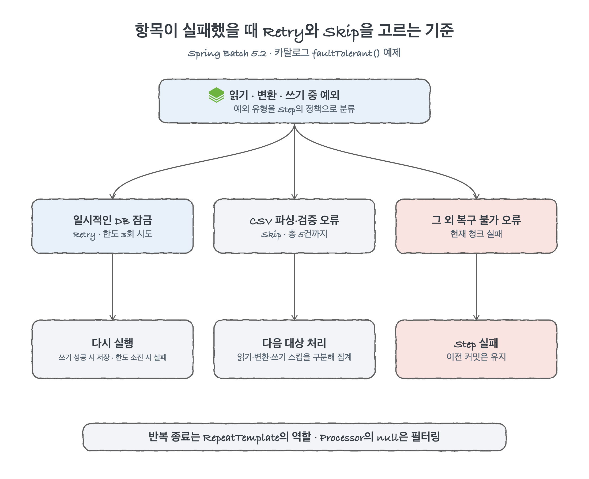

# Spring Batch Repeat, Retry, and Skip

## 1. 반복을 끝내는 조건 정하기

`RepeatTemplate`은 콜백의 `RepeatStatus`와 `CompletionPolicy`를 사용해 반복할 범위를 정한다. 청크 Step에서 커밋 간격은 한 번의 트랜잭션에 읽을 입력 단위를 정하는 데 쓰인다. 반복 정책에 연결하는 `ExceptionHandler`는 반복 중의 예외를 처리한다. 개별 항목의 실패를 다시 시도하거나 제외할 때는 Step의 오류 허용 정책을 사용한다. [Spring Batch 5.2 · Repeat](https://docs.spring.io/spring-batch/reference/5.2/repeat.html) · [Spring Batch 5.2 · Configuring a Step](https://docs.spring.io/spring-batch/reference/5.2/step/chunk-oriented-processing/configuring.html)

## 2. 다시 시도할 오류와 건너뛸 오류 구분하기

| 상황 | 정책 |
| --- | --- |
| 간헐적인 DB 잠금 실패 | 재시도할 예외와 시도 한도를 지정한다. |
| CSV 한 행의 파싱 또는 검증 실패 | 해당 오류를 스킵 대상으로 지정하고 허용 건수를 제한한다. |
| 테이블 누락이나 연결 설정 오류 | 실행을 실패시켜 설정을 점검한다. |
| 비활성 상품처럼 정책상 출력에서 제외할 항목 | 프로세서에서 `null`을 반환해 필터링으로 집계한다. |

다음 Step은 일시적인 잠금 실패를 재시도하고, 파싱과 행 검증 오류는 스킵한다. 읽기·변환·쓰기 스킵 건수는 따로 기록되지만 `skipLimit(5)`는 합계에 적용된다. `retryLimit(3)`은 최초 시도를 포함한 시도 한도다. [Spring Batch 5.2 · Skip Logic](https://docs.spring.io/spring-batch/reference/5.2/step/chunk-oriented-processing/configuring-skip.html) · [Spring Batch 5.2 · Retry Logic](https://docs.spring.io/spring-batch/reference/5.2/step/chunk-oriented-processing/retry-logic.html) · [Spring Batch 5.2.2 API · FaultTolerantStepBuilder](https://docs.spring.io/spring-batch/docs/5.2.2/api/org/springframework/batch/core/step/builder/FaultTolerantStepBuilder.html)



그림의 근거 · [Step Retry 정책](https://docs.spring.io/spring-batch/reference/5.2/step/chunk-oriented-processing/retry-logic.html) · [Step Skip 정책](https://docs.spring.io/spring-batch/reference/5.2/step/chunk-oriented-processing/configuring-skip.html) · [5.2.2 FaultTolerantStepBuilder 소스](https://github.com/spring-projects/spring-batch/blob/v5.2.2/spring-batch-core/src/main/java/org/springframework/batch/core/step/builder/FaultTolerantStepBuilder.java)

```java
import org.springframework.batch.core.Step;
import org.springframework.batch.core.repository.JobRepository;
import org.springframework.batch.core.step.builder.StepBuilder;
import org.springframework.batch.item.ItemReader;
import org.springframework.batch.item.ItemWriter;
import org.springframework.batch.item.file.FlatFileParseException;
import org.springframework.dao.PessimisticLockingFailureException;
import org.springframework.transaction.PlatformTransactionManager;

public class CatalogFaultTolerance {

    public static Step step(JobRepository jobs, PlatformTransactionManager transactions,
                            ItemReader<CatalogChunk.CsvRow> reader, ItemWriter<CatalogChunk.Entry> writer) {
        return new StepBuilder("loadCatalogWithSkips", jobs)
                .<CatalogChunk.CsvRow, CatalogChunk.Entry>chunk(100, transactions)
                .reader(reader)
                .processor(new CatalogProcessor())
                .writer(writer)
                .faultTolerant()
                .skip(FlatFileParseException.class)
                .skip(CatalogProcessor.InvalidCatalogRowException.class)
                .skipLimit(5)
                .retry(PessimisticLockingFailureException.class)
                .retryLimit(3)
                .listener(new CatalogSkipExitStatus())
                .build();
    }
}
```

[리스너](11_spring_batch_execution_listeners.md)는 허용한 스킵이 있는 성공을 `COMPLETED_WITH_SKIPS`로 표시한다. 쓰기 실패는 기본적으로 트랜잭션 롤백을 유발한다. `noRollback(...)`은 일부 예외에서 롤백 방식을 조정하는 옵션이므로 읽기·쓰기 자원의 상태와 복구 동작을 함께 테스트한다. [Spring Batch 5.2 · Controlling Rollback](https://docs.spring.io/spring-batch/reference/5.2/step/chunk-oriented-processing/controlling-rollback.html)
