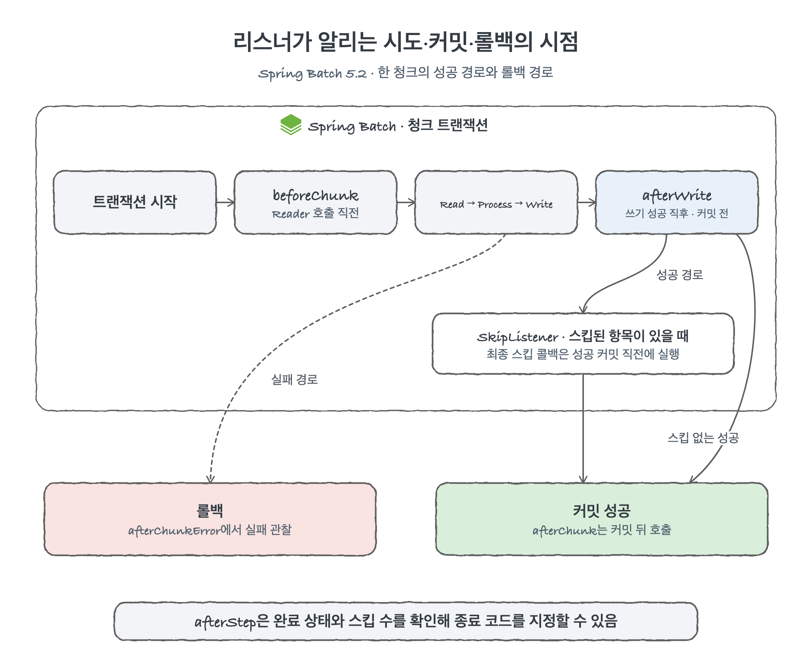

# Spring Batch Execution Listeners

## 1. 관찰 범위에 맞는 리스너 고르기

| 리스너 | 사용할 때 |
| --- | --- |
| `JobExecutionListener` | Job 전체 시작·종료, 최종 상태와 소요 시간 |
| `StepExecutionListener` | Step 시작·종료, 처리 건수, 종료 코드 |
| `ChunkListener` | 청크 시작, 커밋, 롤백 관찰 |
| `ItemReadListener`, `ItemProcessListener`, `ItemWriteListener` | 읽기·변환·쓰기 단계에서 발생한 호출이나 오류 관찰 |
| `SkipListener` | 최종적으로 스킵된 항목이나 읽기 오류 처리 |
| Spring Retry의 `RetryListener` | 재시도 컨텍스트와 개별 실패 시도 관찰 |

청크의 `beforeChunk()`는 트랜잭션이 시작된 뒤 읽기 전에 호출되고, `afterChunk()`는 커밋 뒤에 호출된다. `ItemWriteListener.afterWrite(...)`는 쓰기 호출 성공 뒤, 트랜잭션 커밋 전에 실행된다. 실패한 시도와 커밋된 기록을 구분하려면 사용하는 리스너의 호출 시점을 확인한다. [Spring Batch 5.2 · Intercepting Step Execution](https://docs.spring.io/spring-batch/reference/5.2/step/chunk-oriented-processing/intercepting-execution.html) · [Spring Batch 5.2.2 API · ChunkListener](https://docs.spring.io/spring-batch/docs/5.2.2/api/org/springframework/batch/core/ChunkListener.html)



그림의 근거 · [Step 리스너](https://docs.spring.io/spring-batch/reference/5.2/step/chunk-oriented-processing/intercepting-execution.html) · [5.2.2 TaskletStep 소스](https://github.com/spring-projects/spring-batch/blob/v5.2.2/spring-batch-core/src/main/java/org/springframework/batch/core/step/tasklet/TaskletStep.java)

## 2. 스킵 결과로 Flow 분기하기

아래 리스너는 Step이 성공했고 스킵이 있는 경우에만 종료 코드를 추가한다. [스킵을 허용하는 Step](09_spring_batch_repeat_retry_and_skip.md)에 `listener(...)`로 등록하면 [조건 분기 Flow](04_spring_batch_flow_and_conditional_transitions.md)에서 검토 Step으로 보낼 수 있다.

```java
import org.springframework.batch.core.BatchStatus;
import org.springframework.batch.core.ExitStatus;
import org.springframework.batch.core.StepExecution;
import org.springframework.batch.core.StepExecutionListener;

public class CatalogSkipExitStatus implements StepExecutionListener {

    @Override
    public ExitStatus afterStep(StepExecution execution) {
        if (execution.getStatus() == BatchStatus.COMPLETED && execution.getSkipCount() > 0) {
            return new ExitStatus("COMPLETED_WITH_SKIPS");
        }
        return null;
    }
}
```

## 3. 처리 시도와 최종 스킵을 구분하기

읽기·변환·쓰기 예외를 알리는 리스너는 재시도할 실패에서도 호출될 수 있다. 제외된 행을 기록하려면 `SkipListener`를 사용할 수 있다. 프레임워크는 스킵 콜백을 트랜잭션 커밋 직전에 호출하도록 구성한다. 외부 시스템으로 내보내는 기록에는 자체 재실행 규칙을 두고, 실패 대응에 필요한 작업과 로그·지표 수집을 구분한다. [Spring Batch 5.2 · SkipListener and Transactions](https://docs.spring.io/spring-batch/reference/5.2/step/chunk-oriented-processing/intercepting-execution.html)
