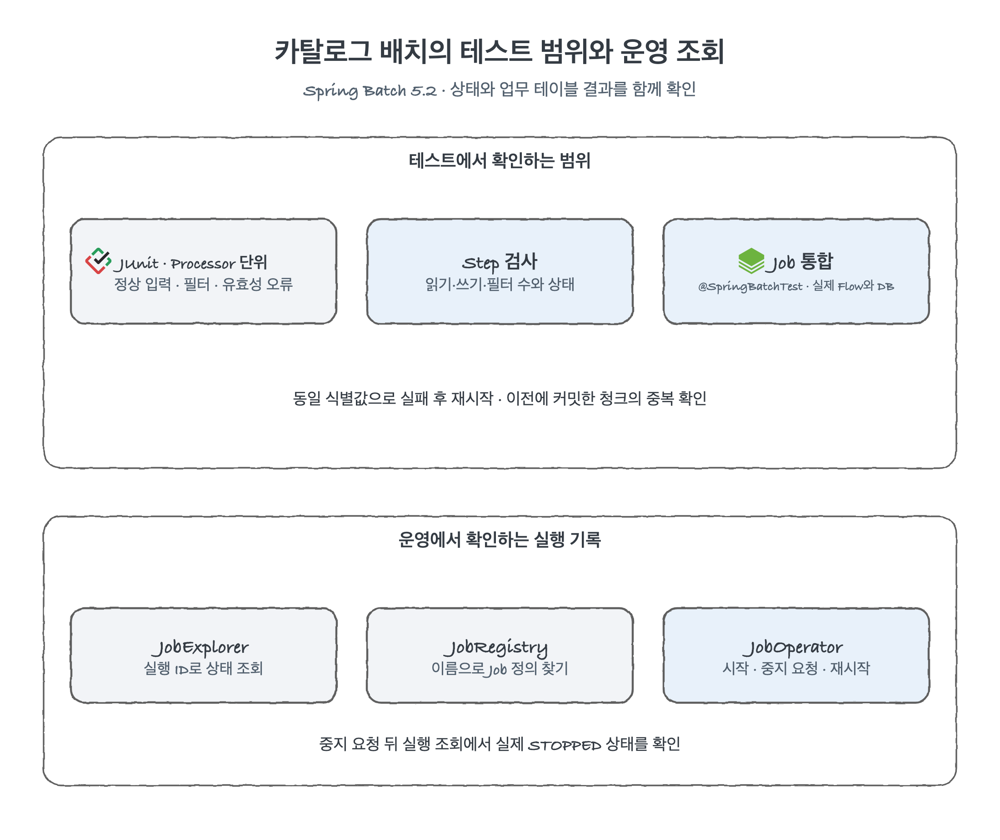

# Spring Batch Testing and Operations

## 1. 어떤 단위로 테스트할지 정하기

프로세서는 대표 입력만으로 필터링과 검증을 테스트할 수 있다. Job 통합 테스트는 메타데이터 저장소와 대상 테이블을 준비한 뒤 실제 실행 결과를 조회한다. 성공 여부에 더해 읽기·필터·쓰기 건수와 저장된 행을 확인한다. 재시작 테스트는 같은 식별 파라미터로 실패를 재현한 뒤 다시 실행해, 커밋한 이전 청크가 중복 처리되지 않는지 확인한다. [Spring Batch 5.2 · Unit Testing](https://docs.spring.io/spring-batch/reference/5.2/testing.html) · [배치 저장소 통합 테스트](../spring-db/08_spring_data_access_integration_testing.md)



그림의 근거 · [Spring Batch 테스트](https://docs.spring.io/spring-batch/reference/5.2/testing.html) · [메타데이터 운영 API](https://docs.spring.io/spring-batch/reference/5.2/job/advanced-meta-data.html)

## 2. 가져오기 Job 실행 테스트

`spring-batch-test`를 추가하면 `@SpringBatchTest`에서 `JobLauncherTestUtils`와 `JobRepositoryTestUtils`를 사용할 수 있다. 아래 테스트는 [Job](02_spring_batch_job_configuration_and_execution.md), 실행 파라미터로 생성하는 [Reader](06_spring_batch_item_readers_and_checkpoints.md)와 [Writer](07_spring_batch_item_writers_and_output.md)를 등록한 Boot 테스트 구성을 전제로 한다. `catalog_stage` 테이블은 테스트 데이터베이스에 초기화한다. [Spring Batch 5.2 · Testing a Job](https://docs.spring.io/spring-batch/reference/5.2/testing.html)

```java
import java.nio.file.Files;
import java.nio.file.Path;
import java.time.LocalDate;
import java.util.List;

import org.junit.jupiter.api.Test;
import org.junit.jupiter.api.io.TempDir;
import org.springframework.batch.core.BatchStatus;
import org.springframework.batch.core.Job;
import org.springframework.batch.core.JobParametersBuilder;
import org.springframework.batch.core.StepExecution;
import org.springframework.batch.test.JobLauncherTestUtils;
import org.springframework.batch.test.context.SpringBatchTest;
import org.springframework.beans.factory.annotation.Autowired;
import org.springframework.beans.factory.annotation.Qualifier;
import org.springframework.boot.test.context.SpringBootTest;
import org.springframework.jdbc.core.JdbcTemplate;

import static org.junit.jupiter.api.Assertions.assertEquals;

@SpringBatchTest
@SpringBootTest(properties = "spring.batch.job.enabled=false")
class CatalogImportJobTest {

    @Autowired
    JobLauncherTestUtils launcher;

    @Autowired
    @Qualifier("catalogImport")
    Job job;

    @Autowired
    JdbcTemplate jdbc;

    @TempDir
    Path temporary;

    @Test
    void writesOnlyActiveRows() throws Exception {
        Path csv = temporary.resolve("catalog.csv");
        Files.writeString(csv, """
                sku,name,priceCents,active
                LAMP-01,Desk lamp,2500,true
                OLD-01,Old catalog entry,1200,false
                """);
        var day = LocalDate.of(2026, 2, 1);
        var parameters = new JobParametersBuilder()
                .addLocalDate("businessDate", day)
                .addString("inputFile", csv.toString())
                .toJobParameters();

        launcher.setJob(job);
        var execution = launcher.launchJob(parameters);

        assertEquals(BatchStatus.COMPLETED, execution.getStatus());
        assertEquals(1L, execution.getStepExecutions().stream().mapToLong(StepExecution::getFilterCount).sum());
        assertEquals(List.of("LAMP-01"), jdbc.queryForList(
                "SELECT sku FROM catalog_stage WHERE business_date = ? ORDER BY sku", String.class, day));
    }
}
```

필수 파라미터가 있는 Job은 테스트에서도 같은 계약으로 값을 제공한다. Step만 확인할 때는 `launchStep(...)`을 사용할 수 있다. 테스트 메타데이터와 사업 데이터는 운영 저장소와 분리하고 테스트마다 필요한 범위만 초기화한다. [Spring Batch 5.2 · Testing Individual Steps](https://docs.spring.io/spring-batch/reference/5.2/testing.html)

## 3. 실행 조회, 중지, 재시작

| 구성 요소 | 운영에서의 역할 |
| --- | --- |
| `JobExplorer` | 실행 ID로 상태, 마지막 Step, 건수 정보를 조회한다. |
| `JobRegistry` | 실행 가능한 Job을 이름으로 찾는다. |
| `JobOperator` | 실행 시작이나 중지·재시작 등 작업을 요청한다. |

`stop(executionId)`의 성공 반환은 중지 요청이 전달됐다는 뜻이다. 실제 `STOPPED` 상태는 별도로 확인한다. 재시작 전에는 실패 단계와 원래 식별 파라미터, 입력 가용성을 확인한다. 처리 시간과 실패율에 더해 스킵 수, 마지막 성공한 기준일, 남아 있는 미처리 대상도 운영 지표로 사용할 수 있다. [Spring Batch 5.2 · Advanced Metadata Usage](https://docs.spring.io/spring-batch/reference/5.2/job/advanced-meta-data.html) · [Spring Batch 5.2 · Monitoring and Metrics](https://docs.spring.io/spring-batch/reference/5.2/monitoring-and-metrics.html)

Boot가 배치를 자동 구성하면 단일 Job이 시작할 때 실행될 수 있다. Job 빈이 여러 개라면 `spring.batch.job.name`으로 선택하고, 스케줄러나 테스트에서 명시적으로 시작할 때는 `spring.batch.job.enabled=false`를 사용한다. `@EnableBatchProcessing`으로 수동 구성하면 Boot의 배치 스키마 초기화도 물러나므로 메타데이터 스키마를 별도로 준비한다. [Spring Boot 3.5 · Batch Applications](https://docs.spring.io/spring-boot/3.5/how-to/batch.html) · [Spring Boot 3.5 · Database Initialization](https://docs.spring.io/spring-boot/3.5/how-to/data-initialization.html)
