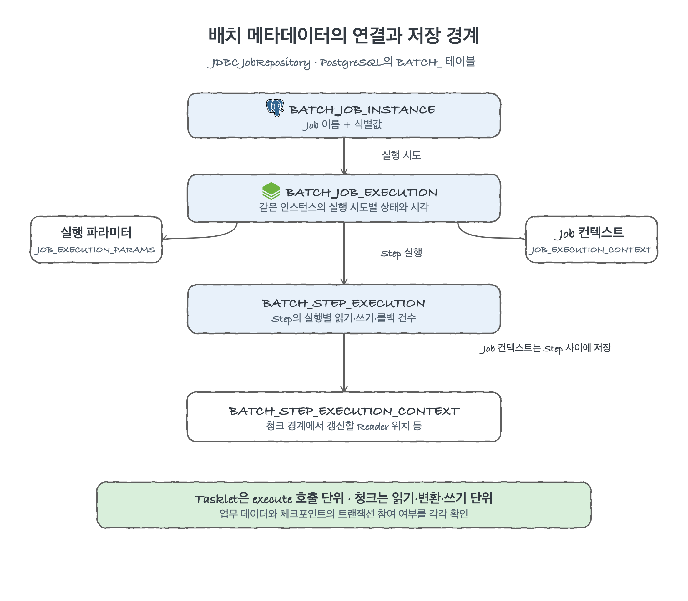

# Spring Batch Execution Metadata and Transaction Boundaries

첫 Job을 실행한 뒤에는 업무 테이블과 실행 메타데이터를 함께 확인한다. 기존 문서와 동일하게 Spring Batch 5.2를 기준으로, 카탈로그 적재 작업의 준비 Tasklet과 청크 Step을 비교한다. [Spring Batch 5.2 · Domain Language](https://docs.spring.io/spring-batch/reference/5.2/domain.html)

## 1. Job이 시작돼 체크포인트가 저장되기까지

1. `JobLauncher`가 Job과 `JobParameters`를 받아 실행을 시작한다. `JobRepository`는 Job 이름과 식별 파라미터로 인스턴스를 찾고 해당 실행 시도를 기록한다.
2. Step이 시작될 때 `StepExecution`이 생긴다. JDBC 저장소를 사용하면 Job과 Step의 상태와 건수를 `BATCH_` 테이블에서 조회할 수 있다.
3. Step의 `ExecutionContext`에는 Reader가 재시작할 위치 같은 작은 상태를 저장한다. Step 컨텍스트는 커밋 지점에서, Job 컨텍스트는 Step 사이에서 저장된다. 큰 결과는 업무 테이블이나 파일에 두고 식별자만 넘긴다.
4. 실패한 Job을 같은 식별 파라미터로 다시 시작하면 같은 인스턴스의 새 실행을 확인할 수 있다. 완료된 Step은 기본적으로 건너뛴다. 재시작 동안 입력의 내용과 순서를 유지한다.

[Spring Batch 5.2 · Configuring a JobRepository](https://docs.spring.io/spring-batch/reference/5.2/job/configuring-repository.html) · [Spring Batch 5.2 · Configuring a Step for Restart](https://docs.spring.io/spring-batch/reference/5.2/step/chunk-oriented-processing/restart.html)



그림의 근거 · [JDBC 메타데이터 스키마](https://docs.spring.io/spring-batch/reference/5.2/schema-appendix.html) · [배치 도메인](https://docs.spring.io/spring-batch/reference/5.2/domain.html) · [TaskletStep](https://docs.spring.io/spring-batch/reference/5.2/step/tasklet.html)

## 2. Tasklet 호출과 청크 커밋의 차이

| 실행 방식 | 트랜잭션 단위 | 카탈로그 예 |
| --- | --- | --- |
| `TaskletStep` | `Tasklet.execute(...)` 한 번마다 트랜잭션을 사용한다. `FINISHED`를 반환하면 끝나고 `CONTINUABLE`이면 다시 호출된다. | 적재할 기준일을 검증하고 시작 기록을 남긴다. |
| 청크 Step | 설정한 간격까지 항목을 읽고 변환·기록한 뒤 해당 청크를 커밋한다. | 상품을 일정 건수씩 처리해 중간 실패 시 마지막 커밋 지점에서 이어간다. |

커스텀 Tasklet은 다음처럼 카탈로그 기준일을 받아 시작 기록을 남긴다. `catalog_import_audit.business_date`가 기본 키이고 `JdbcTemplate`이 Step의 트랜잭션에 참여하는 구성을 전제로 한다. `prepareAudit`와 기존 적재 Step을 `JobBuilder.start(prepareAudit).next(load)` 형태로 연결할 수 있다.

```java
import java.time.LocalDate;
import org.springframework.batch.core.Step;
import org.springframework.batch.core.repository.JobRepository;
import org.springframework.batch.core.step.builder.StepBuilder;
import org.springframework.batch.repeat.RepeatStatus;
import org.springframework.jdbc.core.JdbcTemplate;
import org.springframework.transaction.PlatformTransactionManager;

public class CatalogAuditStep {
    public static Step create(JobRepository repository,
            PlatformTransactionManager transactions, JdbcTemplate jdbc) {
        return new StepBuilder("prepareAudit", repository)
                .tasklet((contribution, context) -> {
                    String rawDate = (String) context.getStepContext()
                            .getJobParameters().get("businessDate");
                    LocalDate date = LocalDate.parse(rawDate);
                    jdbc.update("""
                            INSERT INTO catalog_import_audit (business_date) VALUES (?)
                            ON CONFLICT (business_date) DO NOTHING
                            """, date);
                    return RepeatStatus.FINISHED;
                }, transactions)
                .build();
    }
}
```

[Spring Batch 5.2 · TaskletStep](https://docs.spring.io/spring-batch/reference/5.2/step/tasklet.html) · [Spring Batch 5.2 · Chunk-oriented Processing](https://docs.spring.io/spring-batch/reference/5.2/step/chunk-oriented-processing.html)

## 3. Docker의 PostgreSQL에서 실행 기록 읽기

아래 구성을 `compose.yaml`에 저장하고 `docker compose up -d --wait`로 실행한다. 애플리케이션을 같은 Compose 네트워크에서 실행하면 JDBC URL은 `jdbc:postgresql://db:5432/batch`다. 호스트에서 실행한다면 루프백으로 포트를 매핑한 뒤 그 포트를 사용한다. Spring Batch의 PostgreSQL 스키마를 적용하고 `CREATE TABLE catalog_import_audit (business_date date PRIMARY KEY)`로 실습 테이블을 준비한다. [Spring Batch 5.2 · Metadata Schema](https://docs.spring.io/spring-batch/reference/5.2/schema-appendix.html)

```yaml
services:
  db:
    image: postgres:17-alpine
    environment:
      POSTGRES_DB: batch
      POSTGRES_USER: batch
      POSTGRES_PASSWORD: batch-local
    healthcheck:
      test: ["CMD-SHELL", "pg_isready -h 127.0.0.1 -U batch -d batch"]
      interval: 2s
      timeout: 3s
      retries: 15
```

`docker compose exec db psql -U batch -d batch`에서 다음으로 최근 실행을 확인한다.

```sql
SELECT i.job_name, j.job_execution_id, j.status AS job_status,
       s.step_name, s.status AS step_status,
       s.read_count, s.write_count, s.commit_count, s.rollback_count
FROM batch_job_instance i
JOIN batch_job_execution j ON j.job_instance_id = i.job_instance_id
JOIN batch_step_execution s ON s.job_execution_id = j.job_execution_id
ORDER BY j.job_execution_id DESC, s.step_execution_id
LIMIT 20;
```

두 번째 청크의 쓰기에 실패하도록 만든 뒤 실패한 실행의 롤백 건수와 실제 반영된 행을 확인한다. 장애를 제거하고 같은 기준일로 실행해 인스턴스는 유지되고 실행 ID가 바뀌는지 확인한다. 업무 DB와 메타데이터 DB의 트랜잭션이 분리된 구성에서는 재실행 시 업무 데이터 중복을 추가로 검증한다.

Spring Batch 5.2.2와 PostgreSQL 17에서 기준일에 해당하는 상품 102개를 청크 크기 2로 실행했다. 두 번째 청크에서 실패한 실행은 `read_count=4`, `write_count=2`, `rollback_count=1`이었고 업무 테이블에는 2개만 남았다. 같은 기준일로 재시작하자 준비 Step을 건너뛰고 나머지 100개를 처리했다.

관련 문서 [Spring Batch Job Configuration and Execution](02_spring_batch_job_configuration_and_execution.md) · [Spring Batch Chunk Processing and Transactions](05_spring_batch_chunk_processing_and_transactions.md)
