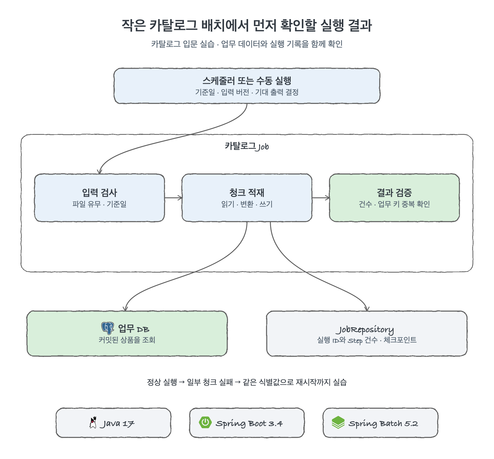

# Getting Started with Reliable Spring Batch Jobs

배치는 정산, 파일 적재, 일별 집계처럼 정해진 범위의 데이터를 한 번에 처리하는 작업이다. 첫 Job을 설계할 때는 정상 실행과 중간 실패 후 재시작을 함께 확인한다. 어디까지 저장됐는지 설명할 수 있어야 다음 실행에서 누락이나 중복을 찾을 수 있다. [Spring Batch 5.2 · Introduction](https://docs.spring.io/spring-batch/reference/5.2/spring-batch-intro.html) · [Spring Batch 5.2 · Architecture](https://docs.spring.io/spring-batch/reference/5.2/spring-batch-architecture.html)

## 1. 작은 입력으로 실행 결과를 확인한다

하루치 상품 데이터를 적재하는 작업이라면 먼저 처리할 기준일, 입력 파일 버전, 기대 출력 표를 정한다. 정상 데이터 몇 건과 검증에 실패할 데이터 한 건으로 시작한다. Job의 종료 상태와 업무 테이블의 결과를 함께 확인한 다음, 입력을 늘리거나 스케줄을 연결한다.

그림의 근거 · [배치 도메인](https://docs.spring.io/spring-batch/reference/5.2/domain.html) · [청크 처리](https://docs.spring.io/spring-batch/reference/5.2/step/chunk-oriented-processing.html) · [Step 재시작](https://docs.spring.io/spring-batch/reference/5.2/step/chunk-oriented-processing/restart.html)

| 질문 | 작은 실습에서 확인할 내용 |
| --- | --- |
| 무엇을 한 번의 작업으로 볼까? | 기준일과 입력 버전으로 `JobInstance`를 구분한다. |
| 어디까지 저장됐을까? | 업무 테이블과 `StepExecution`의 읽기·쓰기·롤백 건수를 같이 확인한다. |
| 실패하면 어디서 이어갈까? | 같은 식별 파라미터와 입력으로 재시작하고 이미 커밋한 결과가 중복되지 않는지 검증한다. |

[Spring Batch 5.2 · Domain Language](https://docs.spring.io/spring-batch/reference/5.2/domain.html) · [Spring Batch Testing and Operations](12_spring_batch_testing_and_operations.md)

## 2. 배치 작업과 실행 시점을 나눈다

스케줄러나 수동 실행 명령은 **언제, 어떤 기준일로 실행할지** 결정한다. Spring Batch의 Job은 그 입력으로 **어떤 단계에서 무엇을 처리하고 어디까지 완료했는지** 관리한다. 예를 들어 새벽에 수행하는 일별 집계는 스케줄러에서 전날 기준일로 시작하고, 장애 후 다시 실행할 때도 원래 기준일을 전달한다. [Spring Batch 5.2 · Introduction](https://docs.spring.io/spring-batch/reference/5.2/spring-batch-intro.html)

Job은 하나 이상의 Step으로 구성된다. 파일 유무 검사처럼 독립된 실행은 Tasklet으로, 여러 행의 읽기·변환·쓰기는 청크 Step으로 시작할 수 있다. 청크는 커밋 단위를 제공하며, 재시작 위치를 복구하려면 Reader가 상태를 저장할 수 있어야 한다. 실행 기록은 `JobRepository`에서 관리한다. [Spring Batch 5.2 · TaskletStep](https://docs.spring.io/spring-batch/reference/5.2/step/tasklet.html) · [Spring Batch 5.2 · Chunk-oriented Processing](https://docs.spring.io/spring-batch/reference/5.2/step/chunk-oriented-processing.html)

## 3. 첫 실습 환경을 준비한다

1. 기존 예제와 맞춰 Java 17, Spring Boot 3.4 계열, Spring Batch 5.2 계열을 기준으로 한다. 프로젝트에는 `spring-boot-starter-batch`와 사용할 DB의 JDBC 드라이버를 추가한다. [Spring Boot 3.4 · System Requirements](https://docs.spring.io/spring-boot/3.4/system-requirements.html) · [Spring Boot 3.4 · Batch Applications](https://docs.spring.io/spring-boot/3.4/how-to/batch.html)
2. [13번 문서의 Docker Compose 환경](13_spring_batch_execution_metadata_and_transaction_boundaries.md#3-docker의-postgresql에서-실행-기록-읽기)에서 PostgreSQL을 띄운다. 배치 실행 메타데이터용 `BATCH_` 테이블과 적재 대상 업무 테이블을 각각 준비한다. [Spring Batch 5.2 · Metadata Schema](https://docs.spring.io/spring-batch/reference/5.2/schema-appendix.html)
3. Job 하나를 등록하고, 시작 시 자동 실행할지 명시적으로 호출할지 정한다. 테스트가 Job을 직접 실행한다면 Boot 자동 실행을 끄는 `spring.batch.job.enabled=false`를 사용할 수 있다. [Spring Boot 3.4 · Running Spring Batch Jobs on Startup](https://docs.spring.io/spring-boot/3.4/how-to/batch.html#howto.batch.running-jobs-on-startup)
4. 정상 실행, 청크 중간 실패, 같은 인스턴스 재시작을 차례로 확인한다. 완료 상태, 실행 ID, 업무 키 중복 여부를 보면 정상 종료와 데이터 적재가 함께 검증된다. [Spring Batch 5.2 · Configuring a Step for Restart](https://docs.spring.io/spring-batch/reference/5.2/step/chunk-oriented-processing/restart.html)

다음 단계는 [Job 구성과 실행](02_spring_batch_job_configuration_and_execution.md)에서 이어간다.
