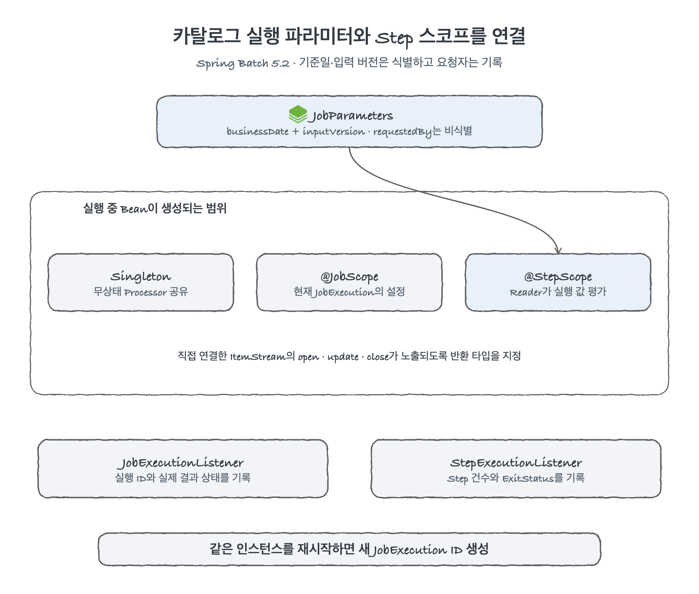

# Designing Spring Batch Steps, Parameters, and Listeners

카탈로그 적재를 예로, 입력을 확인하고 상품을 저장한 뒤 실행 결과를 기록하는 Job을 설계한다. Spring Batch 5.2를 기준으로 Step의 처리 단위, JobInstance의 식별 기준, 리스너가 관측하는 시점을 연결한다. 실습 환경은 [13번 문서의 Docker Compose와 PostgreSQL](13_spring_batch_execution_metadata_and_transaction_boundaries.md#3-docker의-postgresql에서-실행-기록-읽기)을 재사용한다.

## 1. 입력 검사와 행 적재에 맞는 Step 고르기

| 작업 | Step 유형 | 동작 |
| --- | --- | --- |
| 기준일의 입력이 준비됐는지 확인 | Tasklet | 검사 한 번이 끝나면 `RepeatStatus.FINISHED`를 반환한다. 반복이 필요하면 `CONTINUABLE`로 다음 호출을 요청할 수 있다. |
| 상품을 읽고 검증해 저장 | 청크 지향 Step | Reader가 항목을 읽고, 선택적인 Processor가 변환·필터링하며, Writer가 한 청크의 출력을 기록한다. |
| 적재 결과와 기대 건수 비교 | Tasklet | 입력과 출력의 건수를 대조하고 일치하지 않으면 후속 처리를 중단한다. |

Tasklet의 트랜잭션은 `execute(...)` 호출 단위다. 청크 Step은 지정한 간격을 기준으로 커밋하며 Reader가 `null`을 반환하면 입력을 다 읽은 것이다. 저장이 실패하면 해당 청크의 트랜잭션에 속한 DB 변경이 롤백된다. 이후 재시작에 필요한 읽기 위치는 `ItemStream`과 `ExecutionContext`로 저장한다. 검사가 재시작 때도 필요하면 해당 Step의 `allowStartIfComplete(true)`를 검토한다. [Spring Batch 5.2 · TaskletStep](https://docs.spring.io/spring-batch/reference/5.2/step/tasklet.html) · [Chunk-oriented Processing](https://docs.spring.io/spring-batch/reference/5.2/step/chunk-oriented-processing.html) · [Configuring a Step for Restart](https://docs.spring.io/spring-batch/reference/5.2/step/chunk-oriented-processing/restart.html)

## 2. 실행 파라미터와 Scope를 연결하기

| JobParameter | 식별 여부 | 설계 의도 |
| --- | --- | --- |
| `businessDate` | 식별 | 처리할 업무 기준일을 지정한다. |
| `inputVersion` | 식별 | 같은 날의 정정 데이터와 원래 입력을 구분한다. |
| `requestedBy` | 비식별 | 실행 요청자를 기록한다. 요청자만 바뀌면 기존 인스턴스의 식별 기준은 유지된다. |

Job 이름과 식별 파라미터를 합쳐 `JobInstance`를 구분한다. 실패 건을 재시작할 때는 기준일과 입력 버전을 보존한다. 재처리를 위해 새 버전을 제출할 때는 기존 출력과 병합할지 교체할지 정한다. 시각을 매번 식별 값에 추가하면 재시작해야 할 실패 건과 별개 인스턴스가 생긴다. [Spring Batch 5.2 · Domain Language](https://docs.spring.io/spring-batch/reference/5.2/domain.html)

| Scope | 생성 범위와 적용 |
| --- | --- |
| Singleton | 애플리케이션에서 공유하는 무상태 Processor나 공통 설정에 쓴다. |
| `@JobScope` | 실행 중인 Job 단위로 빈을 만든다. Job 전체에서 공유하는 런타임 설정에 사용할 수 있다. |
| `@StepScope` | 실행 중인 Step 단위로 빈을 만든다. Reader에 `@Value("#{jobParameters['inputVersion']}")`처럼 실행 값을 바인딩하거나, 파티션 Reader에 `stepExecutionContext`의 범위를 전달한다. |

`ItemStream`을 구현한 Step 스코프 빈은 반환 타입으로 `ItemStream` 또는 구체 Reader 타입을 노출해 `open`·`update`·`close`가 호출되게 한다. Spring Batch 5.2는 멀티스레드·파티션 Step에서 `@JobScope` 사용을 권장하지 않는다. [Spring Batch 5.2 · Late Binding](https://docs.spring.io/spring-batch/reference/5.2/step/late-binding.html)



그림의 근거 · [Late Binding](https://docs.spring.io/spring-batch/reference/5.2/step/late-binding.html) · [배치 도메인](https://docs.spring.io/spring-batch/reference/5.2/domain.html) · [Step 리스너](https://docs.spring.io/spring-batch/reference/5.2/step/chunk-oriented-processing/intercepting-execution.html)

## 3. 리스너로 실패 지점과 실행 결과를 확인하기

| 리스너 | 관측 목적 |
| --- | --- |
| `JobExecutionListener` | `beforeJob`과 `afterJob`으로 전체 실행을 추적한다. `afterJob`은 실패한 실행에도 호출되므로 실제 상태를 읽는다. |
| `StepExecutionListener` | 단계별 읽기·쓰기·스킵 수와 종료 코드를 관측한다. `afterStep`에서 반환하는 `ExitStatus`는 조건 분기에 사용할 수 있다. |
| `ChunkListener` | 성공한 청크의 `afterChunk`는 커밋 뒤, `afterChunkError`는 실패 시 호출된다. |
| `ItemWriteListener` | `afterWrite`는 Writer가 성공을 반환한 뒤 커밋 전에 실행된다. 최종 저장 여부를 판단할 때 이 시점을 고려한다. |

[Spring Batch 5.2 · Configuring a Job](https://docs.spring.io/spring-batch/reference/5.2/job/configuring.html) · [Intercepting Step Execution](https://docs.spring.io/spring-batch/reference/5.2/step/chunk-oriented-processing/intercepting-execution.html)

다음 리스너는 Job의 실행 ID와 상태를 함께 남긴다. JobBuilder의 `listener(new CatalogRunListener())`로 연결할 수 있다.

```java
import org.springframework.batch.core.JobExecution;
import org.springframework.batch.core.JobExecutionListener;

public class CatalogRunListener implements JobExecutionListener {
    private static final System.Logger LOG =
            System.getLogger(CatalogRunListener.class.getName());

    @Override
    public void afterJob(JobExecution execution) {
        LOG.log(System.Logger.Level.INFO, "instance={0} execution={1} status={2} exitCode={3}",
                execution.getJobInstance().getId(), execution.getId(),
                execution.getStatus(), execution.getExitStatus().getExitCode());
    }
}
```

청크 크기를 2로 두고 세 번째 상품 저장 중 오류를 재현한다. 첫 실행에서 앞선 두 건만 저장되고 리스너가 `FAILED`를 기록하는지 확인한다. 오류를 제거한 뒤 같은 식별 파라미터로 재시작하면 같은 인스턴스에서 실행 ID가 바뀌고, 성공 상태와 최종 적재 건수를 확인할 수 있다.

Spring Batch 5.2.2와 Docker의 PostgreSQL로 검증할 때, 재시작 요청자의 `requestedBy` 값을 바꿨다. 리스너에는 동일한 인스턴스 ID로 `FAILED`와 `COMPLETED`가 서로 다른 실행 ID에 기록됐으며, 최종 적재 결과는 중복 없이 102건이었다.

관련 문서 [Spring Batch Step Configuration and Restart](03_spring_batch_step_configuration_and_restart.md) · [Spring Batch Execution Listeners](11_spring_batch_execution_listeners.md) · [Getting Started with Reliable Spring Batch Jobs](17_getting_started_with_reliable_spring_batch_jobs.md)
