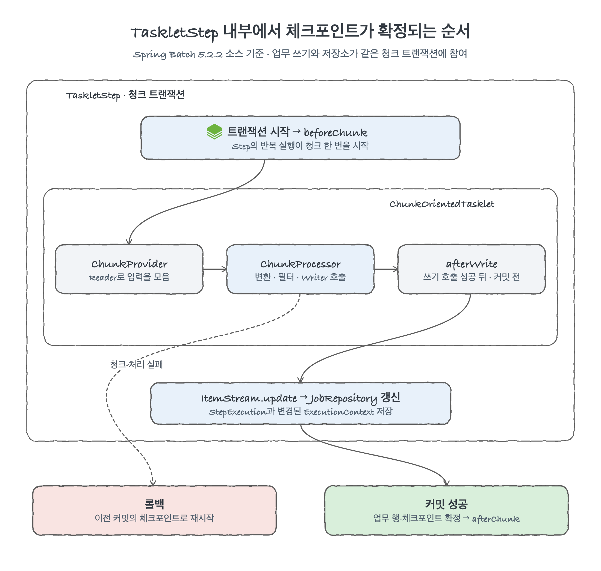

# Spring Batch Step Internals, Checkpoints, and Fault Tolerance

Spring Batch 5.2의 청크 Step을 따라가며 **어느 항목까지 커밋됐는지**, **같은 항목이 다시 처리되는 이유는 무엇인지**, **어떤 실패가 Job을 멈추는지**를 확인한다. 예제는 상품 데이터를 변환해 DB에 쓰는 Step을 사용한다.

## 1. 청크 Step이 하는 일

| 구성 요소 | 책임 |
| --- | --- |
| `TaskletStep` | 반복 실행과 청크 트랜잭션을 관리하고 `StepExecution`과 `ExecutionContext`를 저장한다. |
| `ChunkOrientedTasklet` | ChunkProvider에서 입력 청크를 얻어 ChunkProcessor로 넘긴다. 기본 설정에서는 읽은 입력을 버퍼링할 수 있다. |
| ChunkProvider | Reader를 호출해 커밋 간격까지 입력을 모은다. Reader의 `null`은 입력 종료다. |
| ChunkProcessor | Processor로 변환·필터링한 결과를 Writer에 전달한다. Fault-tolerant 구성에서는 설정에 따라 Retry와 Skip을 처리한다. |

정상 청크에서 쓰기가 끝나면 `TaskletStep`이 Stream의 상태를 갱신하고 실행 메타데이터를 저장한 뒤 트랜잭션이 커밋된다. `afterWrite`는 커밋 전이고, 성공한 청크의 `afterChunk`는 커밋 뒤다. 업무 데이터와 메타데이터가 같은 트랜잭션에 참여하도록 구성하면 마지막 체크포인트와 DB 결과를 일치시킬 수 있다. [Spring Batch 5.2.2 · TaskletStep 소스](https://github.com/spring-projects/spring-batch/blob/v5.2.2/spring-batch-core/src/main/java/org/springframework/batch/core/step/tasklet/TaskletStep.java) · [ChunkOrientedTasklet 소스](https://github.com/spring-projects/spring-batch/blob/v5.2.2/spring-batch-core/src/main/java/org/springframework/batch/core/step/item/ChunkOrientedTasklet.java) · [리스너 호출 시점](15_spring_batch_flow_listeners_and_fault_tolerance.md#2-리스너의-호출-시점과-기록-범위)



그림의 근거 · [5.2.2 TaskletStep 소스](https://github.com/spring-projects/spring-batch/blob/v5.2.2/spring-batch-core/src/main/java/org/springframework/batch/core/step/tasklet/TaskletStep.java) · [5.2.2 ChunkOrientedTasklet 소스](https://github.com/spring-projects/spring-batch/blob/v5.2.2/spring-batch-core/src/main/java/org/springframework/batch/core/step/item/ChunkOrientedTasklet.java) · [Step 리스너](https://docs.spring.io/spring-batch/reference/5.2/step/chunk-oriented-processing/intercepting-execution.html)

## 2. ItemStream으로 체크포인트를 저장한다

| 호출 | Reader·Writer가 할 일 |
| --- | --- |
| `open(context)` | 파일이나 커서를 열고 필요한 경우 이전 실행의 위치를 복원한다. |
| `update(context)` | 다음 항목 위치, 마지막 정렬 키, 출력 파일 오프셋 등 복구에 필요한 상태를 남긴다. |
| `close()` | 실행 중 연 파일이나 커서를 닫는다. |

여러 Stream이 같은 Step 컨텍스트를 쓸 때에는 이름과 상태 키를 구분한다. 재시작에는 같은 식별 파라미터와 입력 버전·순서가 필요하다. `@StepScope`로 선언한 빈은 `ItemStream` 또는 구체 타입을 반환해 프록시가 수명주기 인터페이스를 노출하게 한다. 커스텀 래퍼가 수명주기를 내부 Stream에 전달하지 않으면 `.stream(...)`으로 등록한다. [Spring Batch 5.2 · ItemStream](https://docs.spring.io/spring-batch/reference/5.2/readers-and-writers/item-stream.html) · [Late Binding](https://docs.spring.io/spring-batch/reference/5.2/step/late-binding.html) · [Registering ItemStream with a Step](https://docs.spring.io/spring-batch/reference/5.2/step/chunk-oriented-processing/registering-item-streams.html)

## 3. ItemProcessor의 필터링과 오류를 구분한다

| 사례 | 설정과 결과 |
| --- | --- |
| 유료 카탈로그에서 무료 상품 제외 | Processor가 `null`을 반환한다. 필터 건수로 집계한다. |
| 음수 가격이나 빈 SKU | 검증 예외를 발생시키고 명시한 예외만 스킵 한도 안에서 제외한다. |
| 일시적 DB 잠금 실패 | 해당 예외만 제한적으로 재시도한다. |
| 허용한 범위를 벗어난 예외 | Step이 실패한다. 실행 메타데이터와 업무 테이블에서 마지막 커밋을 확인한다. |

롤백이나 재시도로 동일 항목이 Processor에 다시 들어올 수 있다. 입력을 변경하는 대신 변환 결과를 새로 만들고, 반복 실행에 민감한 외부 변경은 별도의 복구 계약을 둔다. 스킵 건수는 읽기·변환·쓰기별로 기록되며 `skipLimit`는 합계에 적용된다. Writer 오류는 기본적으로 롤백을 유발한다. [Spring Batch 5.2 · Item Processing](https://docs.spring.io/spring-batch/reference/5.2/processor.html) · [Skip Logic](https://docs.spring.io/spring-batch/reference/5.2/step/chunk-oriented-processing/configuring-skip.html) · [Retry Logic](https://docs.spring.io/spring-batch/reference/5.2/step/chunk-oriented-processing/retry-logic.html) · [Controlling Rollback](https://docs.spring.io/spring-batch/reference/5.2/step/chunk-oriented-processing/controlling-rollback.html)

```java
import org.springframework.batch.core.Step;
import org.springframework.batch.core.repository.JobRepository;
import org.springframework.batch.core.step.builder.StepBuilder;
import org.springframework.batch.item.ItemStreamReader;
import org.springframework.batch.item.ItemWriter;
import org.springframework.dao.CannotAcquireLockException;
import org.springframework.transaction.PlatformTransactionManager;

public class CatalogChunkStep {
    public record Product(String sku, long priceCents) {}

    public static class InvalidCatalogRow extends RuntimeException {
        public InvalidCatalogRow(String message) {
            super(message);
        }
    }

    public static Step create(JobRepository jobs, PlatformTransactionManager transactions,
            ItemStreamReader<Product> reader, ItemWriter<Product> writer) {
        return new StepBuilder("loadPaidCatalog", jobs)
                .<Product, Product>chunk(2, transactions)
                .reader(reader)
                .processor(product -> {
                    if (product.sku() == null || product.sku().isBlank()
                            || product.priceCents() < 0) {
                        throw new InvalidCatalogRow("Invalid SKU or price");
                    }
                    if (product.priceCents() == 0) {
                        return null;
                    }
                    return new Product(product.sku().strip(), product.priceCents());
                })
                .writer(writer)
                .faultTolerant()
                .skip(InvalidCatalogRow.class)
                .skipLimit(2)
                .retry(CannotAcquireLockException.class)
                .retryLimit(3)
                .build();
    }
}
```

## 4. Retry와 재시작을 따로 검증한다

[Docker의 PostgreSQL](13_spring_batch_execution_metadata_and_transaction_boundaries.md#3-docker의-postgresql에서-실행-기록-읽기)에서 정상 상품, 무료 상품, 검증 실패 상품을 포함한 순서가 고정된 입력을 사용한다. Writer에서 한 번만 잠금 예외를 발생시킨 뒤 같은 실행에서 복구하는지 확인한다. 다음 청크는 스킵·재시도 정책에 포함되지 않은 오류로 실패시켜, 같은 JobInstance를 재시작할 때 이전에 커밋한 상품을 다시 쓰지 않는지 확인한다.

`StepExecution`에서 `filterCount`, `processSkipCount`, `rollbackCount`를 각각 읽고 업무 테이블의 SKU와 대조한다. 롤백 건수는 트랜잭션 실패를 관측하는 값이므로 재시도 횟수는 RetryListener나 테스트의 호출 추적으로 별도 검증한다. [Spring Batch 5.2 · Metadata Schema](https://docs.spring.io/spring-batch/reference/5.2/schema-appendix.html) · [Batch Processing and Transactions](https://docs.spring.io/spring-batch/reference/5.2/transaction-appendix.html)

Spring Batch 5.2.2와 PostgreSQL 17에서 입력 여섯 건으로 검증했다. 한 건은 필터링했고 한 건은 변환 단계에서 스킵했다. 잠금 예외가 발생한 쓰기는 두 번째 시도에서 성공했다. 마지막 청크 실패 후 같은 인스턴스를 재시작했을 때 남은 두 건만 기록해, 최종 테이블에 고유 상품 네 건이 남았다.

관련 문서 [Spring Batch Chunk Processing and Transactions](05_spring_batch_chunk_processing_and_transactions.md) · [Spring Batch Repeat, Retry, and Skip](09_spring_batch_repeat_retry_and_skip.md)
