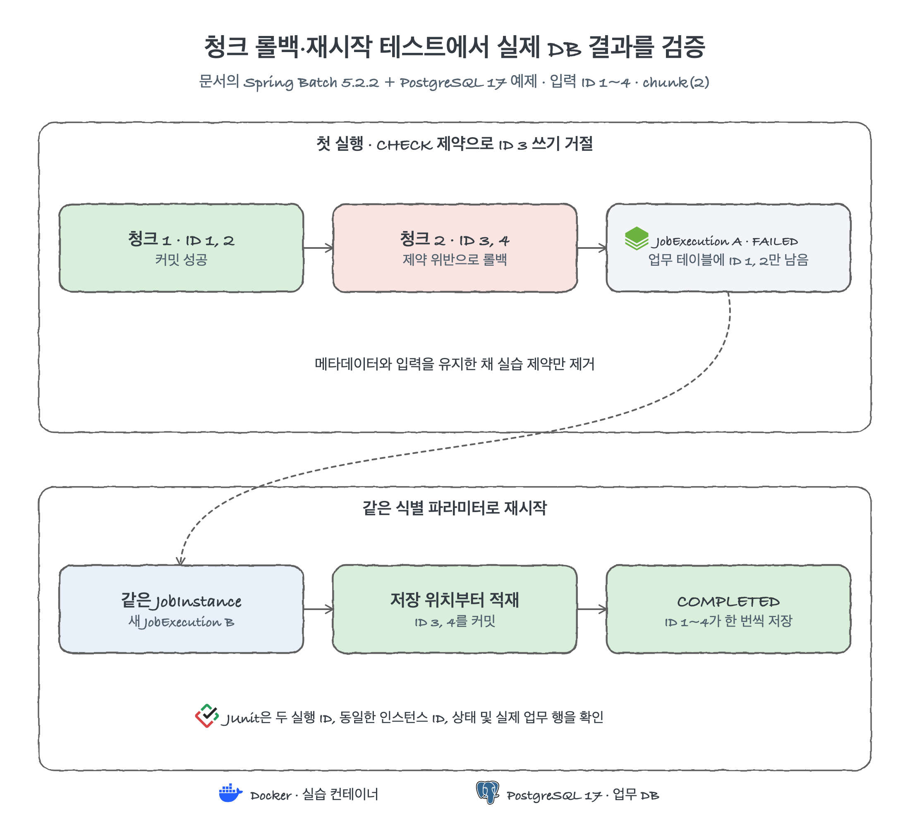

# Testing Spring Batch Jobs and Verifying Restartability

Spring Batch 5.2의 카탈로그 적재를 예로 들어 Processor, Step, Job에서 각각 무엇을 검증할지 정리한다. 재시작 테스트의 완료 조건은 Job의 종료 상태와 실제 저장된 업무 데이터가 함께 맞는 것이다.

## 1. 실패를 관측할 수 있는 테스트 범위를 고른다

| 검증 범위 | 도구 | 한 가지 확인할 결과 |
| --- | --- | --- |
| Processor 단위 | JUnit으로 `process(...)` 직접 호출 | 정상 입력은 변환하고, 제외 대상은 `null`을 반환하며, 잘못된 입력은 의도한 예외로 처리한다. |
| Step 스코프 | `MetaDataInstanceFactory`와 `StepScopeTestUtils` | 주어진 JobParameters와 `ExecutionContext`로 Reader가 올바른 파일명이나 파티션 범위를 해석한다. |
| 개별 Step | `JobLauncherTestUtils.launchStep(name, parameters)` | 해당 단계의 읽기·쓰기·스킵 건수와 출력 데이터가 맞는다. |
| 전체 Job | `JobLauncherTestUtils.launchJob(parameters)` | 실제 Flow를 타고 종료되며, 실패 후 같은 인스턴스를 재시작하면 체크포인트부터 이어진다. |

`@SpringBatchTest`는 테스트 유틸리티와 Job·Step 스코프 리스너를 등록한다. Job 빈이 여러 개면 `setJob(...)`으로 검증할 대상을 정한다. Step 스코프만 검증할 때는 `doInStepScope(...)`에 필요한 `StepExecution`을 전달한다. `ItemStream` Reader를 직접 호출하는 테스트는 `open(...)`과 `close()`도 책임진다. [Spring Batch 5.2 · Unit Testing](https://docs.spring.io/spring-batch/reference/5.2/testing.html) · [StepScopeTestUtils API](https://docs.spring.io/spring-batch/docs/5.2.2/api/org/springframework/batch/test/StepScopeTestUtils.html)

## 2. DB 오류로 청크 롤백과 재시작을 검증한다

[Docker의 PostgreSQL 환경](13_spring_batch_execution_metadata_and_transaction_boundaries.md#3-docker의-postgresql에서-실행-기록-읽기)에 배치 메타데이터 스키마를 적용한다. `CatalogBatchTestConfig`에는 같은 데이터소스를 사용하는 `JdbcTemplate`과 카탈로그 Job을 등록한다. Job은 [기준일이 바인딩된 JDBC 페이징 Reader](14_spring_batch_database_pipelines_and_scheduling.md#2-기준일-파라미터로-reader를-구성하기)로 ID 1~4를 순서대로 읽고, 청크 크기 2로 `catalog_stage(id bigint PRIMARY KEY)`에 쓴다. 테스트 준비 데이터를 먼저 커밋해 각 청크의 커밋과 롤백을 관측할 수 있게 한다.

```java
import java.util.List;
import org.junit.jupiter.api.Test;
import org.springframework.batch.core.BatchStatus;
import org.springframework.batch.core.JobParametersBuilder;
import org.springframework.batch.test.JobLauncherTestUtils;
import org.springframework.batch.test.context.SpringBatchTest;
import org.springframework.beans.factory.annotation.Autowired;
import org.springframework.jdbc.core.JdbcTemplate;
import org.springframework.test.context.junit.jupiter.SpringJUnitConfig;

import static org.junit.jupiter.api.Assertions.assertEquals;
import static org.junit.jupiter.api.Assertions.assertNotEquals;

@SpringBatchTest
@SpringJUnitConfig(CatalogBatchTestConfig.class)
class CatalogRestartTest {
    @Autowired JobLauncherTestUtils launcher;
    @Autowired JdbcTemplate jdbc;

    @Test
    void resumesAfterLastCommittedChunk() throws Exception {
        var parameters = new JobParametersBuilder()
                .addString("businessDate", "2026-11-20")
                .addString("inputVersion", "v1")
                .toJobParameters();
        var query = "SELECT id FROM catalog_stage ORDER BY id";

        jdbc.execute("ALTER TABLE catalog_stage ADD CONSTRAINT reject_demo_row CHECK (id <> 3)");
        var first = launcher.launchJob(parameters);
        assertEquals(BatchStatus.FAILED, first.getStatus());
        assertEquals(List.of(1L, 2L), jdbc.queryForList(query, Long.class));

        jdbc.execute("ALTER TABLE catalog_stage DROP CONSTRAINT reject_demo_row");
        var restart = launcher.launchJob(parameters);
        assertEquals(BatchStatus.COMPLETED, restart.getStatus());
        assertEquals(first.getJobInstance().getId(), restart.getJobInstance().getId());
        assertNotEquals(first.getId(), restart.getId());
        assertEquals(List.of(1L, 2L, 3L, 4L), jdbc.queryForList(query, Long.class));
    }
}
```

실패한 첫 실행과 재시작 사이에는 입력과 메타데이터를 그대로 둔다. `JobRepositoryTestUtils.removeJobExecutions()`은 격리된 테스트 저장소의 정리가 필요할 때 사용한다. Spring Boot에서 Job을 테스트가 직접 시작한다면 `spring.batch.job.enabled=false`로 자동 실행을 끌 수 있다. [Spring Batch 5.2 · Testing](https://docs.spring.io/spring-batch/reference/5.2/testing.html) · [JobRepositoryTestUtils API](https://docs.spring.io/spring-batch/docs/5.2.2/api/org/springframework/batch/test/JobRepositoryTestUtils.html) · [Spring Boot 3.4 · Batch Applications](https://docs.spring.io/spring-boot/3.4/how-to/batch.html)

Spring Batch 5.2.2와 Docker의 PostgreSQL 17에서 이 JUnit 테스트가 통과했다. 첫 실행에서 DB 제약 위반이 발생해 ID 1·2만 남았고, 같은 JobInstance로 재시작하자 ID 1~4가 모두 한 번씩 저장됐다.



그림의 근거 · [Spring Batch 테스트](https://docs.spring.io/spring-batch/reference/5.2/testing.html) · [Step 재시작](https://docs.spring.io/spring-batch/reference/5.2/step/chunk-oriented-processing/restart.html) · [롤백 제어](https://docs.spring.io/spring-batch/reference/5.2/step/chunk-oriented-processing/controlling-rollback.html)

## 3. 마지막 검증에서 볼 항목

- **정상 실행**. 예상한 Step을 지나고 출력 행 수와 업무 키가 기대값과 일치한다.
- **오류 분류**. 제외 항목, 스킵된 오류, 재시도가 끝나 실패한 오류를 테스트 표본으로 구분한다.
- **중간 실패 후 복구**. 실패 직전까지 커밋한 데이터와 재시작 뒤 완성된 데이터를 비교한다. 이미 커밋한 행은 중복되지 않는다.
- **병렬 구성**. 운영에 파티셔닝을 사용할 때는 실패 파티션 하나를 재시작해 전체 범위에 누락이나 중복이 없는지 확인한다.
- **운영 확인**. 실행 ID로 마지막 Step, 실패 원인, 원래 식별 파라미터를 찾고 동일 인스턴스를 재시작할 수 있다.

관련 문서 [Spring Batch Testing and Operations](12_spring_batch_testing_and_operations.md) · [Spring Batch Job Launching, Operations, and Flow Control](22_spring_batch_job_launching_operations_and_flow_control.md) · [Spring Batch Parallel and Distributed Processing](23_spring_batch_parallel_and_distributed_processing.md)
