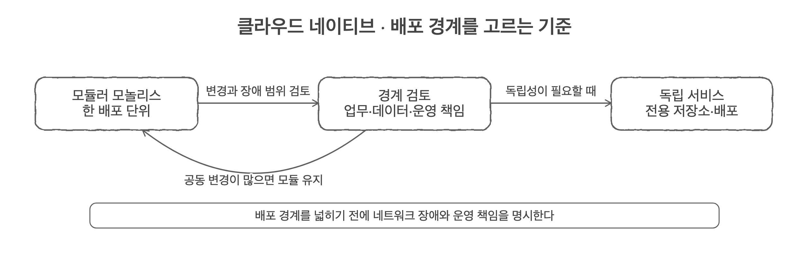

# 클라우드 네이티브 서비스 경계 정하기

쇼핑몰에서 기능을 분리할지는 변경 단위, 데이터의 주인, 장애를 감당할 팀을 기준으로 결정한다. Cloud Native의 느슨한 결합과 운영 자동화 원칙은 모듈러 모놀리스부터 적용할 수 있다. [CNCF 클라우드 네이티브 정의](https://www.cncf.io/about/who-we-are/) · [AWS 서비스별 데이터베이스](https://docs.aws.amazon.com/prescriptive-guidance/latest/modernization-data-persistence/database-per-service.html) · [Microsoft Strangler Fig](https://learn.microsoft.com/en-us/azure/architecture/patterns/strangler-fig)

그림의 근거 · [CNCF 클라우드 네이티브 정의](https://www.cncf.io/about/who-we-are/) · [AWS 서비스별 데이터베이스](https://docs.aws.amazon.com/prescriptive-guidance/latest/modernization-data-persistence/database-per-service.html) · [Microsoft Strangler Fig](https://learn.microsoft.com/en-us/azure/architecture/patterns/strangler-fig)

## 1. 업무 변경과 데이터 쓰기를 기준으로 경계를 찾는다

Users·Catalogs·Orders가 담당할 업무와 직접 변경하는 데이터를 먼저 적는다. 예를 들어 주문과 주문 라인은 한 서비스의 로컬 트랜잭션 경계에 두고, 재고를 분리한다면 예약 요청·완료·실패에 대한 계약을 먼저 정한다. 팀의 배포와 장애 대응이 함께 움직이는 영역은 모듈로 두고 점진적으로 분리하는 편이 단순할 수 있다. [AWS 서비스별 데이터베이스](https://docs.aws.amazon.com/prescriptive-guidance/latest/modernization-data-persistence/database-per-service.html) · [Microsoft Strangler Fig](https://learn.microsoft.com/en-us/azure/architecture/patterns/strangler-fig) · [AWS Saga 오케스트레이션](https://docs.aws.amazon.com/prescriptive-guidance/latest/cloud-design-patterns/saga-orchestration.html)

SOA와 마이크로서비스를 비교할 때 SOA에서 자주 다루는 여러 시스템의 통합·재사용과 마이크로서비스에서 강조하는 작은 업무 기능의 독립 배포·데이터 소유를 살핀다. 실제 설계에서 경계를 판단할 때는 서비스 이름보다 변경 배포와 데이터 수정 책임을 확인한다. [서비스 경계의 운영 트레이드오프](../microservice-architecture/04_microservice_boundaries_and_operational_tradeoffs.md) [AWS SOA와 마이크로서비스 비교](https://aws.amazon.com/compare/the-difference-between-soa-microservices/) · [AWS 서비스별 데이터베이스](https://docs.aws.amazon.com/prescriptive-guidance/latest/modernization-data-persistence/database-per-service.html)

## 2. Twelve-Factor를 실행 환경의 계약으로 옮긴다

코드베이스·의존성·설정·백엔드 서비스·빌드/릴리스/실행은 같은 아티팩트를 환경별 설정과 자원 연결로 실행하는 기준에 사용한다. 설정을 코드 밖에서 주입하고 외부 자원 주소를 배포마다 바꿀 수 있게 한다. [The Twelve-Factor App](https://12factor.net/)

프로세스·포트 바인딩·동시성·폐기 가능성은 무상태 복제와 빠른 시작·정상 종료의 기준이다. 개발/운영 환경 유사성·로그·관리 작업을 적용해 같은 종류의 자원, 로그 스트림, 일회성 운영 작업의 책임을 정한다. [The Twelve-Factor App](https://12factor.net/)

## 3. 운영 가능성을 검증한 뒤 분리를 늘린다

한 인스턴스를 교체해도 사용자 진행 상태가 유지되는지, 다른 서비스가 중단되어도 실패 범위를 설명할 수 있는지, 배포를 되돌릴 때 데이터와 계약이 호환되는지 확인한다. 독립 롤백을 검증하기 어려운 경계는 분리 이전에 모듈과 계약부터 명확히 한다. [The Twelve-Factor App](https://12factor.net/) · [CNCF 클라우드 네이티브 정의](https://www.cncf.io/about/who-we-are/) · [Microsoft Strangler Fig](https://learn.microsoft.com/en-us/azure/architecture/patterns/strangler-fig)
