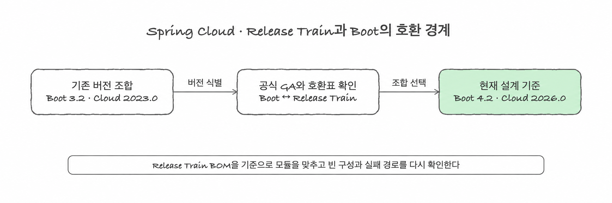

# Spring Cloud 릴리스 트레인을 선택하기

2026-11-23 기준 공식 최신 GA는 Spring Cloud 2026.0.0(Paddington)이며, 그 릴리스의 기준은 Spring Boot 4.2.0이다. Spring Boot 3.2와 Spring Cloud 2023.0은 기존 환경의 버전 조합 예시다. [Spring Cloud 2026.0.0 릴리스](https://spring.io/blog/2026/11/20/spring-cloud-2026-0-0-has-been-released/) · [Spring Cloud 프로젝트](https://spring.io/projects/spring-cloud/) · [Spring Cloud 지원 버전](https://github.com/spring-cloud/spring-cloud-release/wiki/Supported-Versions)

그림의 근거 · [Spring Cloud 2026.0.0 릴리스](https://spring.io/blog/2026/11/20/spring-cloud-2026-0-0-has-been-released/) · [Spring Cloud 프로젝트](https://spring.io/projects/spring-cloud/) · [Spring Cloud 지원 버전](https://github.com/spring-cloud/spring-cloud-release/wiki/Supported-Versions)

## 1. 현재 운영 버전과 목표 조합을 각각 파악한다

Boot 버전을 먼저 확인하고 그에 맞는 Spring Cloud Release Train을 선택한다. BOM은 Gateway·Config·Netflix·Commons 등 트레인에 포함되는 의존성 버전을 함께 맞춘다. 2026.0.0 릴리스 노트는 주요 Cloud 모듈을 5.1.0으로 기록하고, Boot 4.2.0은 Java 17 이상과 Spring Framework 7.1 이상을 요구한다. [Spring Cloud 2026.0.0 릴리스](https://spring.io/blog/2026/11/20/spring-cloud-2026-0-0-has-been-released/) · [Spring Cloud 프로젝트](https://spring.io/projects/spring-cloud/) · [Spring Boot 4.2 요구사항](https://docs.spring.io/spring-boot/system-requirements.html)

## 2. 제품 이름의 변화와 기능 경계를 대조한다

Spring Cloud가 제공하는 구성·서비스 발견·라우팅·부하 분산·장애 격리 기능은 애플리케이션이 맡을 운영 책임과 함께 고른다. 2026.0.0에서 Spring Cloud Bus 프로젝트는 Spring Cloud Stream에 편입됐고 Bus 아티팩트 좌표는 유지됐다. 기존 예제의 문서나 starter 이름은 대상 릴리스의 공식 가이드와 대조한다. [Spring Cloud 프로젝트](https://spring.io/projects/spring-cloud/) · [Spring Cloud 2026.0.0 릴리스](https://spring.io/blog/2026/11/20/spring-cloud-2026-0-0-has-been-released/)

## 3. 업그레이드 계약을 성립시킨 뒤 전환한다

한 번에 라이브러리 조합을 맞춘 뒤 부팅, 설정 조회 실패, 인스턴스가 없는 라우팅, JWT 검증, 오래된 소비자와 새 이벤트의 호환을 시험한다. 같은 애플리케이션을 두 버전으로 띄우는 동안 API 계약과 데이터 읽기·쓰기를 함께 대조할 수 있어야 한다. [Spring Cloud 2026.0.0 릴리스](https://spring.io/blog/2026/11/20/spring-cloud-2026-0-0-has-been-released/) · [Spring Cloud 프로젝트](https://spring.io/projects/spring-cloud/) · [OpenAPI 3.2.1 명세](https://spec.openapis.org/oas/v3.2.1.html) · [Kubernetes Deployment](https://kubernetes.io/docs/concepts/workloads/controllers/deployment/)
