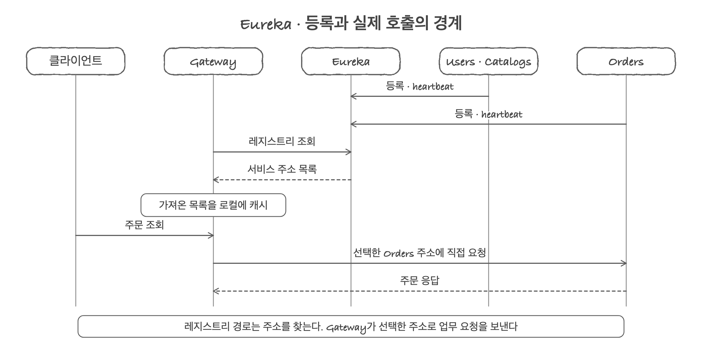

# Eureka로 서비스를 등록하고 찾기

Gateway가 Users, Catalogs, Orders의 주소를 인스턴스마다 기억하면 배포할 때마다 설정을 바꿔야 한다. Eureka를 쓰면 각 서비스가 자신의 주소를 레지스트리에 등록하고, Gateway는 서비스 ID로 현재 알고 있는 후보 주소를 조회한다. [Spring Cloud Netflix · Registering with Eureka](https://docs.spring.io/spring-cloud-netflix/reference/spring-cloud-netflix.html)

## 1. 등록과 조회

Users, Catalogs, Orders는 각자의 서비스 ID 아래 호스트와 포트 등 접속 정보를 등록하고 주기적으로 하트비트를 보낸다. 같은 Orders 복제본들은 서비스 ID `orders`를 공유하고 서로 다른 인스턴스 ID를 가진다. 호출자가 실제로 접속하는 주소와 포트가 Eureka에 올라가는지 확인한다. [Spring Cloud Netflix · Registering with Eureka](https://docs.spring.io/spring-cloud-netflix/reference/spring-cloud-netflix.html) · [Spring Cloud Netflix · Eureka Metadata](https://docs.spring.io/spring-cloud-netflix/reference/spring-cloud-netflix.html)

그림의 근거 · [Spring Cloud Netflix · Registering with Eureka](https://docs.spring.io/spring-cloud-netflix/reference/spring-cloud-netflix.html) · [Spring Cloud Netflix · Standalone Mode](https://docs.spring.io/spring-cloud-netflix/reference/spring-cloud-netflix.html)

## 2. 등록 전파와 상태

Eureka 서버와 조회 클라이언트는 각각 등록 정보를 캐시한다. 새 Orders 인스턴스가 레지스트리에 보인 시점과 Gateway의 후보 목록에 나타난 시점을 따로 측정한다. 종료할 때도 Gateway의 목록에서 빠지기까지 시간이 걸릴 수 있다. [Spring Cloud Netflix · Registration Latency](https://docs.spring.io/spring-cloud-netflix/reference/spring-cloud-netflix.html) · [Spring Cloud Netflix · Standalone Mode](https://docs.spring.io/spring-cloud-netflix/reference/spring-cloud-netflix.html) · [Spring Cloud Netflix · Registering with Eureka](https://docs.spring.io/spring-cloud-netflix/reference/spring-cloud-netflix.html)

기본 Eureka 상태는 하트비트에 의존한다. 예를 들어 Orders 프로세스가 살아 있어도 주문 DB 연결이 끊기면 요청을 처리할 수 없다. Actuator 상태를 Eureka에 반영할지 정하고, 반영한다면 어떤 의존성 실패가 트래픽 제외 조건인지 서비스별로 정한다. [Spring Cloud Netflix · Eureka’s Health Checks](https://docs.spring.io/spring-cloud-netflix/reference/spring-cloud-netflix.html)

## 3. 단일 서버 실습과 장애 검증

실습에는 단일 Eureka 서버를 두고 서버 자신의 등록과 레지스트리 조회를 끈다. 운영에서 Eureka를 쓰기로 했다면 피어를 여러 서버에 두고, 한 피어가 중단되는 동안 등록과 조회가 어떻게 이어지는지 검증한다. [Spring Cloud Netflix · Standalone Mode](https://docs.spring.io/spring-cloud-netflix/reference/spring-cloud-netflix.html)

실습에서는 Orders 복제본을 하나 늘린 뒤 강제 종료하고, Eureka의 등록 상태와 Gateway의 후보 목록, 실제 연결 성공 여부를 같은 시간축에서 대조한다. Eureka를 중단했을 때는 이미 목록을 받은 Gateway의 호출과 목록을 처음 받아야 하는 Gateway의 동작을 각각 확인한다. [Spring Cloud Netflix · Registration Latency](https://docs.spring.io/spring-cloud-netflix/reference/spring-cloud-netflix.html) · [Spring Cloud Netflix · Standalone Mode](https://docs.spring.io/spring-cloud-netflix/reference/spring-cloud-netflix.html)
