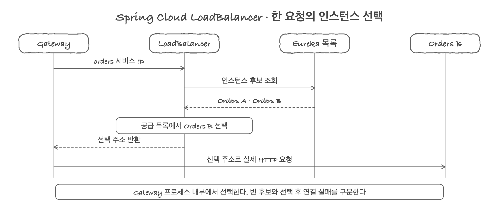

# Spring Cloud LoadBalancer로 인스턴스 선택하기

Eureka는 `orders`에 해당하는 인스턴스 목록을 제공한다. Spring Cloud LoadBalancer는 그 목록에서 이번 요청을 보낼 인스턴스를 고른다. Gateway처럼 호출을 보내는 프로세스 안에서 이 선택을 하므로 클라이언트 측 로드밸런싱이라고 부른다. [Spring Cloud Commons · LoadBalancer](https://docs.spring.io/spring-cloud-commons/reference/spring-cloud-commons/loadbalancer.html)

## 1. 서비스 ID에서 한 인스턴스로

WebFlux Gateway에서 `lb://orders`를 대상으로 하는 라우트가 선택되면 `ReactiveLoadBalancerClientFilter`가 서비스 ID를 실제 호스트와 포트로 해석한다. Server Web MVC는 `lb://` 대상을 LoadBalancer 필터로 해석한다. 두 구현에서 Gateway가 선택한 Orders 인스턴스에 HTTP 요청을 보낸다. [Spring Cloud Gateway WebFlux · ReactiveLoadBalancerClientFilter](https://docs.spring.io/spring-cloud-gateway/reference/spring-cloud-gateway-server-webflux/global-filters.html) · [Spring Cloud Gateway Web MVC · LoadBalancer Filter](https://docs.spring.io/spring-cloud-gateway/reference/spring-cloud-gateway-server-webmvc/filters/loadbalancer.html)

그림의 근거 · [Spring Cloud Commons · LoadBalancer](https://docs.spring.io/spring-cloud-commons/reference/spring-cloud-commons/loadbalancer.html) · [Spring Cloud Gateway WebFlux · ReactiveLoadBalancerClientFilter](https://docs.spring.io/spring-cloud-gateway/reference/spring-cloud-gateway-server-webflux/global-filters.html)

## 2. 선택 정책과 목록의 신선도

기본 선택 정책은 라운드 로빈이다. Orders 복제본의 처리 능력이 비슷한 실습에서는 이 정책으로 시작한다. 처리 용량이 다르면 가중치를, 같은 가용 영역을 우선해야 하면 영역 선호를 검토한다. 영역 선호 정책은 같은 영역에 후보가 없을 때 조회한 전체 후보를 사용한다. [Spring Cloud Commons · LoadBalancer](https://docs.spring.io/spring-cloud-commons/reference/spring-cloud-commons/loadbalancer.html) · [Spring Cloud Commons · Weighted and Zone-Based Load-Balancing](https://docs.spring.io/spring-cloud-commons/reference/spring-cloud-commons/loadbalancer.html)

Eureka 클라이언트가 이미 인스턴스 목록을 캐시하므로 LoadBalancer 쪽 캐시는 끄는 구성을 택한다. 목록을 두 번 캐시하면 레지스트리에서 사라진 주소를 호출자가 더 오래 후보로 유지할 수 있다. [Spring Cloud Commons · LoadBalancer Caching](https://docs.spring.io/spring-cloud-commons/reference/spring-cloud-commons/loadbalancer.html) · [Spring Cloud Netflix · Registration Latency](https://docs.spring.io/spring-cloud-netflix/reference/spring-cloud-netflix.html)

## 3. 후보가 없는 실패와 연결 실패

라우트가 선택됐어도 `orders` 후보가 비어 있으면 두 Gateway의 기본 LoadBalancer 응답은 `503`이다. 목록에 주소가 남아 있는 동안에는 인스턴스가 선택된 뒤 HTTP 연결이 실패할 수 있다. 관측할 때 후보 수, 선택된 인스턴스, 접속 결과를 구분하면 두 실패의 원인을 찾을 수 있다. [Spring Cloud Gateway WebFlux · ReactiveLoadBalancerClientFilter](https://docs.spring.io/spring-cloud-gateway/reference/spring-cloud-gateway-server-webflux/global-filters.html) · [Spring Cloud Gateway Web MVC · LoadBalancer Filter](https://docs.spring.io/spring-cloud-gateway/reference/spring-cloud-gateway-server-webmvc/filters/loadbalancer.html) · [Spring Cloud Netflix · Registration Latency](https://docs.spring.io/spring-cloud-netflix/reference/spring-cloud-netflix.html)

Orders A와 B를 함께 실행해 요청이 어디로 가는지 확인한 뒤 B를 종료한다. B가 후보에서 빠지는 데 걸린 시간을 기록하고, 마지막 인스턴스까지 내렸을 때 빈 목록의 `503`이 관측되는지 확인한다. [Spring Cloud Commons · LoadBalancer](https://docs.spring.io/spring-cloud-commons/reference/spring-cloud-commons/loadbalancer.html) · [Spring Cloud Netflix · Registration Latency](https://docs.spring.io/spring-cloud-netflix/reference/spring-cloud-netflix.html) · [Spring Cloud Gateway WebFlux · ReactiveLoadBalancerClientFilter](https://docs.spring.io/spring-cloud-gateway/reference/spring-cloud-gateway-server-webflux/global-filters.html)
