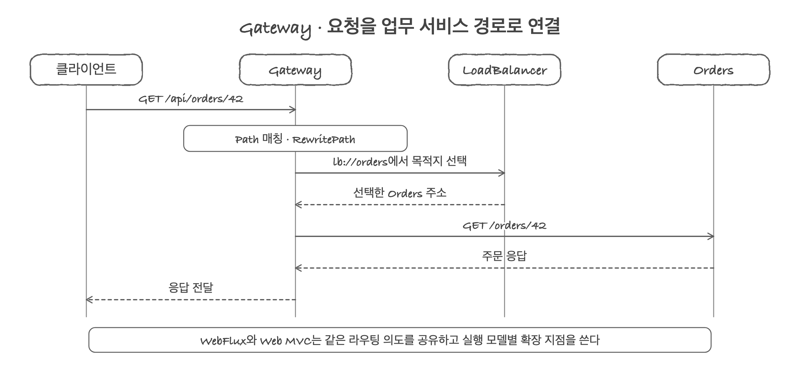

# Spring Cloud Gateway로 요청 라우팅하기

외부 API 계약은 Gateway에서 정의한다. 예제에서는 `/api/users/**`, `/api/catalogs/**`, `/api/orders/**`를 각각 Users, Catalogs, Orders에 연결한다. 클라이언트는 배포마다 바뀌는 복제본 주소 대신 공개 경로를 사용한다. [Spring Cloud Gateway · Server Variants](https://docs.spring.io/spring-cloud-gateway/reference/) · [Spring Cloud Gateway WebFlux · ReactiveLoadBalancerClientFilter](https://docs.spring.io/spring-cloud-gateway/reference/spring-cloud-gateway-server-webflux/global-filters.html)

## 1. 라우트 결정과 실제 전달

라우트의 ID는 관측에 사용하고, `Path`나 `Method` 같은 Predicate는 어떤 요청이 라우트를 타는지 결정한다. 대상 URI는 어느 서비스로 보낼지 정하고, 필터는 전달 전후의 요청이나 응답을 처리한다. `GET /api/orders/42`가 주문 라우트와 매칭된 뒤에 `lb://orders`에서 실제 인스턴스를 선택한다. [Spring Cloud Gateway WebFlux · Route Predicate Factories](https://docs.spring.io/spring-cloud-gateway/reference/spring-cloud-gateway-server-webflux/request-predicates.html) · [Spring Cloud Gateway WebFlux · How It Works](https://docs.spring.io/spring-cloud-gateway/reference/spring-cloud-gateway-server-webflux/how-it-works.html) · [Spring Cloud Gateway WebFlux · ReactiveLoadBalancerClientFilter](https://docs.spring.io/spring-cloud-gateway/reference/spring-cloud-gateway-server-webflux/global-filters.html)

그림의 근거 · [Spring Cloud Gateway WebFlux · How It Works](https://docs.spring.io/spring-cloud-gateway/reference/spring-cloud-gateway-server-webflux/how-it-works.html) · [Spring Cloud Gateway WebFlux · Route Predicate Factories](https://docs.spring.io/spring-cloud-gateway/reference/spring-cloud-gateway-server-webflux/request-predicates.html) · [Spring Cloud Gateway WebFlux · ReactiveLoadBalancerClientFilter](https://docs.spring.io/spring-cloud-gateway/reference/spring-cloud-gateway-server-webflux/global-filters.html)

## 2. WebFlux와 Web MVC 선택

Server WebFlux는 Spring WebFlux와 Reactor 기반으로 요청을 비동기 처리하며, Server Web MVC는 Servlet과 WebMvc.fn의 `RouterFunction`으로 라우팅한다. 운영 중인 필터와 라이브러리가 블로킹 I/O에 의존하면 Web MVC를 검토하고, 필터까지 논블로킹 흐름을 유지할 수 있으면 WebFlux를 검토한다. 선택한 구현에서 필요한 필터와 관측 기능이 제공되는지 먼저 확인한다. [Spring Cloud Gateway · Server WebFlux](https://docs.spring.io/spring-cloud-gateway/reference/spring-cloud-gateway-server-webflux/starter.html) · [Spring Cloud Gateway · Server Web MVC](https://docs.spring.io/spring-cloud-gateway/reference/spring-cloud-gateway-server-webmvc/starter.html) · [Spring Cloud Gateway Web MVC · How It Works](https://docs.spring.io/spring-cloud-gateway/reference/spring-cloud-gateway-server-webmvc/how-it-works.html)

## 3. 외부에 공개할 라우트와 검증

WebFlux의 DiscoveryClient Route Definition Locator를 활성화하면 발견한 서비스 ID로 라우트를 만들 수 있다. 기본 경로는 `/serviceId/**`다. 예제는 공개 라우트에 허용할 경로와 메서드를 명시하고, Eureka 조회는 등록된 대상의 인스턴스를 찾는 데 사용한다. 내부 서비스가 새로 등록되어도 공개 라우트가 늘어나지 않는지 확인한다. [Spring Cloud Gateway WebFlux · DiscoveryClient Route Definition Locator](https://docs.spring.io/spring-cloud-gateway/reference/spring-cloud-gateway-server-webflux/the-discoveryclient-route-definition-locator.html) · [Spring Cloud Gateway WebFlux · Route Predicate Factories](https://docs.spring.io/spring-cloud-gateway/reference/spring-cloud-gateway-server-webflux/request-predicates.html)

라우트 경로가 겹치는 경우, 허용하지 않은 메서드가 들어오는 경우, 라우트는 일치하지만 백엔드 후보가 없는 경우를 각각 검증한다. 요청 경로, 선택된 라우트 ID와 대상 서비스 ID를 함께 보면 잘못된 매칭과 인스턴스 부재를 구별할 수 있다. [Spring Cloud Gateway WebFlux · Route Predicate Factories](https://docs.spring.io/spring-cloud-gateway/reference/spring-cloud-gateway-server-webflux/request-predicates.html) · [Spring Cloud Gateway WebFlux · Gateway Metrics Filter](https://docs.spring.io/spring-cloud-gateway/reference/spring-cloud-gateway-server-webflux/global-filters.html) · [Spring Cloud Gateway WebFlux · ReactiveLoadBalancerClientFilter](https://docs.spring.io/spring-cloud-gateway/reference/spring-cloud-gateway-server-webflux/global-filters.html)
