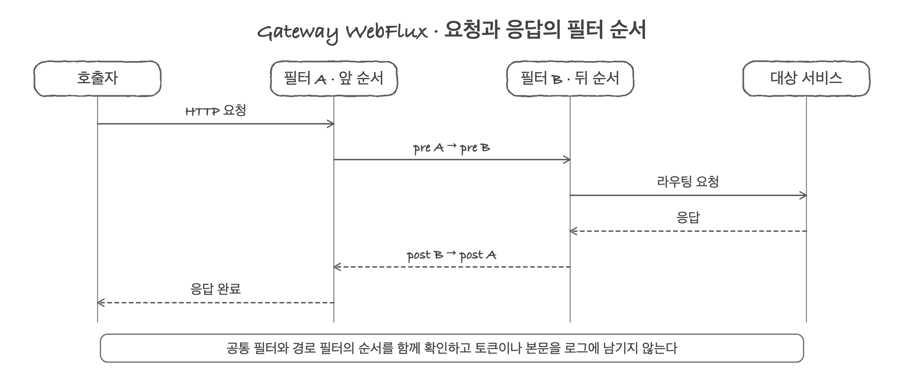

# 게이트웨이 필터 체인 설계하기

게이트웨이 필터를 배치할 때는 적용할 라우트와 읽거나 바꿀 데이터를 먼저 정한다. 예제에서는 요청 식별자를 여러 라우트에 전달하고, 주문 경로 변환은 Orders 라우트에서만 수행한다. [Spring Cloud Gateway WebFlux · Global Filter Ordering](https://docs.spring.io/spring-cloud-gateway/reference/spring-cloud-gateway-server-webflux/global-filters.html) · [Spring Cloud Gateway WebFlux · RewritePath](https://docs.spring.io/spring-cloud-gateway/reference/spring-cloud-gateway-server-webflux/gatewayfilter-factories/rewritepath-factory.html)

## 1. 공통 필터와 라우트별 필터

Server WebFlux는 라우트가 매칭되면 `GlobalFilter`와 해당 라우트의 `GatewayFilter`를 한 체인으로 합친다. 라우트마다 설정이 다른 동작이 기본 필터로 표현되지 않으면 커스텀 `GatewayFilterFactory`를 사용한다. Server Web MVC에서는 WebMvc.fn의 `HandlerFilterFunction`과 요청용 `BeforeFilterFunctions`, 응답용 `AfterFilterFunctions`를 사용한다. [Spring Cloud Gateway WebFlux · Global Filter Ordering](https://docs.spring.io/spring-cloud-gateway/reference/spring-cloud-gateway-server-webflux/global-filters.html) · [Spring Cloud Gateway WebFlux · Custom Filter Factories](https://docs.spring.io/spring-cloud-gateway/reference/spring-cloud-gateway-server-webflux/developer-guide.html) · [Spring Cloud Gateway Web MVC · How It Works](https://docs.spring.io/spring-cloud-gateway/reference/spring-cloud-gateway-server-webmvc/how-it-works.html)

## 2. 요청과 응답에서 실행되는 순서

WebFlux는 합친 체인을 `Ordered` 우선순위로 정렬한다. 우선순위가 높은 A가 요청 단계에서 B보다 먼저 실행되고, 두 필터가 체인을 끝까지 진행하면 응답 단계는 B, A 순서다. A가 B의 로그와 하위 호출이 공유할 요청 식별자를 만들도록 배치하면 A에서 전체 처리 시간을 잴 수 있다. [Spring Cloud Gateway WebFlux · Global Filter Ordering](https://docs.spring.io/spring-cloud-gateway/reference/spring-cloud-gateway-server-webflux/global-filters.html) · [Spring Cloud Gateway WebFlux · How It Works](https://docs.spring.io/spring-cloud-gateway/reference/spring-cloud-gateway-server-webflux/how-it-works.html)

그림의 근거 · [Spring Cloud Gateway WebFlux · Global Filter Ordering](https://docs.spring.io/spring-cloud-gateway/reference/spring-cloud-gateway-server-webflux/global-filters.html) · [Spring Cloud Gateway WebFlux · How It Works](https://docs.spring.io/spring-cloud-gateway/reference/spring-cloud-gateway-server-webflux/how-it-works.html)

## 3. 로깅 범위와 실패 검증

로그에는 요청 식별자, 라우트 ID, 결과 상태와 경과 시간을 남긴다. 토큰이 담긴 `Authorization` 헤더, 세션을 담은 쿠키, 비밀번호는 제외한다. WebFlux의 요청 타이머에서는 `routeId`, `status`, `httpMethod` 태그로 결과를 집계할 수 있다. [OWASP · Logging Cheat Sheet](https://cheatsheetseries.owasp.org/cheatsheets/Logging_Cheat_Sheet.html) · [Spring Cloud Gateway WebFlux · Gateway Metrics Filter](https://docs.spring.io/spring-cloud-gateway/reference/spring-cloud-gateway-server-webflux/global-filters.html)

정상 응답과 Orders 타임아웃, 인증 거절을 각각 보내 로그가 남는 지점을 확인한다. 라우트가 매칭되기 전에 Spring Security가 거절한 요청도 기록해야 한다면 보안 경계에 별도 관측 지점을 둔다. Orders까지 전달된 요청은 하위 서비스 로그와 요청 식별자로 연결되는지 확인한다. [Spring Cloud Gateway WebFlux · How It Works](https://docs.spring.io/spring-cloud-gateway/reference/spring-cloud-gateway-server-webflux/how-it-works.html) · [OWASP · Logging Cheat Sheet](https://cheatsheetseries.owasp.org/cheatsheets/Logging_Cheat_Sheet.html) · [Spring Security Reactive · OAuth2 Resource Server JWT](https://docs.spring.io/spring-security/reference/reactive/oauth2/resource-server/jwt.html)
