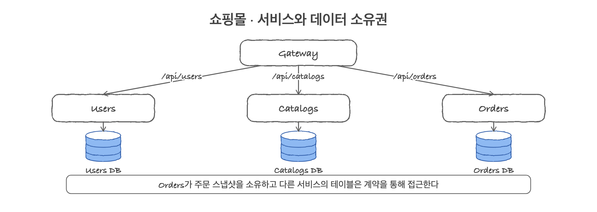

# Users·Catalogs·Orders의 API와 저장소 설계하기

쇼핑몰 예제에서 Users는 사용자 계정, Catalogs는 상품·재고, Orders는 주문과 구매 시점의 스냅샷을 소유한다. Gateway가 외부 경로를 제공하고, 서비스는 자신이 소유한 데이터의 변경을 책임진다. [AWS 서비스별 데이터베이스](https://docs.aws.amazon.com/prescriptive-guidance/latest/modernization-data-persistence/database-per-service.html) · [Spring Cloud 프로젝트](https://spring.io/projects/spring-cloud/)

그림의 근거 · [AWS 서비스별 데이터베이스](https://docs.aws.amazon.com/prescriptive-guidance/latest/modernization-data-persistence/database-per-service.html) · [Spring Cloud 프로젝트](https://spring.io/projects/spring-cloud/)

## 1. 업무 값의 주인과 저장 경계를 기록한다

Orders는 주문 ID, 구매 시점의 상품명·단가와 수량을 저장한다. Catalogs에서 가격이 바뀌어도 과거 주문을 당시 값으로 조회한다. 로컬 H2 같은 실습 저장소를 사용하더라도 다른 서비스가 해당 테이블을 직접 조회하지 않도록 하고, 운영 DB의 제약과 트랜잭션을 대상으로 별도 검증을 둔다. [AWS 서비스별 데이터베이스](https://docs.aws.amazon.com/prescriptive-guidance/latest/modernization-data-persistence/database-per-service.html) · [The Twelve-Factor App](https://12factor.net/)

## 2. API 계약에 상태와 리소스의 의미를 담는다

예시에서 사용자 생성 커밋이 완료되면 `201 Created`와 조회 위치로 응답한다. 유일한 사용자 식별자 충돌은 `409 Conflict`로 정의한다. 주문 접수가 재고 예약까지 기다리지 않는 계약이면 `202 Accepted`와 진행 상태 조회 위치를 제공한다. [RFC 9110 HTTP 상태 코드](https://www.rfc-editor.org/rfc/rfc9110.html#name-status-codes) · [AWS Saga 오케스트레이션](https://docs.aws.amazon.com/prescriptive-guidance/latest/cloud-design-patterns/saga-orchestration.html)

첨부 목차의 Swagger/OAS 3.0은 강의 버전이다. 현재 공개 OpenAPI 3.2.1 명세를 참고해 외부 경로·요청 스키마·응답 코드·인증 요구를 계약으로 기록한다. 실제 문서 생성기와 소비 도구가 지원하는 OAS 버전을 함께 확인해 고른다. [OpenAPI 3.2.1 명세](https://spec.openapis.org/oas/v3.2.1.html) · [RFC 9110 HTTP 상태 코드](https://www.rfc-editor.org/rfc/rfc9110.html#name-status-codes)

## 3. 경계 간 조합과 실패의 책임을 정한다

Users 화면에서 최근 주문을 표시할 때 HTTP로 Orders를 조회할지, 별도 조회 모델을 사용할지 지연·최신성 요구에 맞춰 고른다. Orders 장애를 주문 없음과 구분하고, 재고 예약 실패나 진행 중 응답이 공개 API의 상태와 일치하는지 검증한다. [AWS 서비스별 데이터베이스](https://docs.aws.amazon.com/prescriptive-guidance/latest/modernization-data-persistence/database-per-service.html) · [Microsoft CQRS](https://learn.microsoft.com/en-us/azure/architecture/patterns/cqrs) · [AWS Saga 오케스트레이션](https://docs.aws.amazon.com/prescriptive-guidance/latest/cloud-design-patterns/saga-orchestration.html) · [RFC 9110 HTTP 상태 코드](https://www.rfc-editor.org/rfc/rfc9110.html#name-status-codes)
