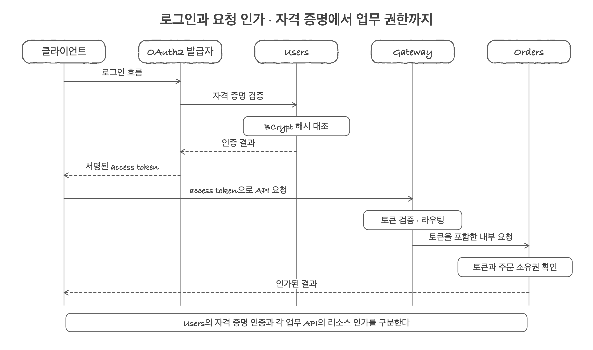

# 서비스 라우트와 사용자 인증 보호하기

로그인과 API 호출은 다른 경계를 거친다. 예제에서 Users는 계정과 비밀번호 해시를 관리하고 OAuth2 인가 서버는 로그인 결과에 따라 액세스 토큰을 발급한다. Gateway와 보호 대상인 Orders는 각각 JWT를 검증하는 리소스 서버다. [Spring Security · Password Storage](https://docs.spring.io/spring-security/reference/features/authentication/password-storage.html) · [Spring Security · Authorization Server](https://docs.spring.io/spring-security/reference/servlet/oauth2/authorization-server/) · [Spring Security Reactive · OAuth2 Resource Server JWT](https://docs.spring.io/spring-security/reference/reactive/oauth2/resource-server/jwt.html) · [Spring Security Servlet · OAuth2 Resource Server JWT](https://docs.spring.io/spring-security/reference/servlet/oauth2/resource-server/jwt.html)

## 1. Users의 비밀번호와 토큰 발급

Users는 가입할 때 `PasswordEncoder`의 BCrypt 구현으로 만든 단방향 해시를 저장하고 로그인 시 입력값과 저장된 해시를 대조한다. BCrypt 작업 비용은 실제 환경에서 로그인 응답 시간과 처리량을 함께 측정해 정한다. 인가 서버의 토큰 서명 키는 비밀번호 해시 및 사용자 DB와 별도로 관리한다. [Spring Security · Password Storage](https://docs.spring.io/spring-security/reference/features/authentication/password-storage.html) · [Spring Security · Authorization Server](https://docs.spring.io/spring-security/reference/servlet/oauth2/authorization-server/) · [Spring Security Servlet · JWT Key Rotation](https://docs.spring.io/spring-security/reference/servlet/oauth2/resource-server/jwt.html)

그림의 근거 · [Spring Security · Password Storage](https://docs.spring.io/spring-security/reference/features/authentication/password-storage.html) · [Spring Security · Authorization Server](https://docs.spring.io/spring-security/reference/servlet/oauth2/authorization-server/) · [Spring Security Reactive · OAuth2 Resource Server JWT](https://docs.spring.io/spring-security/reference/reactive/oauth2/resource-server/jwt.html) · [Spring Security Servlet · OAuth2 Resource Server JWT](https://docs.spring.io/spring-security/reference/servlet/oauth2/resource-server/jwt.html)

## 2. Gateway 인증과 Orders 권한 검사

보호 라우트에는 Spring Security의 OAuth2 Resource Server를 적용한다. WebFlux Gateway에서는 Reactive 설정을 사용하고, Orders가 Servlet 서비스라면 Servlet 설정을 사용한다. 두 경계가 신뢰하는 발급자의 공개키로 서명과 만료 시각, 사용 가능 시각, 발급자를 검증하고, 각 리소스 서버가 허용할 대상(`aud`)도 정책에 맞춰 검증한다. 예제는 양쪽에서 허용하는 대상으로 발급된 토큰을 전달한다. [Spring Security Reactive · OAuth2 Resource Server JWT](https://docs.spring.io/spring-security/reference/reactive/oauth2/resource-server/jwt.html) · [Spring Security Servlet · OAuth2 Resource Server JWT](https://docs.spring.io/spring-security/reference/servlet/oauth2/resource-server/jwt.html)

실습에서 `AuthFilter`가 맡던 JWT 인증은 Spring Security의 Resource Server에 맡긴다. Gateway는 외부 경로의 공개 여부와 필요한 권한 범위를 먼저 확인한다. Orders는 전달된 토큰을 검증하고 주문 조회의 권한 범위와 주문 소유권을 확인한다. [Spring Security Reactive · OAuth2 Resource Server JWT](https://docs.spring.io/spring-security/reference/reactive/oauth2/resource-server/jwt.html) · [Spring Security Servlet · OAuth2 Resource Server JWT](https://docs.spring.io/spring-security/reference/servlet/oauth2/resource-server/jwt.html) · [RFC 6750 · Bearer Token Errors](https://www.rfc-editor.org/rfc/rfc6750.html#section-3.1)

## 3. 경로 변환과 실패 검증

WebFlux Gateway의 `RewritePath`는 공개 경로 `/api/orders/42`를 내부 경로 `/orders/42`로 바꾼다. Gateway의 접근 규칙은 공개 경로를 기준으로, Orders의 접근 규칙은 전달받은 내부 경로를 기준으로 점검한다. Server Web MVC에서 명시적인 `lb()` 필터를 사용한다면 경로를 바꾸는 필터를 먼저 적용한다. [Spring Cloud Gateway WebFlux · RewritePath](https://docs.spring.io/spring-cloud-gateway/reference/spring-cloud-gateway-server-webflux/gatewayfilter-factories/rewritepath-factory.html) · [Spring Cloud Gateway Web MVC · LoadBalancer Filter](https://docs.spring.io/spring-cloud-gateway/reference/spring-cloud-gateway-server-webmvc/filters/loadbalancer.html) · [Spring Security Reactive · OAuth2 Resource Server JWT](https://docs.spring.io/spring-security/reference/reactive/oauth2/resource-server/jwt.html)

만료됐거나 발급자 또는 대상이 일치하지 않는 토큰은 `401`, 유효한 토큰이라도 요청에 필요한 권한 범위가 빠지면 `403`인지 확인한다. 다른 사용자의 주문 조회가 Orders에서 거부되는지, 공개 경로로 허용한 요청만 변환된 내부 경로에 도달하는지, 인가 서버가 공개키를 교체할 때 검증이 어떻게 이어지는지도 확인한다. [RFC 6750 · Bearer Token Errors](https://www.rfc-editor.org/rfc/rfc6750.html#section-3.1) · [Spring Security Servlet · OAuth2 Resource Server JWT](https://docs.spring.io/spring-security/reference/servlet/oauth2/resource-server/jwt.html) · [Spring Security Servlet · JWT Key Rotation](https://docs.spring.io/spring-security/reference/servlet/oauth2/resource-server/jwt.html) · [Spring Cloud Gateway WebFlux · RewritePath](https://docs.spring.io/spring-cloud-gateway/reference/spring-cloud-gateway-server-webflux/gatewayfilter-factories/rewritepath-factory.html)
