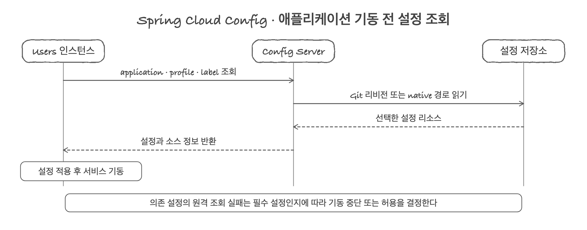

# Spring Cloud Config로 외부 설정 관리하기

Spring Cloud 2026.0.0(Paddington), Spring Boot 4.2.0, Spring Cloud Config 5.1.0을 기준으로 한다. 파일 시스템 백엔드는 원문을 확인한 Config 5.0.6으로 표기한다. [Spring Cloud 공식 릴리스](https://spring.io/blog/2026/11/20/spring-cloud-2026-0-0-has-been-released/) · [Config 5.0.6 파일 시스템 백엔드](https://docs.spring.io/spring-cloud-config/reference/server/environment-repository/file-system-backend.html)

## 1. 서비스의 시작 경로에서 설정 공급 경계를 정한다

Orders는 기동 중 Config Client로 Config Server에 접속해 외부 속성을 Spring 환경에 로드한다. Config Server는 요청에 맞는 설정을 저장소에서 읽어 속성 소스로 반환한다. Gateway, Users, Catalogs도 이 경로를 사용할 경우 설정 서버의 연결 실패가 여러 서비스의 기동에 영향을 줄 수 있다. [Config Data Import](https://docs.spring.io/spring-cloud-config/reference/client.html#spring-boot-config-data-import) · [Config Environment Repository](https://docs.spring.io/spring-cloud-config/reference/server/environment-repository.html)

Config Client는 실행 초기에 설정을 가져온다. 서버는 Git이나 파일 시스템 백엔드에서 요청에 맞는 속성 소스를 조회한다. [Config Data Import](https://docs.spring.io/spring-cloud-config/reference/client.html#spring-boot-config-data-import) · [Config Environment Repository](https://docs.spring.io/spring-cloud-config/reference/server/environment-repository.html) · [Config Git Backend](https://docs.spring.io/spring-cloud-config/reference/server/environment-repository/git-backend.html) · [Config 5.0.6 파일 시스템 백엔드](https://docs.spring.io/spring-cloud-config/reference/server/environment-repository/file-system-backend.html)

## 2. 서비스·환경·설정 리비전을 서로 다른 축으로 선택한다

Config Server의 환경 조회 경로는 `/{application}/{profile}/{label}` 형태다. 예를 들어 `/orders/prod/release-42`에서 `orders`는 서비스 이름, `prod`는 실행 프로필, `release-42`는 Git 쪽 설정 묶음을 가리킨다. Git 백엔드의 label에는 브랜치·태그·커밋 ID를 사용할 수 있다. [Config Environment Repository](https://docs.spring.io/spring-cloud-config/reference/server/environment-repository.html) · [Config 리소스 조회](https://docs.spring.io/spring-cloud-config/reference/client.html#locating-remote-configuration-resources)

Git 백엔드는 변경 검토와 리비전 추적에 적합하다. `file:` URI를 Git 백엔드에 지정하면 Config Server는 로컬 Git 저장소를 직접 사용한다. 로컬에서도 Git 리비전을 선택할 수 있다. [Config Git Backend](https://docs.spring.io/spring-cloud-config/reference/server/environment-repository/git-backend.html)

파일 시스템 백엔드는 서버의 `native` 프로필을 사용하며 지정한 클래스패스나 디렉터리에서 파일을 읽는다. 개발 환경에서 서버와 클라이언트 사이의 조회 흐름을 확인할 때 사용할 수 있다. 운영에서 여러 Config Server가 이 백엔드를 쓸 경우 일관된 파일 사본을 제공할 공유 파일 시스템이 필요하다. [Config 5.0.6 파일 시스템 백엔드](https://docs.spring.io/spring-cloud-config/reference/server/environment-repository/file-system-backend.html)

## 3. 원격 설정이 없을 때 시작을 허용할지 결정한다

Config Data 방식에서는 `spring.config.import`로 원격 설정을 선언한다. `optional:configserver:`는 Config Server 연결 실패를 허용하고, `configserver:`는 연결할 수 없으면 기동을 실패시킨다. 기존 bootstrap 방식에서 이 정책을 선택할 때는 `spring.cloud.config.fail-fast`를 사용한다. [Config Data Import](https://docs.spring.io/spring-cloud-config/reference/client.html#spring-boot-config-data-import) · [Config Client Fail Fast](https://docs.spring.io/spring-cloud-config/reference/client.html#config-client-fail-fast)

Orders 운영 환경에서 올바른 원격 설정이 필수라면 필수 import를 사용하고, 서비스가 시작되기 전에 업무상 필수 속성도 검증한다. 개발 환경에서 안전한 로컬 기본값이 마련된 기능만 선택적 import로 시작한다. 원격 서버 연결 실패와 원격 속성의 누락은 배포 검증에서 따로 검사한다. [Config Data Import](https://docs.spring.io/spring-cloud-config/reference/client.html#spring-boot-config-data-import) · [Config Environment Repository](https://docs.spring.io/spring-cloud-config/reference/server/environment-repository.html) · [Config Client Fail Fast](https://docs.spring.io/spring-cloud-config/reference/client.html#config-client-fail-fast)

Config Data는 기본 프로필을 먼저 불러온 다음 활성 프로필의 설정을 가져올 수 있다. 기동 중 여러 번 조회되는 동작과 실패 후 재시도를 구분한다. 연결 불능에 대비한 재시도 횟수와 간격은 배포 시스템의 시작 제한 시간 안에 들어오도록 정한다. [Config Data Import](https://docs.spring.io/spring-cloud-config/reference/client.html#spring-boot-config-data-import) · [Config Client Retry](https://docs.spring.io/spring-cloud-config/reference/client.html#config-client-retry)

## 4. 저장소 장애와 잘못된 설정을 구분해 복구한다

기동에 실패하면 Config Client에서 서버까지의 연결·인증, 서버에서 저장소까지의 접근, 마지막으로 application·profile·label과 원격 속성의 실제 구성 순서로 확인한다. 이전 설정으로 되돌릴 때는 해당 리비전이 현재 애플리케이션 버전에서도 유효한지 확인하고 시작 경로를 다시 검증한다. [Config Environment Repository](https://docs.spring.io/spring-cloud-config/reference/server/environment-repository.html) · [Config 리소스 조회](https://docs.spring.io/spring-cloud-config/reference/client.html#locating-remote-configuration-resources) · [Config Client Fail Fast](https://docs.spring.io/spring-cloud-config/reference/client.html#config-client-fail-fast)
