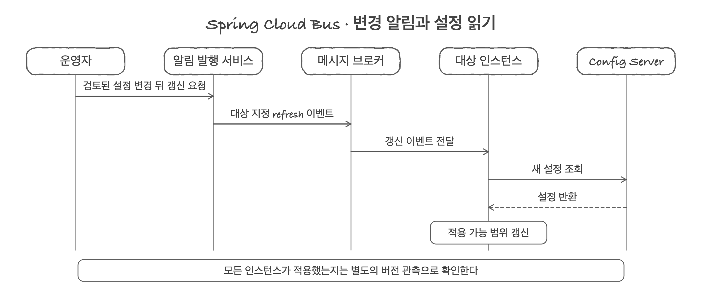

# Spring Cloud Bus로 설정 변경 전파하기

Spring Cloud 2026.0.0부터 Spring Cloud Bus는 Spring Cloud Stream 5.1.0에 편입되었다. 기존 Bus 아티팩트의 좌표는 유지된다. [Spring Cloud 공식 릴리스](https://spring.io/blog/2026/11/20/spring-cloud-2026-0-0-has-been-released/)

## 1. 설정 저장 경로와 변경 신호의 전달 경로를 나눈다

운영자가 설정을 게시한 뒤 관리 경로에서 `/actuator/busrefresh`를 호출하면 Bus가 변경 신호를 배포한다. 대상 Orders 인스턴스는 신호를 받고 갱신을 수행한다. Config Server를 사용한다면 새 설정의 조회 경로는 기존 Config Client와 Config Server 사이에 있다. [Bus Refresh Endpoint](https://docs.spring.io/spring-cloud-stream/reference/bus/bus-endpoints.html#bus-refresh-endpoint) · [Stream Bus 설정](https://docs.spring.io/spring-cloud-stream/reference/5.1/bus/configuration.html#customizing-the-message-broker) · [Config Data Import](https://docs.spring.io/spring-cloud-config/reference/client.html#spring-boot-config-data-import)

RabbitMQ나 Kafka는 갱신 신호를 운반한다. 설정 값의 출처는 Config Server의 설정 저장소이며, 각 인스턴스에서 갱신을 처리한다. [Stream Bus 설정](https://docs.spring.io/spring-cloud-stream/reference/5.1/bus/configuration.html#customizing-the-message-broker) · [Bus Refresh Endpoint](https://docs.spring.io/spring-cloud-stream/reference/bus/bus-endpoints.html#bus-refresh-endpoint) · [Config Data Import](https://docs.spring.io/spring-cloud-config/reference/client.html#spring-boot-config-data-import)

Bus는 Spring Cloud Stream의 binder를 통해 메시지를 브로드캐스트한다. RabbitMQ를 쓰는 환경은 AMQP binder, Kafka를 쓰는 환경은 Kafka binder를 사용한다. 두 경우 모두 `spring.cloud.bus.destination`은 브로커 쪽 Bus 목적지를 지정한다. [Stream Bus 설정](https://docs.spring.io/spring-cloud-stream/reference/5.1/bus/configuration.html#customizing-the-message-broker)

## 2. 운영 환경과 인스턴스 대상을 좁힌다

관리 요청의 대상은 Bus 서비스 ID로 지정할 수 있다. 예를 들어 실제 ID가 `orders:canary:1`이면 `/actuator/busrefresh/orders:canary:1`로 해당 인스턴스를 고르고, `orders:**` 패턴으로 Orders에 속한 모든 인스턴스를 선택할 수 있다. 같은 Bus에 참여하는 인스턴스마다 고유한 ID를 둔다. [Bus 인스턴스 지정](https://docs.spring.io/spring-cloud-stream/reference/bus/addressing.html)

브로커 목적지는 환경의 메시지 경계를 정하고, HTTP 경로의 destination은 그 Bus 안에서 처리할 인스턴스를 선택한다. 운영에서는 환경별 브로커 자격 증명과 목적지를 사용하고, 갱신 요청을 보내는 Actuator 엔드포인트는 인증된 관리 경로에 노출한다. [Stream Bus 설정](https://docs.spring.io/spring-cloud-stream/reference/5.1/bus/configuration.html#customizing-the-message-broker) · [Bus 인스턴스 지정](https://docs.spring.io/spring-cloud-stream/reference/bus/addressing.html) · [Actuator Endpoint Security](https://docs.spring.io/spring-boot/reference/actuator/endpoints.html#actuator.endpoints.security)

## 3. 신호 수신과 실제 설정 적용을 각각 확인한다

갱신은 `@ConfigurationProperties` 재바인딩과 `RefreshScope` 캐시 무효화를 수행한다. `@RefreshScope` 빈은 다음 사용 시 다시 만들어질 수 있다. 생성자 바인딩 객체, 갱신 대상에 포함되지 않은 빈처럼 실행 중 교체할 수 없는 설정은 재배포 경로로 반영한다. [Bus Refresh Endpoint](https://docs.spring.io/spring-cloud-stream/reference/bus/bus-endpoints.html#bus-refresh-endpoint) · [Commons Refresh Scope](https://docs.spring.io/spring-cloud-commons/reference/spring-cloud-commons/application-context-services.html#refresh-scope)

Orders 카나리 한 대에 변경을 보내 적용된 설정 버전과 기능 상태를 확인한 뒤 같은 서비스의 나머지 인스턴스로 넓힌다. Bus 추적의 발행·수신 기록과 각 인스턴스의 애플리케이션 상태를 함께 확인한다. 갱신 전후 설정이 잠시 공존할 수 있으므로 주문 처리 규칙을 바꿀 때는 두 버전이 섞이는 구간까지 설계한다. [Bus 인스턴스 지정](https://docs.spring.io/spring-cloud-stream/reference/bus/addressing.html) · [Bus 이벤트 추적](https://docs.spring.io/spring-cloud-stream/reference/5.1/bus/configuration.html#tracing-bus-events) · [Commons Refresh Scope](https://docs.spring.io/spring-cloud-commons/reference/spring-cloud-commons/application-context-services.html#refresh-scope)

## 4. 일부 인스턴스가 갱신되지 않은 상태를 복구한다

발행 기록이 없으면 관리 요청의 노출·권한과 브로커 연결을 확인한다. 일부 인스턴스의 수신 기록이 빠졌으면 브로커 목적지, 서비스 ID, 대상 패턴부터 확인한다. 수신 이후 동작이 다르면 Config Server의 리비전과 대상 빈의 갱신 가능성을 확인한다. [Actuator Endpoint Security](https://docs.spring.io/spring-boot/reference/actuator/endpoints.html#actuator.endpoints.security) · [Bus 이벤트 추적](https://docs.spring.io/spring-cloud-stream/reference/5.1/bus/configuration.html#tracing-bus-events) · [Bus 인스턴스 지정](https://docs.spring.io/spring-cloud-stream/reference/bus/addressing.html) · [Commons Refresh Scope](https://docs.spring.io/spring-cloud-commons/reference/spring-cloud-commons/application-context-services.html#refresh-scope) · [Config Data Import](https://docs.spring.io/spring-cloud-config/reference/client.html#spring-boot-config-data-import)

카나리 검증에서 실패하면 전체 전파를 보류한다. 이미 변경된 인스턴스에는 호환되는 이전 설정을 게시한 뒤 다시 갱신하고, 실행 중 갱신할 수 없는 대상은 이전 리비전으로 재배포한다. [Bus 인스턴스 지정](https://docs.spring.io/spring-cloud-stream/reference/bus/addressing.html) · [Commons Refresh Scope](https://docs.spring.io/spring-cloud-commons/reference/spring-cloud-commons/application-context-services.html#refresh-scope) · [Config Data Import](https://docs.spring.io/spring-cloud-config/reference/client.html#spring-boot-config-data-import)
