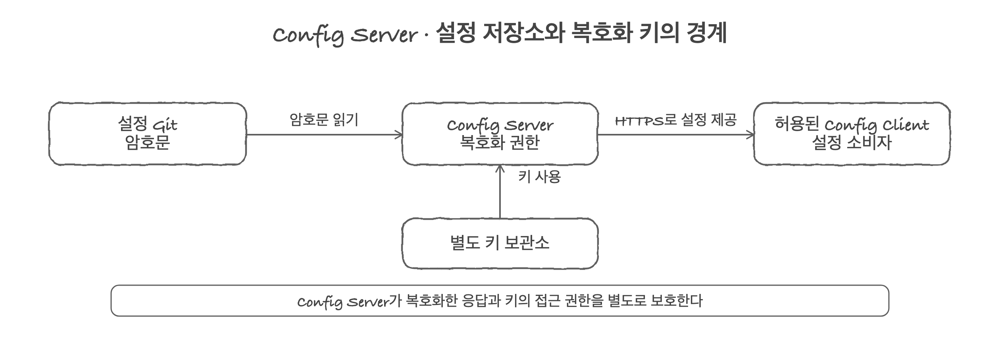

# 설정 비밀과 복호화 키의 경계 설계하기

Spring Cloud 2026.0.0 환경을 기준으로 설명한다. Config Server 암호화·키 교체의 세부 동작은 공식 원문을 확인한 Spring Cloud Config 5.0.6의 적용 범위로 표기한다. [Spring Cloud 공식 릴리스](https://spring.io/blog/2026/11/20/spring-cloud-2026-0-0-has-been-released/) · [Config 5.0.6 암호화·복호화](https://docs.spring.io/spring-cloud-config/reference/server/encryption-and-decryption.html) · [Config 5.0.6 키 교체](https://docs.spring.io/spring-cloud-config/reference/server/using-multiple-keys-and-key-rotation.html)

## 1. 저장된 암호문과 실행 중의 평문을 구분한다

Config Server의 기본 서버 복호화 경로에서는 Git에 저장된 `{cipher}` 값을 읽어 복호화한 뒤 HTTP 설정 응답으로 클라이언트에 전달한다. 암호화한 속성은 저장 시 보호되며, 복호화 키를 가진 서버와 평문을 받는 클라이언트도 신뢰 경계에 포함된다. [Config 5.0.6 암호화·복호화](https://docs.spring.io/spring-cloud-config/reference/server/encryption-and-decryption.html)

Git 읽기 권한, Config Server의 키 사용 권한, 애플리케이션 설정 조회 권한을 별도로 관리한다. 운영 자격 증명을 Vault에서 직접 읽는 경로에는 별도의 Vault 권한을 적용한다. [Config 5.0.6 암호화·복호화](https://docs.spring.io/spring-cloud-config/reference/server/encryption-and-decryption.html) · [Config 5.0.6 키 관리](https://docs.spring.io/spring-cloud-config/reference/server/key-management.html) · [Spring Cloud Vault ConfigData](https://docs.spring.io/spring-cloud-vault/reference/config-data.html)

Config Server 통신에는 TLS와 서비스별 인증·인가를 적용한다. 애플리케이션에 필요한 설정만 읽도록 권한을 제한하고, 평문 응답이나 설정 값이 로그·장애 보고서·관리 엔드포인트에 노출되는지도 확인한다. [Config 5.0.6 암호화·복호화](https://docs.spring.io/spring-cloud-config/reference/server/encryption-and-decryption.html) · [Config Server Security](https://docs.spring.io/spring-cloud-config/reference/server/security.html) · [Actuator Endpoint Security](https://docs.spring.io/spring-boot/reference/actuator/endpoints.html#actuator.endpoints.security)

## 2. 암호화 작업과 복호화 권한의 소유자를 정한다

대칭키 방식은 같은 키를 암호화와 복호화에 사용한다. `encrypt.key`를 쓰는 구성에서는 키를 Git 외부의 비밀 공급 경로로 Config Server에 전달한다. 암호화 담당자에게 키를 제공하면 해당 담당자도 복호화할 수 있다. [Config 5.0.6 키 관리](https://docs.spring.io/spring-cloud-config/reference/server/key-management.html)

RSA 비대칭 방식은 공개키로 암호화하고 개인키로 복호화한다. 공개키로 암호문을 만드는 주체와 keystore에서 개인키를 읽는 Config Server를 나눌 수 있다. 서버의 keystore 접근과 그 비밀번호의 권한도 제한한다. [Config 5.0.6 키 관리](https://docs.spring.io/spring-cloud-config/reference/server/key-management.html)

## 3. 키 교체와 서비스 자격 증명 교체를 따로 검증한다

keystore 기반으로 여러 키를 관리할 때는 새 alias를 서버에 먼저 준비한 뒤 새 키로 만든 암호문에 `{key:…}` 접두사를 넣는다. 각 Config Server에서 새·이전 리비전을 읽는 경로를 확인하고, 복구에 이전 리비전이 필요한 기간과 노출 사고 대응 정책을 고려해 이전 키의 폐기 시점을 정한다. [Config 5.0.6 키 교체](https://docs.spring.io/spring-cloud-config/reference/server/using-multiple-keys-and-key-rotation.html)

키가 노출된 경우 해당 키로 보호했던 비밀에 대해 별도로 교체 범위를 정한다. Orders DB 비밀번호처럼 수명과 폐기가 중요하면 Vault 같은 비밀 관리 시스템에 보관한다. Vault Database Secrets Engine은 역할별 동적 자격 증명 발급과 임대를 지원한다. [Config 5.0.6 키 교체](https://docs.spring.io/spring-cloud-config/reference/server/using-multiple-keys-and-key-rotation.html) · [Spring Cloud Vault ConfigData](https://docs.spring.io/spring-cloud-vault/reference/config-data.html) · [Vault 데이터베이스 자격 증명](https://developer.hashicorp.com/vault/docs/secrets/databases) · [Vault 임대·갱신·폐기](https://developer.hashicorp.com/vault/docs/concepts/lease)

## 4. 필수 비밀을 읽지 못하면 정상 상태로 진입하는 것을 막는다

Config Server가 값을 복호화하지 못하면 해당 값을 속성 소스에서 빼고 `invalid` 접두사가 붙은 속성을 추가할 수 있다. Orders는 필수 자격 증명이 유효할 때 준비 상태로 들어가도록 설계한다. 장애가 나면 요청 리비전의 key alias, 서버 keystore 접근, 최신 자격 증명의 유효성을 비밀 값 없이 점검한다. [Config 5.0.6 암호화·복호화](https://docs.spring.io/spring-cloud-config/reference/server/encryption-and-decryption.html) · [Config 5.0.6 키 교체](https://docs.spring.io/spring-cloud-config/reference/server/using-multiple-keys-and-key-rotation.html) · [Vault 임대·갱신·폐기](https://developer.hashicorp.com/vault/docs/concepts/lease)
