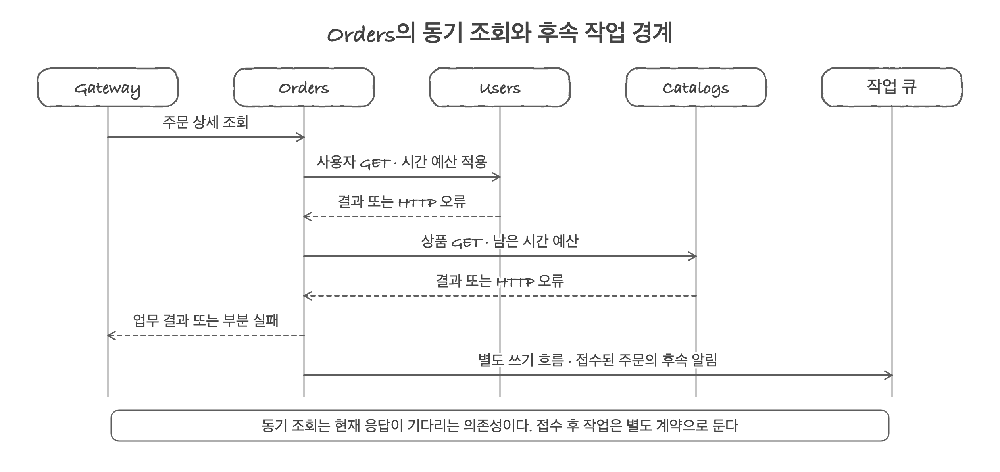

# 서비스 간 동기 HTTP 호출의 계약 설계하기

Spring Cloud 2026.0.0의 OpenFeign 5.1.0과 Spring Boot 4.2.0이 관리하는 Spring Framework 7.1.0의 HTTP 클라이언트를 기준으로 한다. [Spring Cloud 공식 릴리스](https://spring.io/blog/2026/11/20/spring-cloud-2026-0-0-has-been-released/) · [Spring Framework REST Clients](https://docs.spring.io/spring-framework/reference/integration/rest-clients.html) · [Spring Boot 관리 의존성](https://docs.spring.io/spring-boot/appendix/dependency-versions/coordinates.html)

## 1. 현재 요청에서 결과가 필요한 호출만 기다린다

Orders가 주문 화면을 만들기 위해 Catalogs에서 상품 정보를 읽는 경우 화면 응답 전에 조회 결과가 필요하다. 주문 수락 뒤에 처리해도 되는 알림은 후속 작업으로 넘길 수 있다. 장기 작업을 HTTP로 받는다면 수락 응답과 작업 상태 조회를 별도로 정의한다. [Spring Framework REST Clients](https://docs.spring.io/spring-framework/reference/integration/rest-clients.html) · [Asynchronous Request-Reply](https://learn.microsoft.com/en-us/azure/architecture/patterns/asynchronous-request-reply)

Orders는 현재 응답에 필요한 조회만 요청 경로에 둔다. 호출마다 남은 대기 시간과 실패 시 표현할 상태를 정한다. [Spring Framework REST Clients](https://docs.spring.io/spring-framework/reference/integration/rest-clients.html) · [Asynchronous Request-Reply](https://learn.microsoft.com/en-us/azure/architecture/patterns/asynchronous-request-reply) · [AWS 호출 시간 제한과 재시도](https://aws.amazon.com/builders-library/timeouts-retries-and-backoff-with-jitter/)

동기 HTTP 계약에서는 호출자가 현재 업무 응답에 필요한 결과를 기다린다. `WebClient`처럼 논블로킹 I/O를 사용하더라도 현재 응답을 만들려면 원격 결과가 필요한 의존 관계는 남는다. 비동기 업무 처리에서는 작업 수락 시점과 완료 시점의 계약을 각각 정의한다. [Spring Framework REST Clients](https://docs.spring.io/spring-framework/reference/integration/rest-clients.html) · [Asynchronous Request-Reply](https://learn.microsoft.com/en-us/azure/architecture/patterns/asynchronous-request-reply)

## 2. 동기 클라이언트의 구현 선택을 업무 계약과 분리한다

새 동기 호출에는 fluent API인 `RestClient`를 사용하거나, 공통 HTTP 계약을 인터페이스로 표현하고 싶다면 `@HttpExchange` 기반 HTTP Service Client를 `RestClient` 위에 구성한다. `RestTemplate`은 기존 코드에서 볼 수 있는 동기 클라이언트이며 Spring Framework 7.1.0 문서는 `RestClient`로의 전환을 안내한다. [Spring Framework REST Clients](https://docs.spring.io/spring-framework/reference/integration/rest-clients.html) · [Spring HTTP Service Clients](https://docs.spring.io/spring-framework/reference/integration/rest-clients.html#rest-http-service-client)

Spring Cloud OpenFeign은 공식 문서에서 기능 완성 상태(feature-complete)로 안내한다. 기존 Feign 호출을 이전할 때는 반환 타입뿐 아니라 헤더, 타임아웃, 상태별 오류 매핑, 재시도 설정까지 비교해 호출자와의 계약을 확인한다. [OpenFeign 프로젝트 상태](https://docs.spring.io/spring-cloud-openfeign/reference/index.html) · [OpenFeign 클라이언트 구성](https://docs.spring.io/spring-cloud-openfeign/reference/spring-cloud-openfeign.html#spring-cloud-feign-overriding-defaults) · [Spring HTTP Service Clients](https://docs.spring.io/spring-framework/reference/integration/rest-clients.html#rest-http-service-client)

## 3. HTTP 상태를 업무 결과와 원격 실패로 매핑한다

Catalogs 조회가 `404`를 반환하면 해당 조회의 상품 없음으로 해석할 수 있다. `403`은 권한 실패로, `503`은 일시적으로 사용할 수 없는 원격 서비스로 구분한다. API별로 각 상태의 의미와 호출자가 보여 줄 응답을 합의한다. [HTTP 상태 코드](https://www.rfc-editor.org/rfc/rfc9110.html#section-15)

기존 Feign 클라이언트에서는 `ErrorDecoder`로 HTTP 오류를 애플리케이션 예외에 매핑한다. `dismiss404`를 사용하는 클라이언트의 404 처리 경로도 함께 확인한다. Spring Cloud OpenFeign의 기본 `Retryer.NEVER_RETRY`는 재시도를 끄므로 오류 분류와 재시도 정책을 각각 명시한다. [OpenFeign 클라이언트 구성](https://docs.spring.io/spring-cloud-openfeign/reference/spring-cloud-openfeign.html#spring-cloud-feign-overriding-defaults)

## 4. 남은 요청 시간과 호출 결과 불명을 처리한다

Gateway에서 받은 요청의 응답 시간 안에 Orders 자체 처리와 Users·Catalogs 연결 및 응답 대기, 허용된 재시도 시간을 배분한다. 연결 제한과 응답 제한을 각각 검토하고, 재시도와 backoff를 합친 시간이 남은 한도를 넘으면 바로 종료한다. [AWS 호출 시간 제한과 재시도](https://aws.amazon.com/builders-library/timeouts-retries-and-backoff-with-jitter/) · [OpenFeign 클라이언트 구성](https://docs.spring.io/spring-cloud-openfeign/reference/spring-cloud-openfeign.html#spring-cloud-feign-overriding-defaults)

주문을 쓰는 요청이 타임아웃되면 원격에서 변경을 반영했는지 알 수 없는 경우가 있다. 재시도가 필요한 쓰기에는 요청의 동일성을 식별할 방법과 상태 조회 계약을 둔다. 해당 계약이 없다면 결과가 불명확한 쓰기를 자동으로 재호출하지 않는다. [HTTP 멱등 요청](https://www.rfc-editor.org/rfc/rfc9110.html#section-9.2.2) · [Asynchronous Request-Reply](https://learn.microsoft.com/en-us/azure/architecture/patterns/asynchronous-request-reply) · [AWS 호출 시간 제한과 재시도](https://aws.amazon.com/builders-library/timeouts-retries-and-backoff-with-jitter/)
