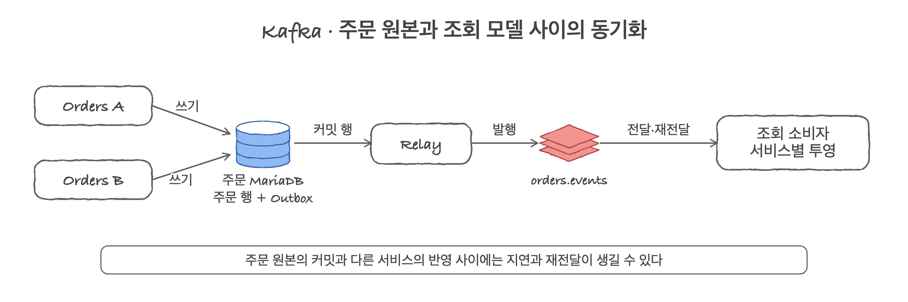

# Kafka로 서비스 데이터 동기화하기

## 1. 주문 원본과 조회용 복제본

쇼핑몰 예시에서 Orders 인스턴스가 두 개로 늘어나도 주문 생성과 상태 변경은 같은 주문 MariaDB에서 커밋한다. 인스턴스는 HTTP 요청을 나누어 처리하고, 주문 저장소가 주문 상태의 기준이 된다. Catalogs의 상품별 주문 집계와 고객의 주문 목록은 같은 데이터를 각자의 조회 목적에 맞게 재구성한 투영을 읽을 수 있다. 주문 직후 확정 상태가 필요한 화면에는 쓰기 결과나 Orders 조회를 사용하고, 목록에서 허용할 반영 지연은 별도로 정한다. [Microsoft · CQRS](https://learn.microsoft.com/en-us/azure/architecture/patterns/cqrs)

그림의 근거 · [AWS · Transactional Outbox](https://docs.aws.amazon.com/prescriptive-guidance/latest/cloud-design-patterns/transactional-outbox.html) · [Apache Kafka 4.2 · 주요 개념](https://kafka.apache.org/42/getting-started/introduction/#main-concepts-and-terminology) · [Microsoft · CQRS](https://learn.microsoft.com/en-us/azure/architecture/patterns/cqrs)

## 2. 커밋된 주문을 토픽으로 전달하기

Orders는 주문 행과 발행할 이벤트를 같은 DB 트랜잭션으로 기록한다. 커밋 후 릴레이가 아웃박스를 읽어 Kafka producer로 주문 이벤트 토픽에 발행한다. 커밋 전에 실패하면 둘 다 롤백되고, DB 커밋 후 Kafka에 접근하지 못하면 아웃박스가 재시도할 데이터를 보존한다. 발행은 됐지만 릴레이가 완료를 기록하기 전에 중단될 수 있으므로 소비자는 같은 이벤트를 다시 받을 수 있다. [AWS · Transactional Outbox](https://docs.aws.amazon.com/prescriptive-guidance/latest/cloud-design-patterns/transactional-outbox.html)

예시 토픽은 `orders.events`이고 메시지 키는 `orderId`다. 같은 주문의 이벤트는 동일 파티션에 매핑되는 동안 그 파티션에 기록된 순서대로 읽힌다. 업무상 발생 순서가 중요하면 발행 경로에서도 순서를 유지하고 이벤트에 주문 버전을 넣는다. Catalogs 집계와 고객 조회가 다른 소비자 그룹이면 두 그룹이 각각 자기 위치에서 읽고, 같은 그룹 안의 여러 인스턴스는 파티션을 나누어 맡는다. [Apache Kafka 4.2 · 주요 개념](https://kafka.apache.org/42/getting-started/introduction/#main-concepts-and-terminology) · [Apache Kafka 4.2 · 설계](https://kafka.apache.org/42/design/design/) · [AWS · Transactional Outbox](https://docs.aws.amazon.com/prescriptive-guidance/latest/cloud-design-patterns/transactional-outbox.html)

## 3. 중복과 갱신 지연을 복구하기

소비자는 이벤트 ID나 주문 버전으로 재처리를 판별한다. 예를 들어 투영 갱신과 처리한 이벤트 ID 기록을 같은 조회 DB 트랜잭션으로 커밋하고, 그 다음 Kafka 오프셋을 확정한다. DB 반영 직후 소비자가 중단되어 같은 레코드를 다시 받아도 이미 처리한 건은 상태를 한 번 더 바꾸지 않는다. 취소가 반영된 행을 오래된 생성 이벤트로 되돌리지 않도록 버전 비교도 적용한다. [AWS · Transactional Outbox](https://docs.aws.amazon.com/prescriptive-guidance/latest/cloud-design-patterns/transactional-outbox.html) · [Apache Kafka 4.2 · 설계](https://kafka.apache.org/42/design/design/)

목록 반영이 늦으면 가장 오래된 미발행 아웃박스의 대기 시간, 소비자 그룹 지연, 투영의 마지막 반영 시각을 차례로 확인한다. 토픽 보존 기간 안에서는 필요한 범위를 다시 읽을 수 있다. 더 오래된 데이터가 필요하면 주문 원본에서 투영을 다시 만들고 재개 위치를 맞춘다. Kafka 토픽 복제는 브로커의 파티션 사본을 유지하고, 서비스의 조회 투영은 별도의 저장소에 조회 목적의 데이터 사본을 유지한다. [AWS · Transactional Outbox](https://docs.aws.amazon.com/prescriptive-guidance/latest/cloud-design-patterns/transactional-outbox.html) · [Apache Kafka 4.2 · 주요 개념](https://kafka.apache.org/42/getting-started/introduction/#main-concepts-and-terminology) · [Microsoft · CQRS](https://learn.microsoft.com/en-us/azure/architecture/patterns/cqrs)
