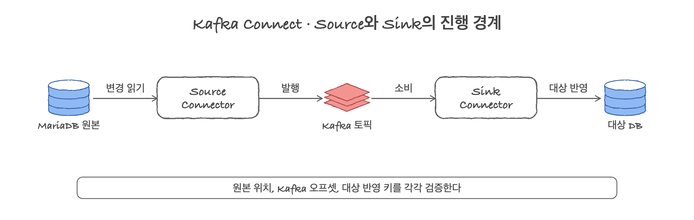

# Kafka Connect 데이터 파이프라인 설계하기

## 1. Source에서 Sink까지의 데이터 이동

쇼핑몰 예시에서 주문 MariaDB의 변경을 조회용이나 분석용 DB에 전달한다. Source Connector는 외부 시스템에서 읽어 Kafka 토픽에 쓰고, Sink Connector는 토픽에서 읽어 외부 저장소에 쓴다. Kafka Connect Worker가 커넥터 플러그인과 Task를 실행한다. 분산 모드에서는 Worker가 작업을 나눠 맡고 커넥터 설정, 소스 오프셋, 작업 상태에는 Kafka의 내부 토픽을 사용한다. [Apache Kafka Connect 4.2 · 사용자 가이드](https://kafka.apache.org/42/kafka-connect/user-guide/)

그림의 근거 · [Apache Kafka Connect 4.2 · 사용자 가이드](https://kafka.apache.org/42/kafka-connect/user-guide/) · [Confluent · JDBC Sink](https://docs.confluent.io/kafka-connectors/jdbc/current/sink-connector/overview.html) · [Debezium 3.7 · MariaDB Connector](https://debezium.io/documentation/reference/3.7/connectors/mariadb.html)

## 2. JDBC 폴링과 MariaDB CDC

Confluent JDBC Source는 SQL을 주기적으로 실행해 결과 행을 내보낸다. 증분 모드에서 새 행을 표시하는 증가 열이나 수정 시각 열로 진행 위치를 추적한다. 조회 간격 동안 여러 번 바뀐 행은 다음 조회 시점에 남은 값만 보일 수 있다. 삭제 통지가 필요하면 소프트 삭제 또는 별도 변경 목록처럼 쿼리에 남는 기록을 설계하거나 로그 기반 CDC를 고려한다. [Confluent · JDBC Source](https://docs.confluent.io/kafka-connectors/jdbc/current/source-connector/overview.html)

Debezium 3.7의 MariaDB 커넥터는 초기 스냅샷 지점부터 binlog를 읽어 행의 삽입, 수정, 삭제를 변경 이벤트로 내보낸다. DB 버전과 커넥터 지원 범위, binlog 설정과 보존 기간, 커넥터가 저장한 재개 위치를 배포 전에 확인한다. 커넥터가 장기간 중단되어 재개할 binlog가 사라지면 기존 위치로 증분 처리를 재개할 수 있는지 먼저 확인하고, 필요하면 새 스냅샷과 조회 저장소 재동기화 범위를 정한다. [Debezium 3.7 · MariaDB Connector](https://debezium.io/documentation/reference/3.7/connectors/mariadb.html)

업무 소비자가 필요로 하는 것이 ‘주문 취소’ 같은 도메인 이벤트라면 Orders가 이벤트 계약을 결정하고 커넥터는 아웃박스 변경을 전달하는 쪽으로 구성할 수 있다. 공유할 데이터를 테이블 행 단위로 선택하는 경우에는 레코드 키와 스키마, 삭제 표현을 Sink에서 수용할 수 있도록 맞춘다. 예를 들어 JDBC Sink의 행 삭제는 키가 있고 값이 없는 tombstone과 활성화 설정을 전제로 한다. [AWS · Transactional Outbox](https://docs.aws.amazon.com/prescriptive-guidance/latest/cloud-design-patterns/transactional-outbox.html) · [Debezium 3.7 · MariaDB Connector](https://debezium.io/documentation/reference/3.7/connectors/mariadb.html) · [Confluent · JDBC Sink](https://docs.confluent.io/kafka-connectors/jdbc/current/sink-connector/overview.html)

## 3. 전달 보장과 재처리

Kafka Connect 4.2의 exactly-once 지원 여부는 커넥터 종류와 설정에 달려 있다. Source는 커넥터 지원과 분산 Worker 구성이 필요하고, Sink는 커넥터가 이를 지원하며 중단된 Kafka 트랜잭션을 읽지 않도록 구성해야 한다. 예시의 Confluent JDBC Sink는 at-least-once 전달을 제공한다. 대상 DB에 쓴 뒤 오프셋 확정 전에 중단될 수 있으므로 안정적인 키와 upsert로 같은 상태 변경을 다시 적용할 수 있게 한다. [Apache Kafka Connect 4.2 · 전달 보장](https://kafka.apache.org/42/kafka-connect/user-guide/#exactly-once-support) · [Confluent · JDBC Sink](https://docs.confluent.io/kafka-connectors/jdbc/current/sink-connector/overview.html)

조회 DB 반영이 멈추면 커넥터와 개별 Task의 상태를 먼저 확인하고, Kafka 소비 지연과 DB의 마지막 반영값을 비교한다. 연결 장애는 연결 복구 후 같은 위치에서 재처리할 수 있도록 하고, 형식이나 스키마가 맞지 않는 레코드는 해당 설정이 지원하는 DLQ로 격리한다. DLQ에 적재된 레코드는 원인을 해결한 뒤 다시 처리하고 대상 DB 반영까지 확인한다. [Apache Kafka Connect 4.2 · 운영](https://kafka.apache.org/42/kafka-connect/user-guide/) · [Confluent · JDBC Sink](https://docs.confluent.io/kafka-connectors/jdbc/current/sink-connector/overview.html)
