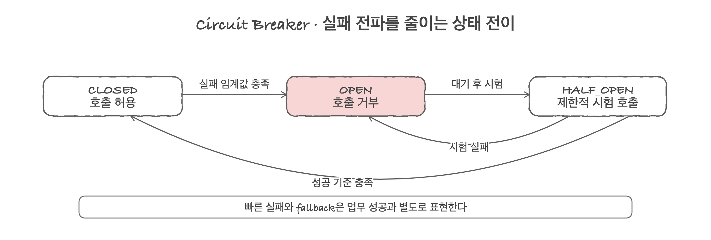

# Circuit Breaker로 원격 호출 장애 격리하기

Spring Cloud 2026.0.0의 Spring Cloud CircuitBreaker 5.1.0과 그 릴리스가 사용하는 Resilience4j 2.4.0을 기준으로 한다. [Spring Cloud 공식 릴리스](https://spring.io/blog/2026/11/20/spring-cloud-2026-0-0-has-been-released/)

## 1. 호출하는 서비스에서 장애를 격리한다

Gateway가 Orders 응답을 기다리고, Orders가 Catalogs 조회를 기다린다면 Catalogs 지연이 두 서비스의 처리 자원을 점유할 수 있다. Catalogs 호출의 차단기는 Orders의 원격 호출 경계에 둔다. Gateway도 Orders 경로를 별도로 보호할 수 있고, 서로 다른 원격 대상은 차단기 상태를 공유하지 않도록 설계한다. [Resilience4j CircuitBreaker](https://resilience4j.readme.io/docs/circuitbreaker) · [Circuit Breaker 패턴](https://learn.microsoft.com/en-us/azure/architecture/patterns/circuit-breaker)

호출자는 OPEN 상태에서 원격 호출을 빠르게 거절하고, HALF_OPEN에서는 일부 시험 호출의 결과를 보고 정상 호출을 재개할지 판단한다. [Resilience4j CircuitBreaker](https://resilience4j.readme.io/docs/circuitbreaker)

## 2. 차단 기준과 복구 기준을 실제 호출 결과로 정한다

Resilience4j는 CLOSED에서 최근 호출을 횟수 또는 시간 윈도로 집계한다. 최소 표본 수에 도달하면 실패율과 느린 호출 비율을 비교하고, 둘 중 하나가 설정한 임계값에 도달하면 OPEN으로 전환한다. 업무상 정상적인 상품 없음과 원격 장애는 같은 실패로 집계하지 않도록 정책을 정한다. [Resilience4j CircuitBreaker](https://resilience4j.readme.io/docs/circuitbreaker) · [Circuit Breaker 패턴](https://learn.microsoft.com/en-us/azure/architecture/patterns/circuit-breaker)

OPEN은 새 호출을 거절한다. 대기 시간이 지난 뒤 자동 전환을 설정했거나 후속 요청이 전이를 유발하면 HALF_OPEN에서 허용한 수만큼 시험한다. 시험 결과의 실패율 또는 느린 호출 비율이 임계값에 도달하면 다시 OPEN으로, 둘 다 기준 미만이면 CLOSED로 돌아간다. [Resilience4j CircuitBreaker](https://resilience4j.readme.io/docs/circuitbreaker)

## 3. 개별 대기와 동시 실행 수를 따로 제한한다

HTTP 연결·응답 타임아웃으로 개별 시도의 대기를 제한한다. 비동기 실행에는 TimeLimiter로 결과 대기 상한을 둘 수 있다. 호출자가 대기를 끝낸 시점에 원격 작업도 중단되었다고 가정하면 주문 처리 결과를 잘못 해석할 수 있다. [AWS 호출 시간 제한과 재시도](https://aws.amazon.com/builders-library/timeouts-retries-and-backoff-with-jitter/) · [Resilience4j TimeLimiter](https://resilience4j.readme.io/docs/timeout) · [HTTP 멱등 요청](https://www.rfc-editor.org/rfc/rfc9110.html#section-9.2.2)

Bulkhead는 동시에 실행하는 호출 수를 제한하고, Circuit Breaker는 관측한 호출 결과로 다음 호출을 허용할지 결정한다. Catalogs에 느린 요청이 쌓이면 Catalogs용 Bulkhead에서 대기와 실행 수를 제한해 Users 같은 독립 경로에 사용할 자원을 확보한다. [Resilience4j Bulkhead](https://resilience4j.readme.io/docs/bulkhead) · [Resilience4j CircuitBreaker](https://resilience4j.readme.io/docs/circuitbreaker) · [Circuit Breaker 패턴](https://learn.microsoft.com/en-us/azure/architecture/patterns/circuit-breaker)

예를 들어 Gateway 전체 한도를 800ms로 두고 Orders 호출에 최대 550ms를 배정한다면, Orders의 자체 처리·하위 호출·재시도 대기를 550ms 안에서 나눠 쓴다. OPEN으로 거절된 호출은 즉시 같은 대상에 재시도하지 않도록 정한다. [AWS 호출 시간 제한과 재시도](https://aws.amazon.com/builders-library/timeouts-retries-and-backoff-with-jitter/) · [Circuit Breaker 패턴](https://learn.microsoft.com/en-us/azure/architecture/patterns/circuit-breaker)

## 4. 폴백이 조회와 주문의 결과를 정확히 전달하게 한다

상품 목록 화면은 제품 정책이 허용할 경우 마지막으로 확인한 목록의 시각을 표시하거나 실패한 영역만 숨길 수 있다. 주문 생성에서는 원격 결과 없이 성공 응답을 합성하면 사용자가 실제 주문 상태를 오해한다. 원인을 알 수 없는 경우 상태 확인 경로를 제공하고, 수락 사실이 확인된 경우에만 수락 상태를 표시한다. [Circuit Breaker 패턴](https://learn.microsoft.com/en-us/azure/architecture/patterns/circuit-breaker) · [HTTP 멱등 요청](https://www.rfc-editor.org/rfc/rfc9110.html#section-9.2.2) · [Asynchronous Request-Reply](https://learn.microsoft.com/en-us/azure/architecture/patterns/asynchronous-request-reply)

차단기 상태 전이, 호출 결과와 소요 시간, Bulkhead 거절, 폴백 응답을 대상 서비스별로 관측한다. 테스트에서는 Catalogs 지연 중 Users 조회가 계속 가능한지, 주문 타임아웃 뒤 성공 화면이 나타나지 않는지, 제한된 시험 호출만 복구 중인 서비스에 도달하는지 확인한다. [CircuitBreaker 지표 수집](https://docs.spring.io/spring-cloud-circuitbreaker/reference/spring-cloud-circuitbreaker-resilience4j/collecting-metrics.html) · [Resilience4j CircuitBreaker](https://resilience4j.readme.io/docs/circuitbreaker) · [Resilience4j Bulkhead](https://resilience4j.readme.io/docs/bulkhead) · [Circuit Breaker 패턴](https://learn.microsoft.com/en-us/azure/architecture/patterns/circuit-breaker)
