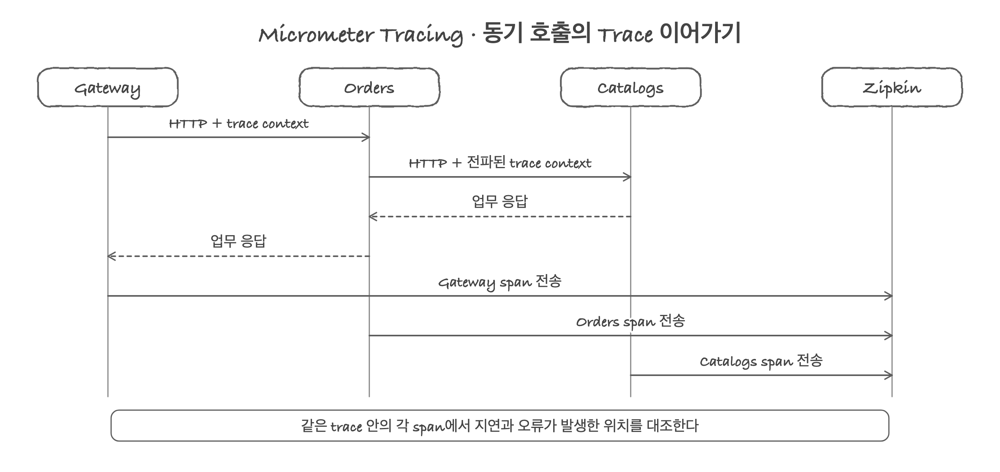

# 서비스 간 요청 분산 추적하기

## 1. 쇼핑몰 요청을 Trace로 연결하기

Gateway가 주문 생성 요청을 Orders에 넘기고 Orders가 Catalogs에 상품을 조회하는 예를 든다. Trace는 이 요청의 경로를 하나로 묶고, Span은 Gateway 수신, 서비스 간 HTTP 호출처럼 각 경계의 작업과 소요 시간을 기록한다. 같은 Trace ID로 로그를 검색하고 Span의 시작·종료 시각과 오류 상태를 함께 읽으면 어느 구간에서 지연이 커졌는지 좁힐 수 있다. [OpenTelemetry · Traces](https://opentelemetry.io/docs/concepts/signals/traces/) · [Spring Boot 4.2 · Tracing](https://docs.spring.io/spring-boot/4.2/reference/actuator/tracing.html)

그림의 근거 · [Spring Boot 4.2 · Tracing](https://docs.spring.io/spring-boot/4.2/reference/actuator/tracing.html) · [OpenTelemetry · Traces](https://opentelemetry.io/docs/concepts/signals/traces/)

## 2. Spring Boot 4.2의 계측과 전파

Spring Cloud 2026.0.0은 Spring Boot 4.2.0 기반이다. 이 기준에서는 Actuator의 Micrometer Observation이 요청 작업을 관측하고 Micrometer Tracing이 이를 추적 데이터로 연결한다. 쇼핑몰 예시에서는 Brave와 Zipkin 조합으로 Span을 내보낸다. 이전 강의의 Spring Cloud Sleuth는 3.1이 마지막 마이너 버전이고 지원한 Boot의 마지막 메이저 계열은 2.x다. [Spring Cloud 2026.0.0 릴리스](https://spring.io/blog/2026/11/20/spring-cloud-2026-0-0-has-been-released/) · [Spring Boot 4.2 · Tracing](https://docs.spring.io/spring-boot/4.2/reference/actuator/tracing.html) · [Spring Cloud Sleuth · 프로젝트 공지](https://github.com/spring-attic/spring-cloud-sleuth#important)

HTTP 양쪽이 W3C Trace Context를 사용하면 발신자는 `traceparent`에 Trace ID와 부모 Span 식별자를 담고 수신자는 이를 읽어 같은 Trace의 다음 Span을 만든다. Spring Boot가 자동 구성한 `RestClient.Builder` 또는 `WebClient.Builder`로 만든 HTTP 클라이언트를 사용하면 전파가 연결된다. Gateway Span은 보이는데 다음 서비스만 새 Trace를 시작한다면 발신 클라이언트 구성과 수신 서비스의 헤더 형식을 비교한다. [W3C · Trace Context](https://www.w3.org/TR/trace-context/) · [Spring Boot 4.2 · Trace 전파](https://docs.spring.io/spring-boot/4.2/reference/actuator/tracing.html#actuator.tracing.propagating-traces)

Kafka도 추적하려면 Spring Kafka 4.2의 `KafkaTemplate`과 리스너 컨테이너에서 Observation을 활성화하고 발신·수신이 추적 컨텍스트 헤더를 전달하는지 확인한다. Spring Boot 4.2의 두 Kafka Observation 설정은 기본값이 각각 `false`다. 배치 리스너는 설정에 따라 배치 단위 또는 레코드별 관측이 생기므로 Span을 해석할 때 처리 단위를 확인한다. [Spring Kafka 4.2 · Monitoring](https://docs.spring.io/spring-kafka/reference/4.2/kafka/micrometer.html#micrometer-observation) · [Spring Boot 4.2 · Application Properties](https://docs.spring.io/spring-boot/4.2/appendix/application-properties/index.html) · [Spring Kafka 4.2.0 · KafkaRecordSenderContext](https://raw.githubusercontent.com/spring-projects/spring-kafka/v4.2.0/spring-kafka/src/main/java/org/springframework/kafka/support/micrometer/KafkaRecordSenderContext.java)

## 3. 샘플 밖 요청과 누락된 Span

Spring Boot 4.2 기본 샘플링 비율은 10%다. 로컬에서 예제 요청 하나의 전체 경로를 확인하는 동안 비율을 높일 수 있고, 공유 환경에서는 추적 저장 비용과 필요한 진단 범위를 함께 고려한다. 드물게 발생하는 주문 실패가 추적에 남지 않았으면 먼저 요청 수와 오류율로 발생 시점을 찾은 뒤 해당 구간의 로그를 대조한다. [Spring Boot 4.2 · Sampling](https://docs.spring.io/spring-boot/4.2/reference/actuator/tracing.html#actuator.tracing.sampling) · [Prometheus · Instrumentation](https://prometheus.io/docs/practices/instrumentation/) · [OpenTelemetry · Traces](https://opentelemetry.io/docs/concepts/signals/traces/)

Zipkin에서 특정 Trace를 찾았지만 Catalogs 구간이 비어 있다면 Orders의 발신 Span과 Catalogs에서 해당 요청을 받은 로그를 먼저 찾는다. 수신 로그가 있으면 헤더 전파, 수신 계측과 Span 전송 상태를 확인한다. 수신 로그도 확인되지 않으면 발신 Span의 시간 초과와 연결 오류를 보고 통신 문제가 발생한 위치부터 좁힌다. [Spring Boot 4.2 · Trace 전파](https://docs.spring.io/spring-boot/4.2/reference/actuator/tracing.html#actuator.tracing.propagating-traces) · [Spring Boot 4.2 · Tracing](https://docs.spring.io/spring-boot/4.2/reference/actuator/tracing.html) · [OpenTelemetry · Traces](https://opentelemetry.io/docs/concepts/signals/traces/)
