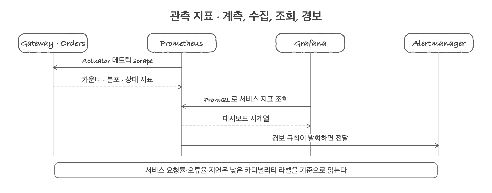

# 서비스 메트릭과 알림 설계하기

## 1. Actuator부터 Grafana까지

Spring Boot 4.2.0 애플리케이션은 Micrometer Prometheus 레지스트리를 통해 메트릭을 제공한다. Prometheus는 HTTP로 타깃의 Actuator `/actuator/prometheus`를 주기적으로 스크레이프해 시계열을 저장하고, Grafana는 Prometheus 데이터 소스를 질의해서 패널을 그린다. 애플리케이션이 레지스트리를 사용하고 스크레이퍼가 해당 엔드포인트에 접근하도록 노출과 인증 범위를 구성한다. [Spring Boot 4.2 · Metrics](https://docs.spring.io/spring-boot/4.2/reference/actuator/metrics.html) · [Spring Boot 4.2 · Actuator Endpoints](https://docs.spring.io/spring-boot/4.2/reference/actuator/endpoints.html) · [Prometheus · Overview](https://prometheus.io/docs/introduction/overview/) · [Grafana · Prometheus 데이터 소스](https://grafana.com/docs/grafana/latest/datasources/prometheus/)

그림의 근거 · [Spring Boot 4.2 · Metrics](https://docs.spring.io/spring-boot/4.2/reference/actuator/metrics.html) · [Prometheus · Overview](https://prometheus.io/docs/introduction/overview/) · [Grafana · Prometheus 데이터 소스](https://grafana.com/docs/grafana/latest/datasources/prometheus/) · [Prometheus · Alertmanager](https://prometheus.io/docs/alerting/latest/alertmanager/)

## 2. 요청량, 오류, 지연 시간을 함께 보기

주문 API 대시보드에는 요청량(Rate), 오류율(Errors), 지연 시간(Duration)을 같은 시간 범위로 놓는다. Gateway는 사용자에게 보인 응답을, Orders는 서버가 실제로 받은 요청을 보여 준다. 예를 들어 Gateway의 주문 요청 오류율이 오르고 Orders 요청량이 줄었다면 Gateway에서 대상 서비스 사이 구간의 라우팅과 연결 상태를 확인한다. Orders에서도 오류율이 같이 올랐다면 DB 연결 풀, 하위 호출, 주문 이벤트 지연 등의 지표로 범위를 좁힌다. [Grafana · RED Method](https://grafana.com/blog/the-red-method-how-to-instrument-your-services/) · [Prometheus · Alerting](https://prometheus.io/docs/practices/alerting/)

요청량과 오류율은 카운터의 증가율로 계산하고, 여러 인스턴스의 지연 시간을 보려면 히스토그램 버킷을 합쳐 분위수를 구한다. Classic Histogram이면 합산할 때 버킷 경계 `le`를 보존한다. 스크레이프 타깃의 `up`과 요청 지표를 함께 보면 실제 유입이 줄었는지, 타깃이 응답하지 않아 측정이 비었는지 구분할 수 있다. [Prometheus · Instrumentation](https://prometheus.io/docs/practices/instrumentation/) · [Prometheus · histogram_quantile](https://prometheus.io/docs/prometheus/latest/querying/functions/#histogram_quantile) · [Prometheus · Jobs and instances](https://prometheus.io/docs/concepts/jobs_instances/#automatically-generated-labels-and-time-series)

레이블은 서비스명, 템플릿 경로, 메서드, 상태처럼 가능한 값이 관리되는 차원으로 정한다. `orderId`, 사용자 ID, Trace ID 같이 값의 종류가 계속 늘어나는 식별자는 로그나 추적에서 검색한다. 예를 들어 `/orders/{id}`로 묶어 두면 주문 ID마다 독립 시계열을 만들지 않고 같은 API의 응답 분포를 볼 수 있다. [Spring Boot 4.2 · Metrics](https://docs.spring.io/spring-boot/4.2/reference/actuator/metrics.html) · [Prometheus · Instrumentation](https://prometheus.io/docs/practices/instrumentation/)

## 3. 오류 예산을 쓰는 속도로 알리기

예시로 주문 생성 성공률 목표를 30일간 99.9%로 정하면 오류 예산은 유효 요청의 0.1%다. 어떤 요청을 분모에 넣고 어떤 응답을 실패로 셀지 먼저 정한다. 짧은 창과 긴 창에서 오류 예산 소진율이 함께 높을 때 알리면 일시적인 변동과 지속적인 사용자 영향을 구분할 수 있다. 지연 목표가 있으면 응답 시간 기준을 충족한 요청의 비율도 따로 계산한다. [Google SRE · Alerting on SLOs](https://sre.google/workbook/alerting-on-slos/)

Prometheus의 알림 규칙이 발화하면 Alertmanager가 알림을 묶어 설정된 수신처로 전달한다. 담당자에게는 실제 주문 실패나 지연이 지속되는 경우를 보내고, DB 여유와 Kafka 소비 지연은 원인을 조사하는 패널과 함께 본다. 메트릭 수집 대상이 사라진 경우에는 별도 신호로 다룬다. 서비스의 요청이 적은 시간대에는 오류율 분모가 작으므로 실제 요청 수와 함께 알림을 판단한다. [Prometheus · Alerting](https://prometheus.io/docs/practices/alerting/) · [Prometheus · Alertmanager](https://prometheus.io/docs/alerting/latest/alertmanager/) · [Prometheus · Jobs and instances](https://prometheus.io/docs/concepts/jobs_instances/#automatically-generated-labels-and-time-series) · [Google SRE · Alerting on SLOs](https://sre.google/workbook/alerting-on-slos/)
