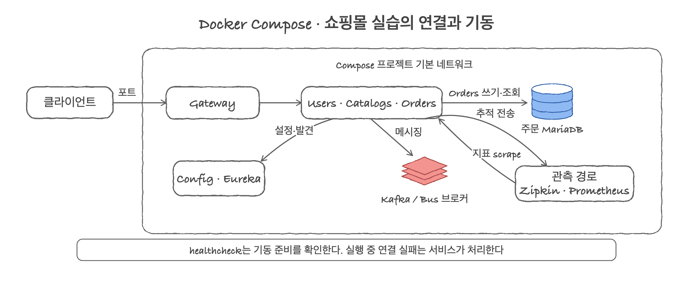

# Docker Compose로 쇼핑몰 배포하기

## 1. 배포 이미지와 실행 환경

쇼핑몰의 기준 버전은 Spring Cloud 2026.0.0과 Spring Boot 4.2.0이다. Config, Gateway, Netflix 모듈은 5.1.0을 사용한다. 예시에서는 서비스별 이미지를 빌드하고 Docker Hub 같은 레지스트리에 게시한 뒤 Compose 호스트에서 가져와 실행한다. 버전 태그는 릴리스를 찾는 이름으로 쓰고, 배포 기록에 이미지 다이제스트를 남겨 같은 이미지 참조로 비교하거나 이전 배포로 돌아갈 수 있게 한다. [Spring Cloud 2026.0.0 릴리스](https://spring.io/blog/2026/11/20/spring-cloud-2026-0-0-has-been-released/) · [Docker Hub · Repositories](https://docs.docker.com/docker-hub/repos/) · [Docker · Image digests](https://docs.docker.com/dhi/explore/security-concepts/digests/)

그림의 근거 · [Docker Compose · Networking](https://docs.docker.com/compose/how-tos/networking/) · [Docker Compose · Startup order](https://docs.docker.com/compose/how-tos/startup-order/) · [Spring Cloud Config 5.1 · Client](https://docs.spring.io/spring-cloud-config/reference/client.html) · [Spring Cloud Gateway 5.1 · Discovery 경로](https://docs.spring.io/spring-cloud-gateway/reference/spring-cloud-gateway-server-webflux/the-discoveryclient-route-definition-locator.html) · [Docker Compose · Profiles](https://docs.docker.com/reference/compose-file/profiles/) · [OpenZipkin · Overview](https://zipkin.io/) · [Prometheus · Overview](https://prometheus.io/docs/introduction/overview/)

## 2. 기본 요청 경로와 선택적인 구성

외부 요청의 진입점은 Gateway다. 같은 Compose 네트워크의 컨테이너는 서비스 이름과 컨테이너 포트로 서로 접근한다. 이 예시에서 Config Server의 주소와 Eureka의 주소는 Compose 서비스명으로 찾고, Gateway는 Eureka에 등록된 Orders·Catalogs 등의 업무 서비스 인스턴스를 조회해 라우팅한다. 원격 설정 없이 실행해도 되는 서비스와 원격 설정이 필수인 서비스는 Config Data Import의 선택 조건을 다르게 둔다. [Docker Compose · Networking](https://docs.docker.com/compose/how-tos/networking/) · [Spring Cloud Config 5.1 · Client](https://docs.spring.io/spring-cloud-config/reference/client.html) · [Spring Cloud Netflix 5.1 · Eureka](https://docs.spring.io/spring-cloud-netflix/reference/spring-cloud-netflix.html) · [Spring Cloud Gateway 5.1 · Discovery 경로](https://docs.spring.io/spring-cloud-gateway/reference/spring-cloud-gateway-server-webflux/the-discoveryclient-route-definition-locator.html)

Orders는 주문 MariaDB를 사용한다. 주문 이벤트와 조회 투영을 함께 검증할 때 Kafka와 필요한 Connect 경로를 올린다. RabbitMQ는 RabbitMQ Binder를 선택한 메시징 흐름이나 RabbitMQ를 전송 수단으로 택한 설정 갱신 흐름을 함께 실행할 때 추가한다. 기본 API 흐름에서 빠져도 되는 기능은 Compose 프로필로 켤 수 있도록 하고, 어떤 흐름이 활성화된 경우 그 기능의 필수 의존성도 같이 활성화한다. [Apache Kafka Connect 4.2 · 사용자 가이드](https://kafka.apache.org/42/kafka-connect/user-guide/) · [Apache Kafka 4.2 · 주요 개념](https://kafka.apache.org/42/getting-started/introduction/#main-concepts-and-terminology) · [Spring Cloud Stream 5.1 · RabbitMQ Binder](https://docs.spring.io/spring-cloud-stream/reference/rabbit/rabbit_overview.html) · [Spring Cloud 2026.0.0 릴리스](https://spring.io/blog/2026/11/20/spring-cloud-2026-0-0-has-been-released/) · [Docker Compose · Profiles](https://docs.docker.com/reference/compose-file/profiles/)

Zipkin은 추적을 모으고 Prometheus와 Grafana는 메트릭을 수집·조회한다. 이 예시에서 관측 서비스의 주소를 API 라우팅 대상과 분리하고, Zipkin 미기동이나 스크레이프 실패는 원인 파악 기능의 저하로 다룬다. 업무 DB 불통으로 주문 처리가 실패하는 상황은 API 자체의 장애로 다룬다. [Spring Boot 4.2 · Tracing](https://docs.spring.io/spring-boot/4.2/reference/actuator/tracing.html) · [OpenZipkin · Overview](https://zipkin.io/) · [Prometheus · Overview](https://prometheus.io/docs/introduction/overview/) · [Grafana · Prometheus 데이터 소스](https://grafana.com/docs/grafana/latest/datasources/prometheus/) · [Spring Cloud Gateway 5.1 · Discovery 경로](https://docs.spring.io/spring-cloud-gateway/reference/spring-cloud-gateway-server-webflux/the-discoveryclient-route-definition-locator.html)

## 3. 시작 순서, 준비 상태와 실행 중 복구

컨테이너 프로세스가 시작됐어도 요청을 받을 준비는 나중에 끝날 수 있다. Compose에서 시작 조건을 `service_healthy`로 두면 의존 서비스의 healthcheck가 통과할 때까지 기다린다. 주문 서비스의 시작 조건으로 MariaDB를 둘 때는 DB가 연결을 받고 InnoDB 초기화가 끝났는지 검사하도록 선택할 수 있다. 그 뒤 주문 스키마와 설정을 로드하고 Eureka 등록 및 Gateway 경유 주문 요청이 실제로 가능한지 확인한다. [Docker Compose · Startup order](https://docs.docker.com/compose/how-tos/startup-order/) · [MariaDB · Container Health Check](https://mariadb.com/docs/server/server-management/automated-mariadb-deployment-and-administration/docker-and-mariadb/using-healthcheck-sh) · [Spring Cloud Netflix 5.1 · Eureka](https://docs.spring.io/spring-cloud-netflix/reference/spring-cloud-netflix.html) · [Spring Cloud Gateway 5.1 · Discovery 경로](https://docs.spring.io/spring-cloud-gateway/reference/spring-cloud-gateway-server-webflux/the-discoveryclient-route-definition-locator.html)

재배포나 재생성으로 컨테이너의 IP가 바뀌면 기존 연결이 끊길 수 있다. 실행 중에는 서비스 이름을 다시 해석해 끊긴 연결을 재설정하고, 읽기처럼 안전한 작업만 시간과 횟수 한도를 두어 다시 시도한다. 주문 응답을 받지 못한 경우에는 요청의 중복 처리를 막는 키로 결과를 확인한 뒤 후속 처리를 결정한다. Compose의 시작 조건은 처음 뜨는 순서를 맞추고, 실행 중 통신 복구는 클라이언트가 맡는다. [Docker Compose · Networking](https://docs.docker.com/compose/how-tos/networking/) · [Docker Compose · Startup order](https://docs.docker.com/compose/how-tos/startup-order/) · [AWS · 멱등 재시도](https://aws.amazon.com/builders-library/making-retries-safe-with-idempotent-APIs/)
